## 捏

笔画数

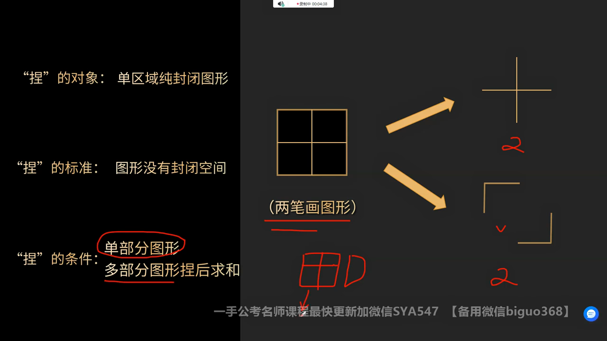

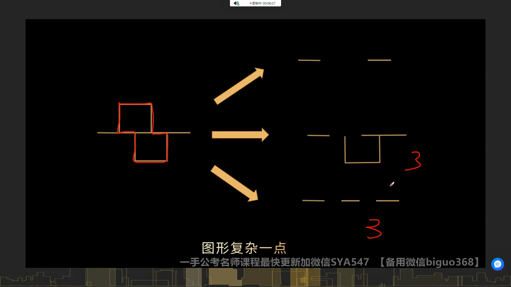

优先捏外围的轮廓

捏点连接的面

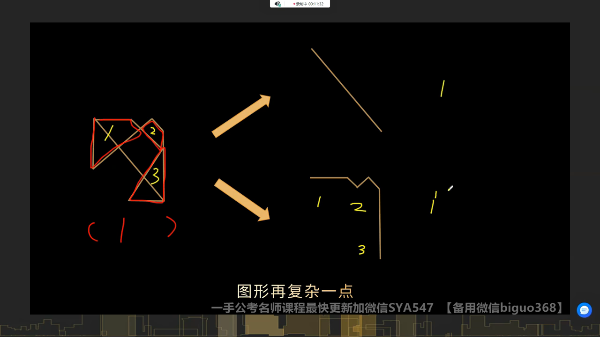

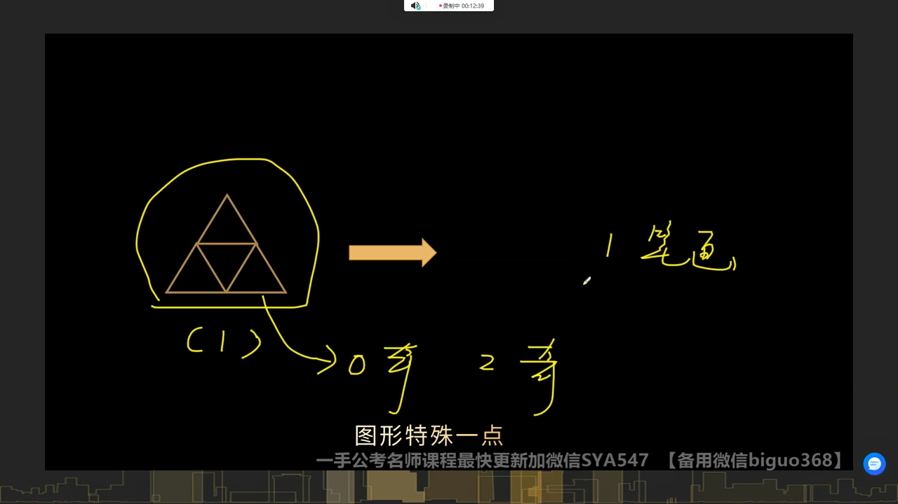

捏完什么都没有也是一笔画

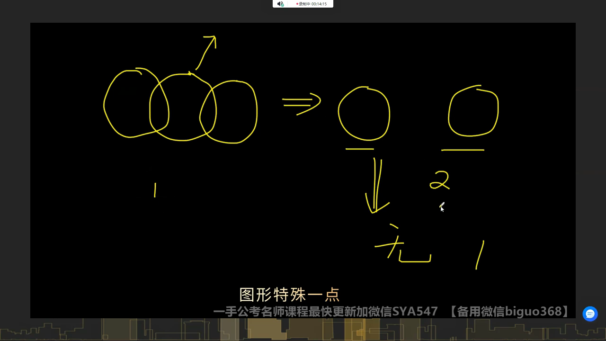

要捏到没有面为止，如图如果捏到一半停下，会误以为是2笔

## 吹

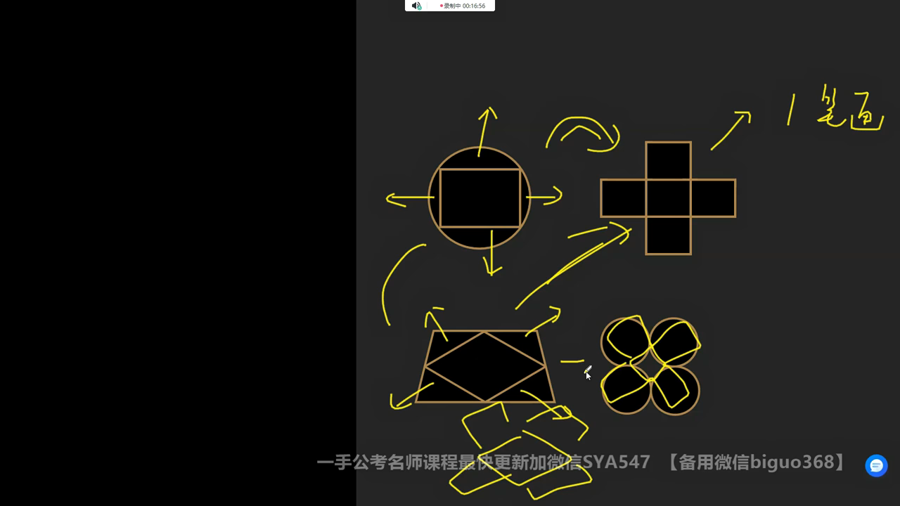

以上4个图都可以通过吹把它们吹成一样，都是一笔画，不管是三角形，半圆，正方形，梯形，和形状无关，因为最终的面都是要捏掉

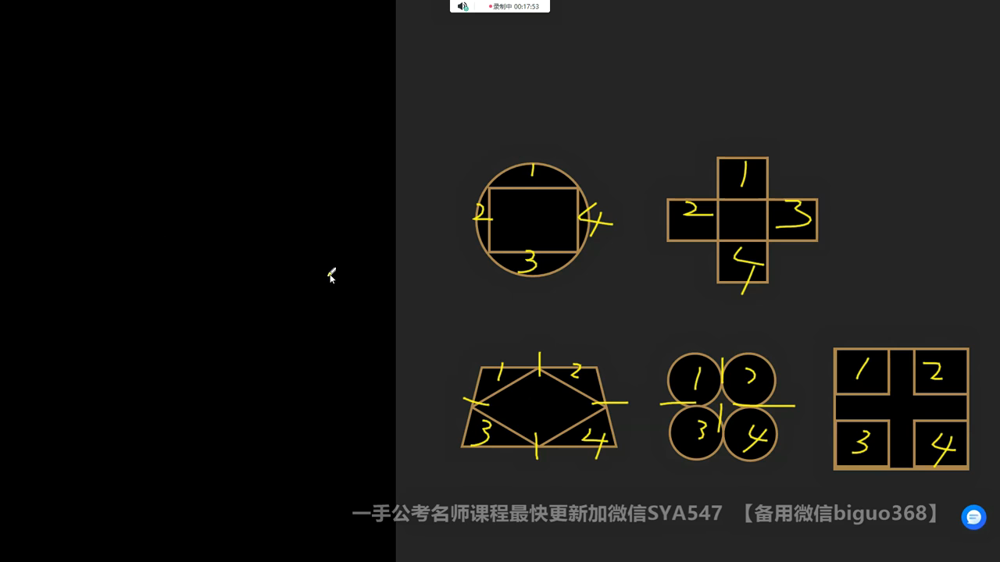

如图5不是点连接，和其他的不一样

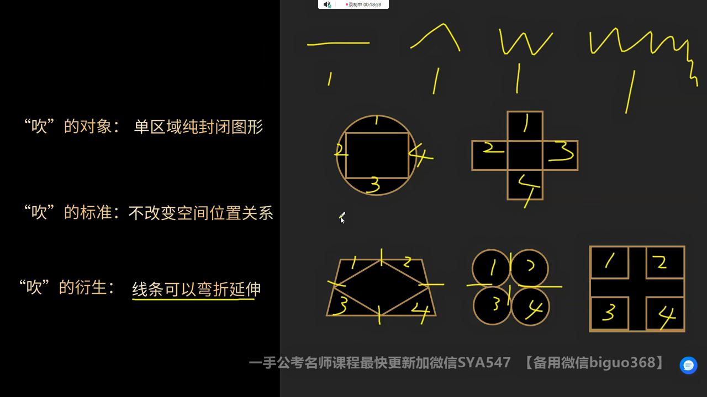

线条可以弯折延伸，如图

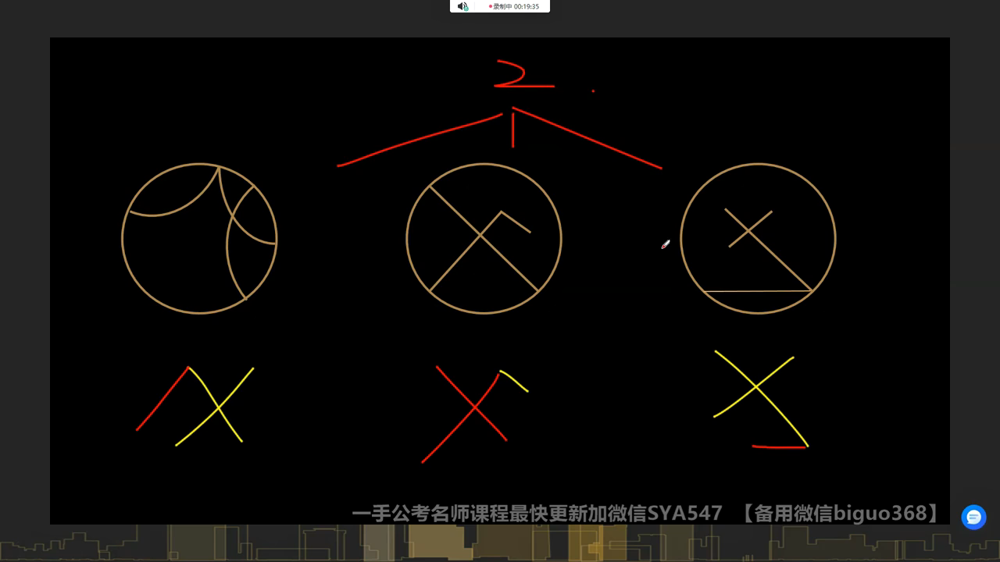

捏的本质是简化图形

捏的效用是利于判断几笔画

吹的本质是联系图形

吹的效用是识别笔画考法

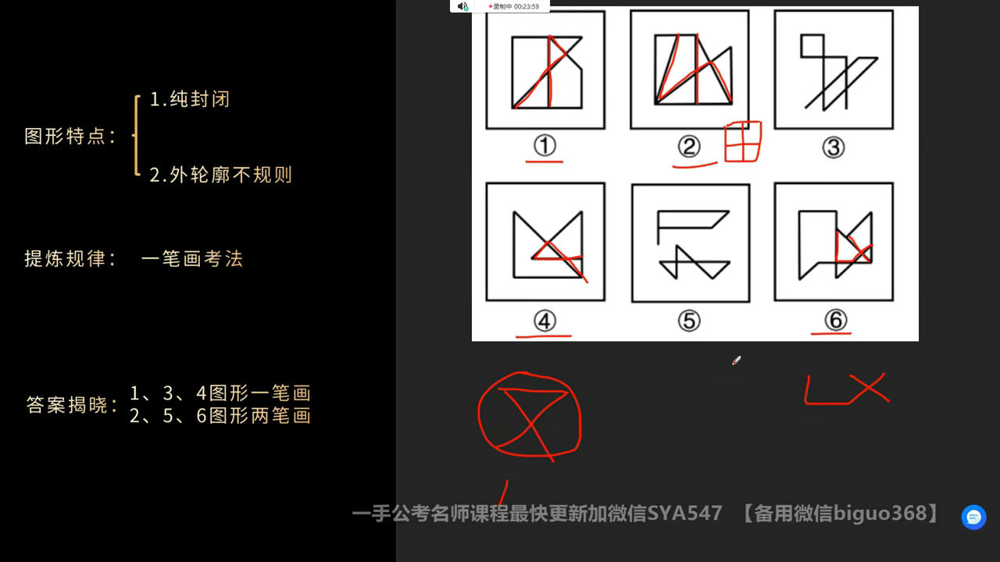

1和4都是外面圆，里面是又字，2和6都是田字的变形，里面都是X

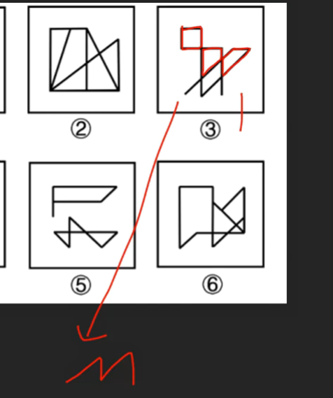

捏的时候捏点连接的图形

扩展

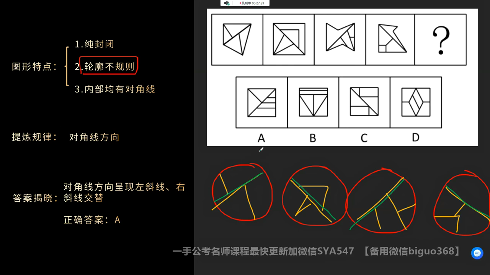

外轮廓不规则，基本不会考察外轮廓，可以用吹的原理，将外轮廓都变为圆