## 1

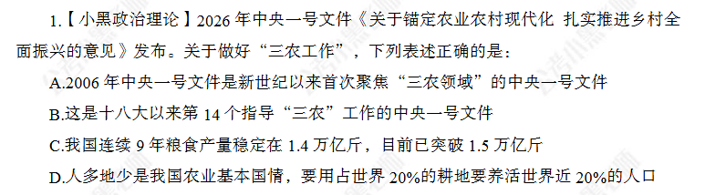

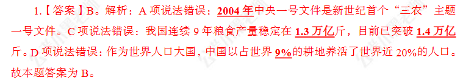

## 2

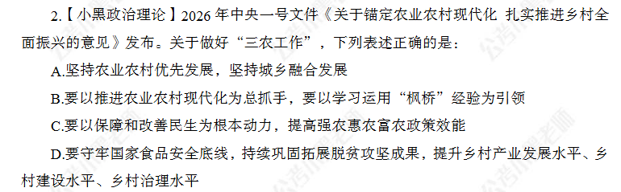

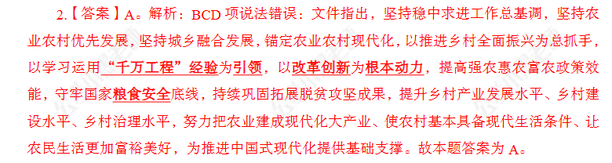

## 3

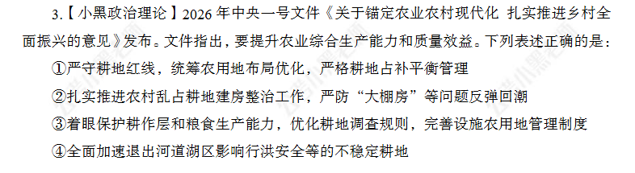

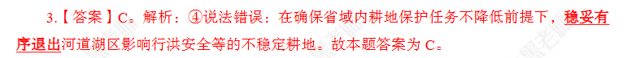

## 4

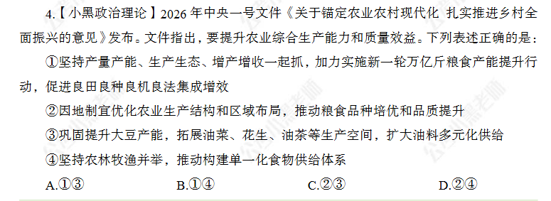

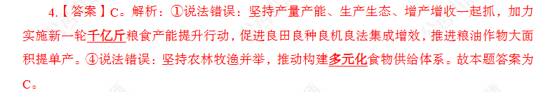

## 5

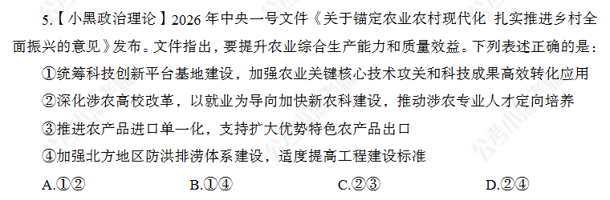

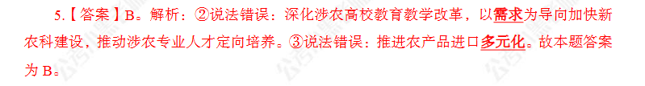

## 6

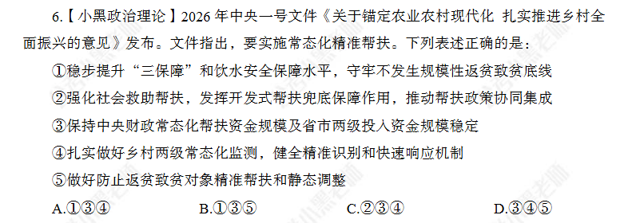

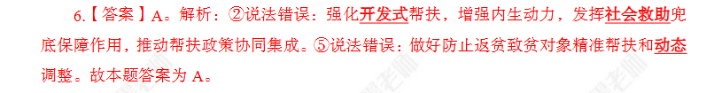

## 7

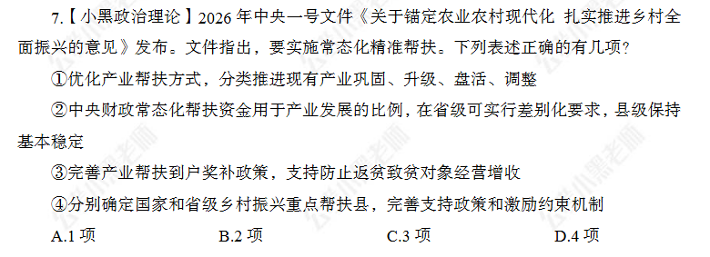

## 8

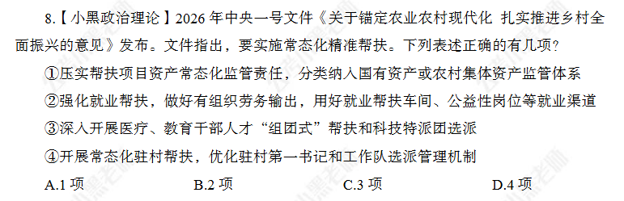

## 9

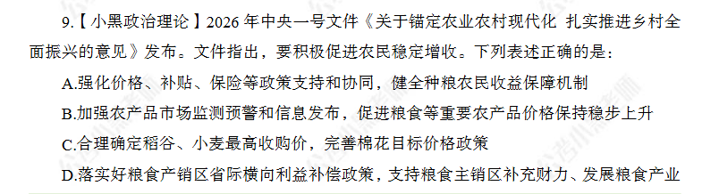

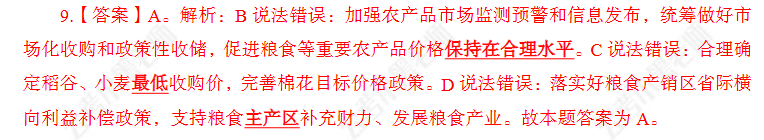

## 10

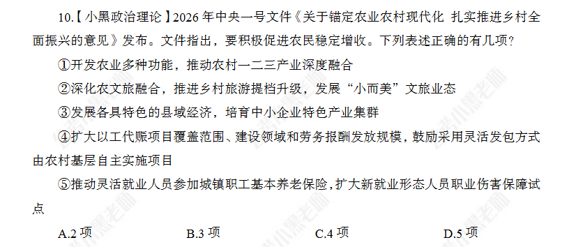

## 11

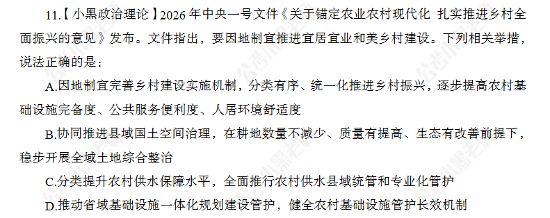

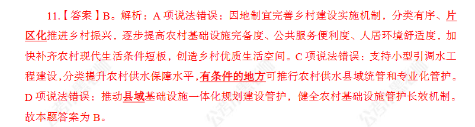

## 12

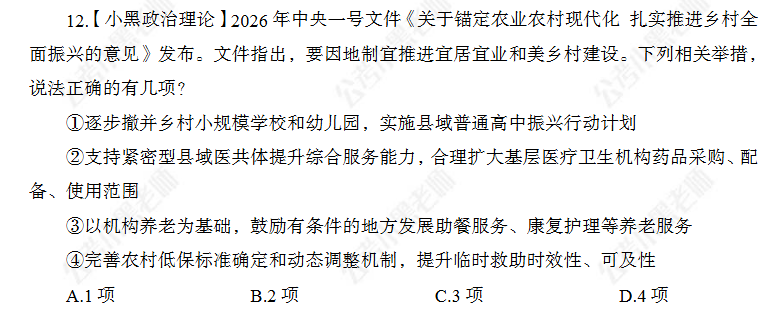

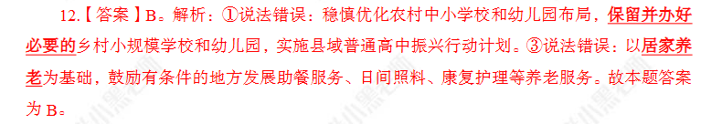

## 13

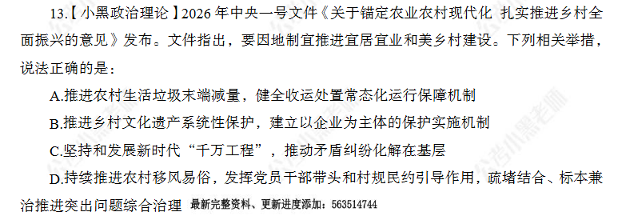

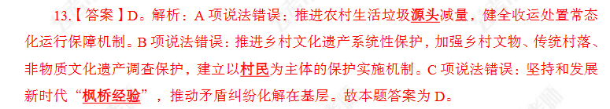

## 14

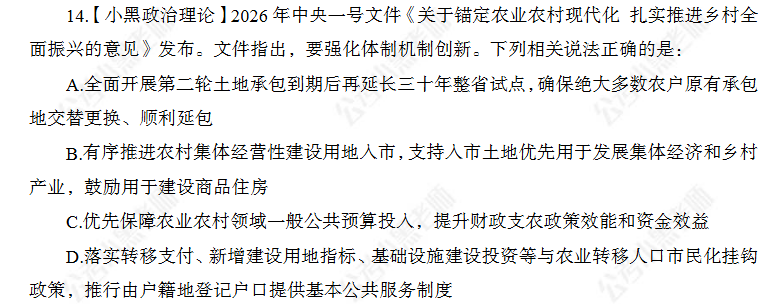

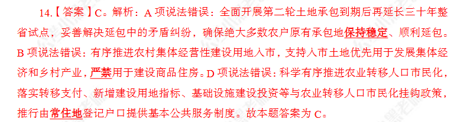

## 15

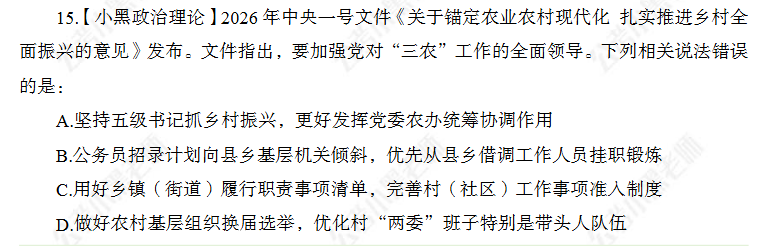

## 消化清单

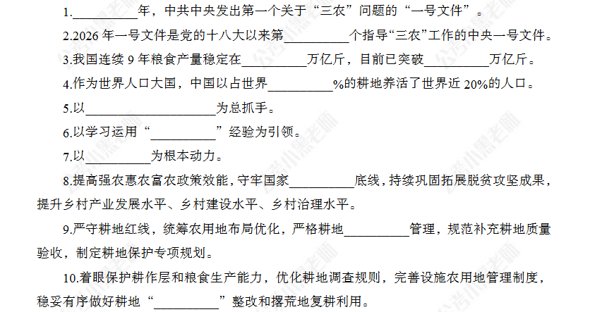

2004 14 1.3 1.4 9% 推进乡村全面振兴 千万工程 改革创新 粮食安全  占补平衡 非粮化

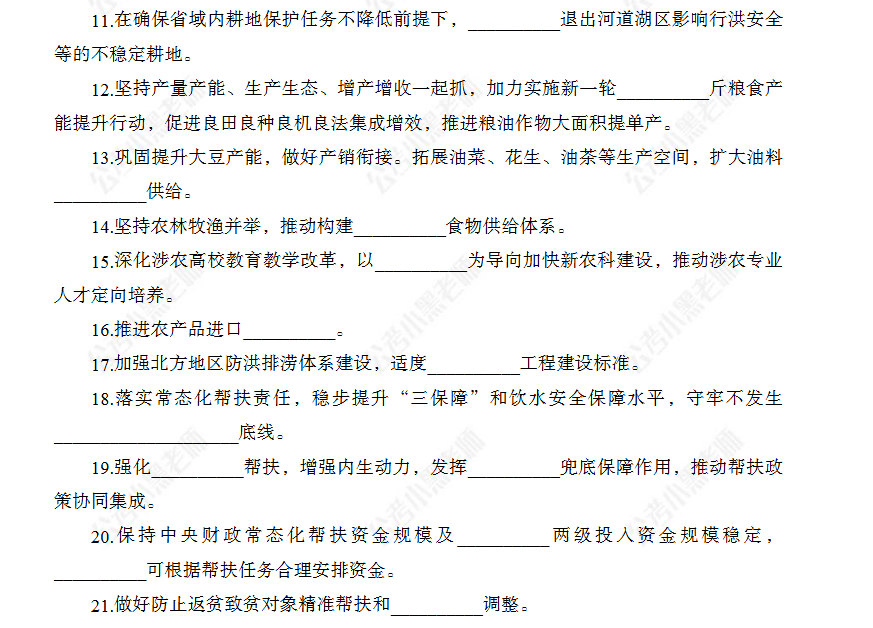

稳妥有序 千亿 多元化 多元化 需求 多元化 提高 规模性返贫致贫 开发式 社会救助 省市 县级 动态

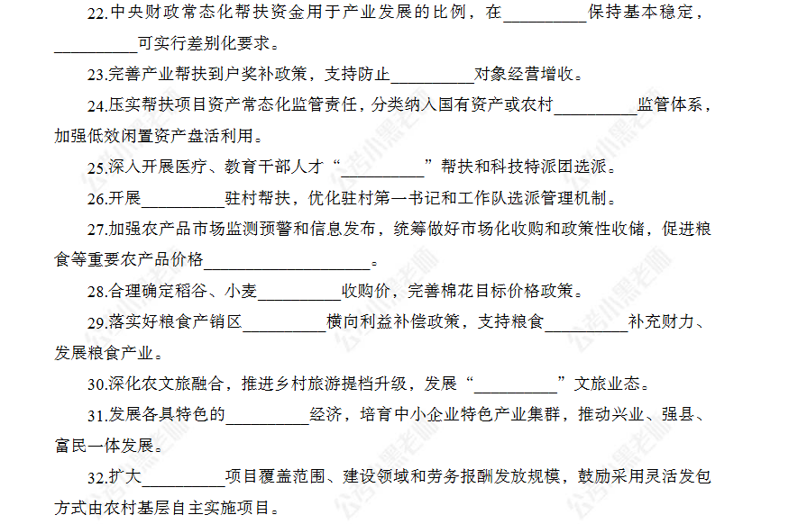

省级 县级 返贫致贫 集体资产 组团式 常态化 保持在合理水平 最低 省际 主产区 小而美 县域 以工代赈

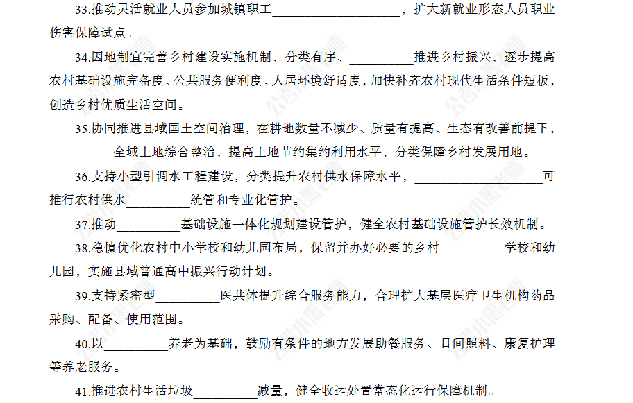

基本养老保险 片区化 稳步开展 有条件的地方 县域 县域 小规模 县域 居家 源头

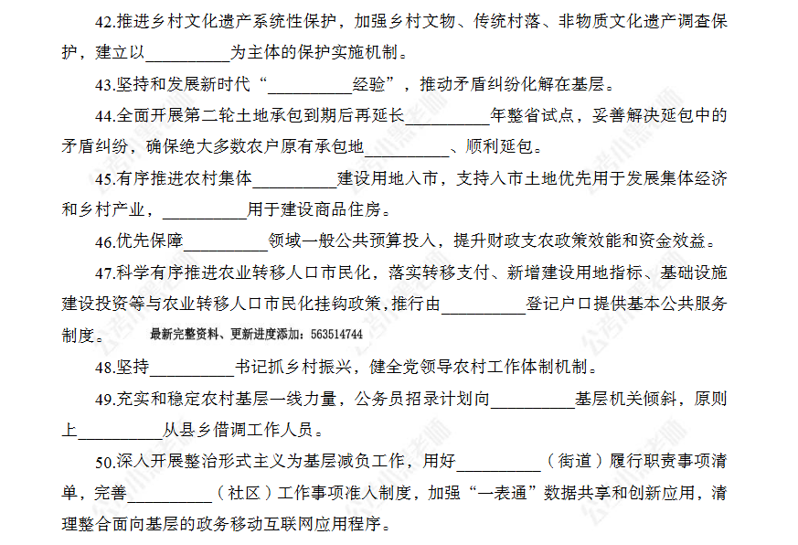

村民 枫桥 三十 交替更换 经营性 严禁 农业农村 常住地 五级 县乡 不得 乡镇 村