## 两会

## 1

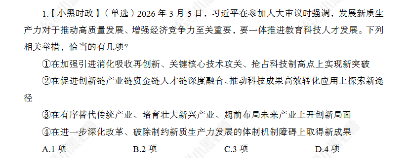

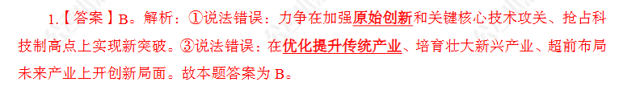

## 2

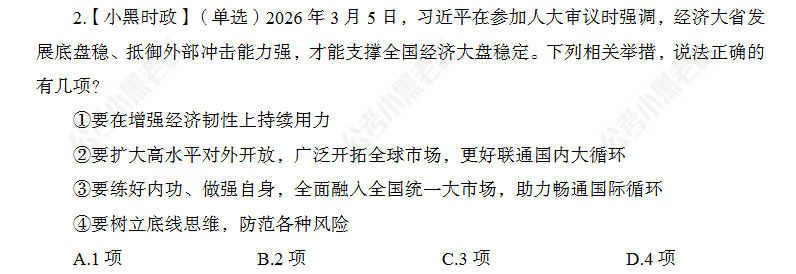

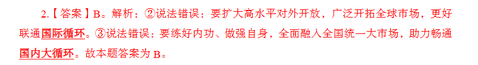

## 3

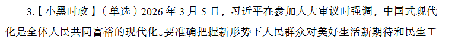

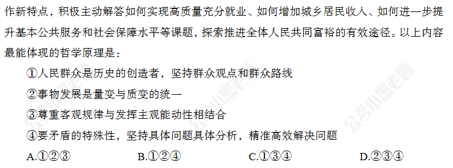

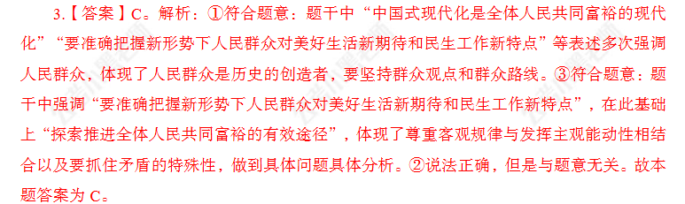

## 4

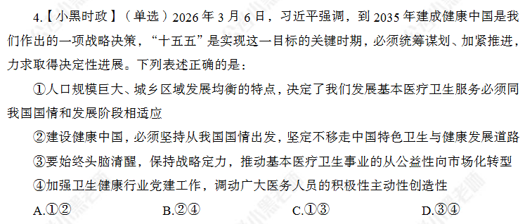

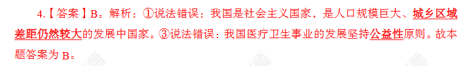

## 5

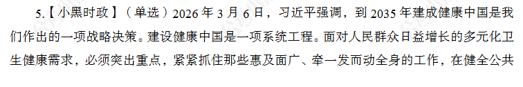

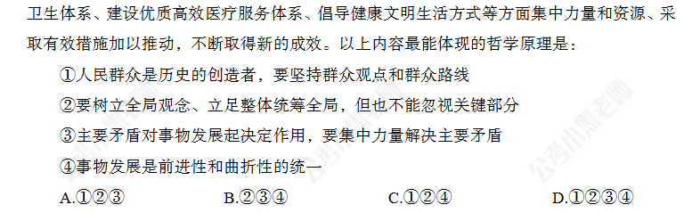

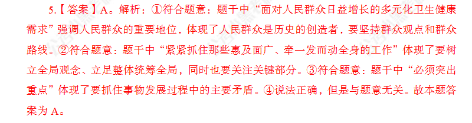

## 6

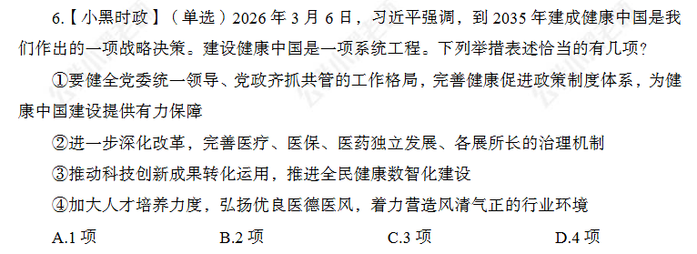

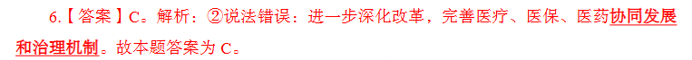

## 7

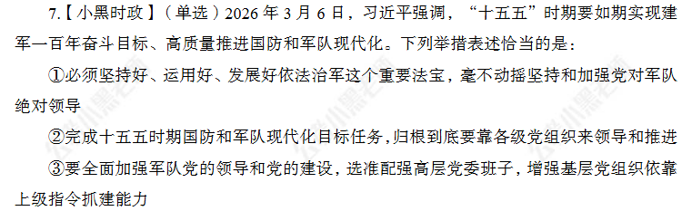

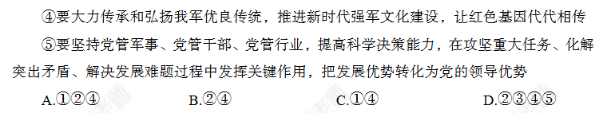

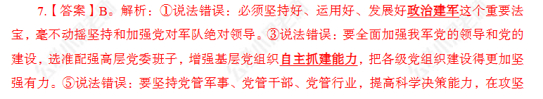

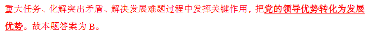

## 8

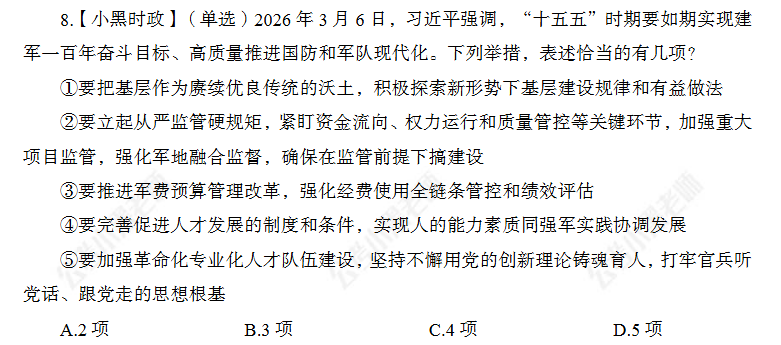

## 消化清单

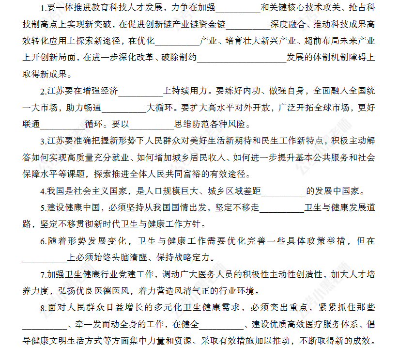

原始创新 人才链 提升传统 新质生产力 经济韧性 国内 国际 底线 仍然巨大 特色 根本问题 惠及面广 公共卫生体系 

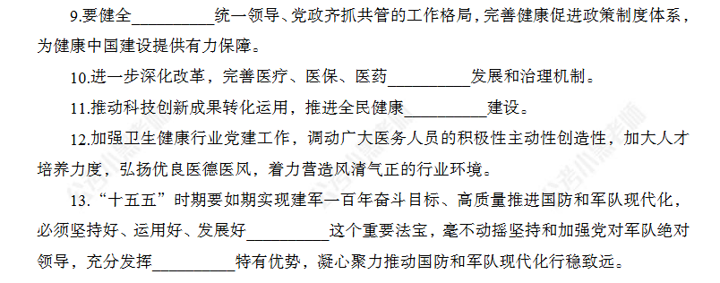

党委 协同 数智化 政治建军 政治建军

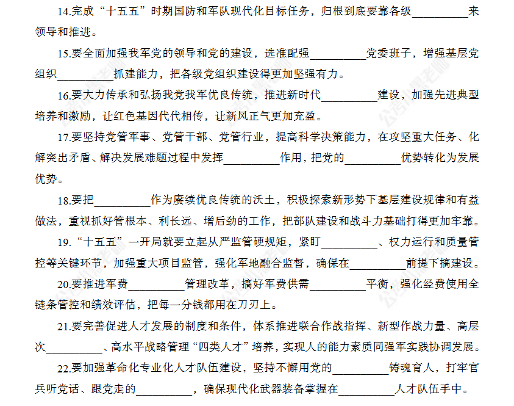

党组织 高层 自主 强军文化 关键 领导 基层 资金流向 监管 预算 动态 科技创新 创新理论 思想根基 革命化

## 政府工作报告

## 1

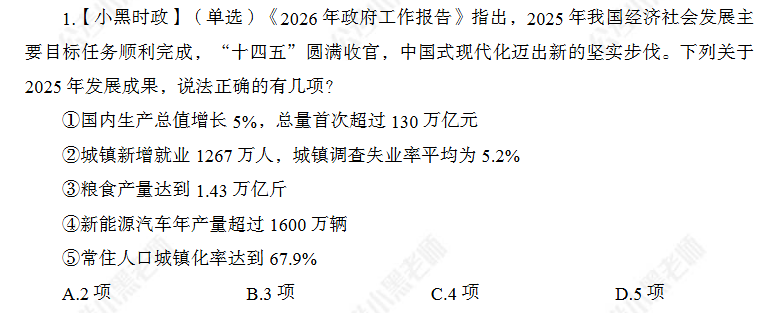

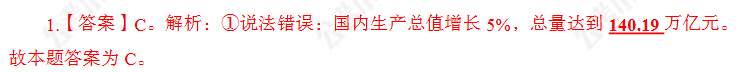

## 2

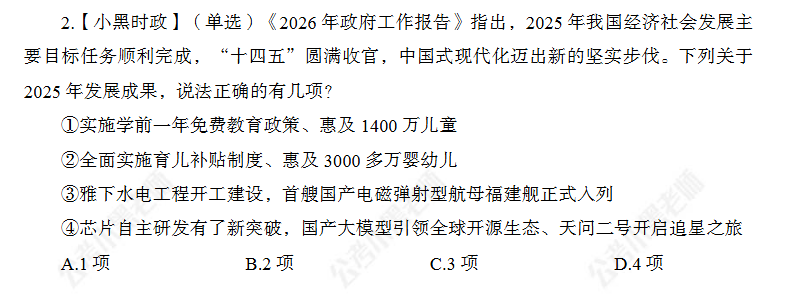

## 3

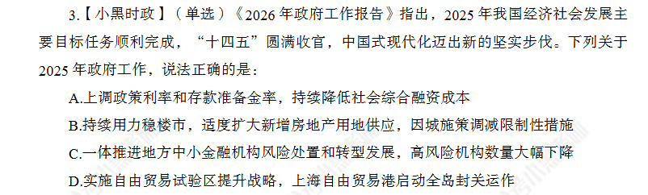

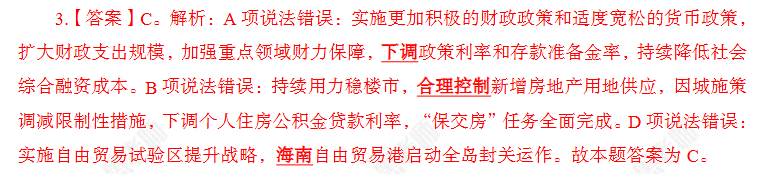

## 4

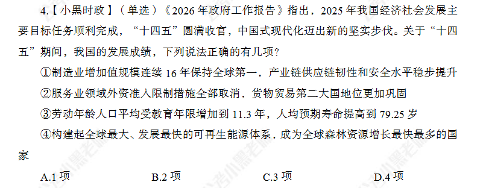

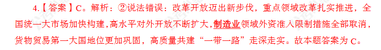

## 5

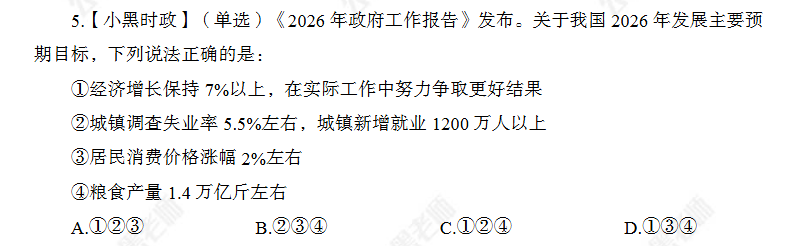

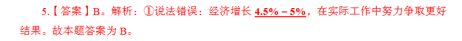

## 6

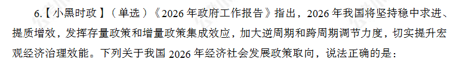

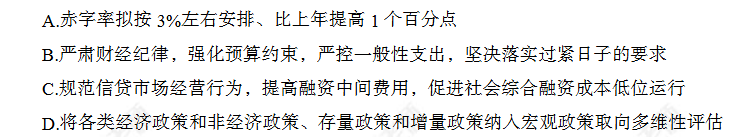

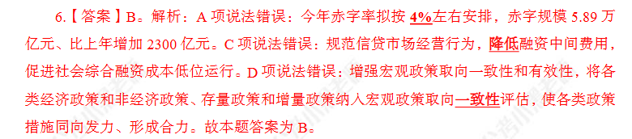

## 7

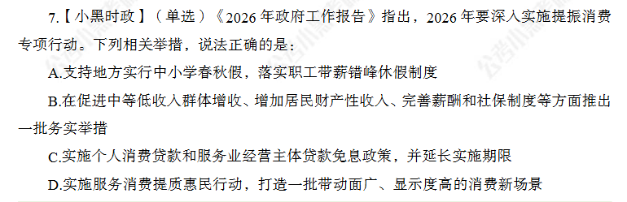

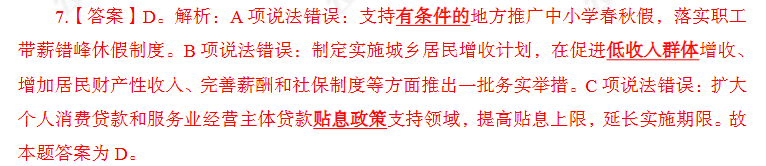

## 8

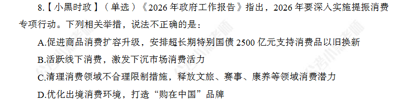

## 9

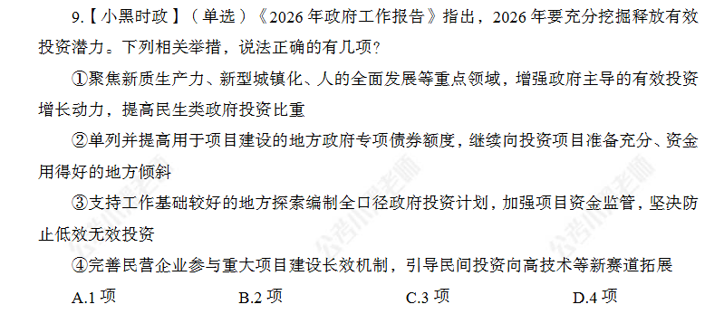

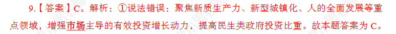

## 10

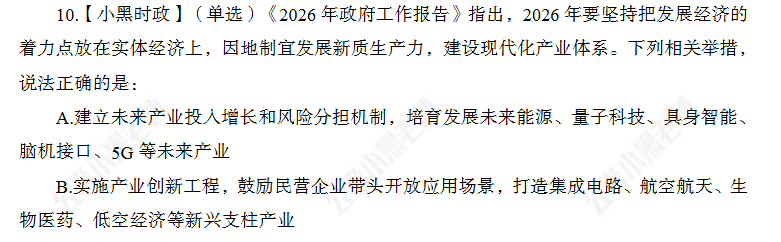

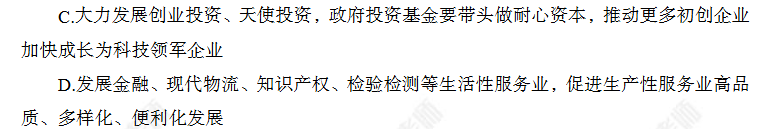

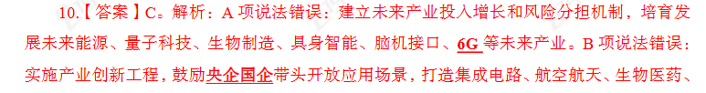

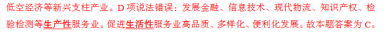

## 11

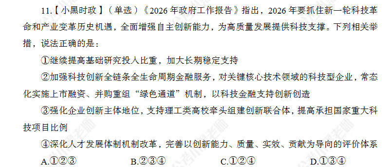

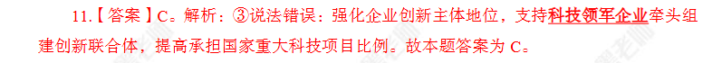

## 12

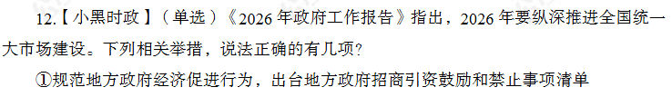

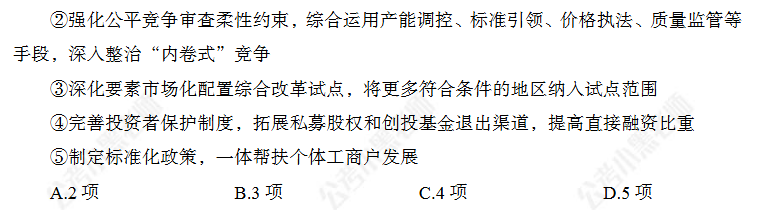

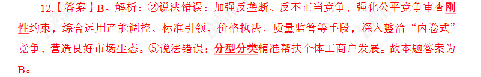

## 13

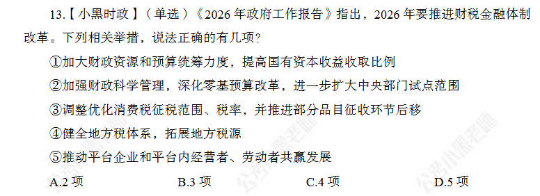

## 14

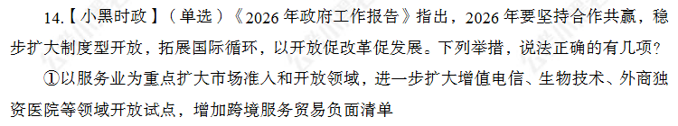

## 15

## 16

## 17

## 18

## 19

## 20

## 消化清单

5 5.2 1.43  1600 67.9 学前一年 育儿补贴

前列 天问二号 福建舰 扩大 下调 合理控制 调减 下调 中小 海南 制造业 第一 制造业 第一 高于 全国统筹 11.3

最快最多 可再生能源 4.5%-5% 2 1.4 4 一般性 

降低 一致性 春秋假 低收入 财产性 贴息 提高 带动面广 线下 入境 市场 提高

工作基础较好的 高技术 现代服务业 未来产业 央企国企 政府 生产性 生活性 提高

科技金融 企业 科技领军企业 创新 鼓励和禁止 刚性 市场化 提高 分型分类 提高 零基预算 后移 地方  

服务业 压减 内外贸易 国民 本地化 中间品 流入地 县域 比较 创新型 

以工代赈 劳动密集 新兴产业 普通高中 公益性 改善性 全国统筹 中度 多元化 强度 

一体化 总量 保障性 白名单 源头 枫桥经验 高效办成一件事 差异化 铸牢中华民族共同体意识 人民 实干