## 1

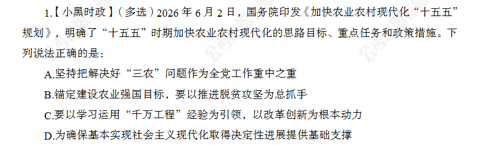

## 2

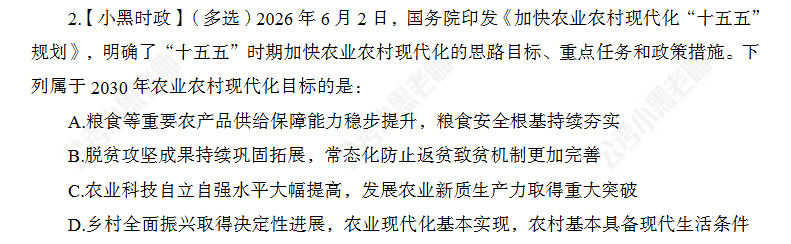

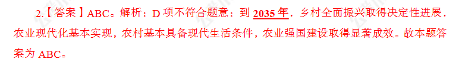

## 3

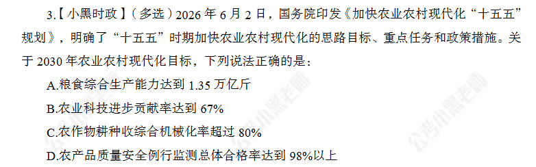

## 4

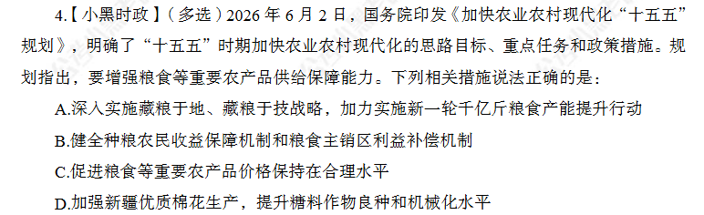

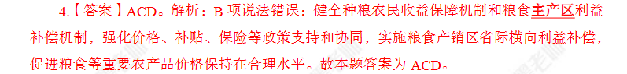

## 5

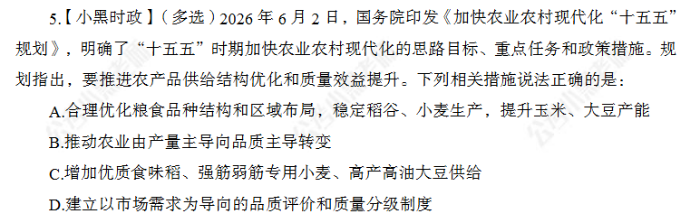

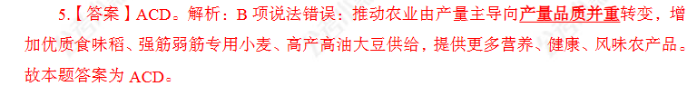

## 6

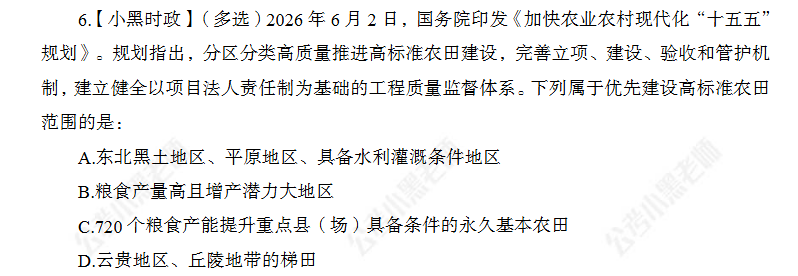

## 7

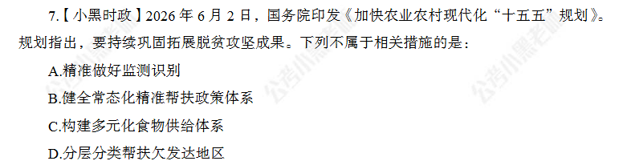

## 8

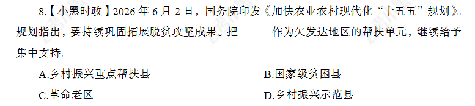

## 9

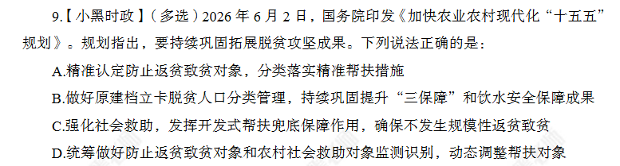

## 10

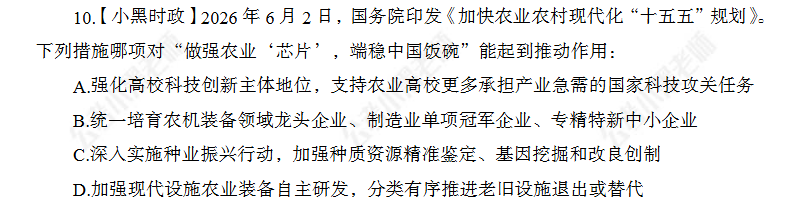

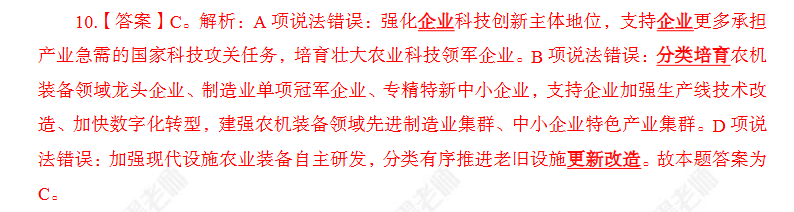

## 11

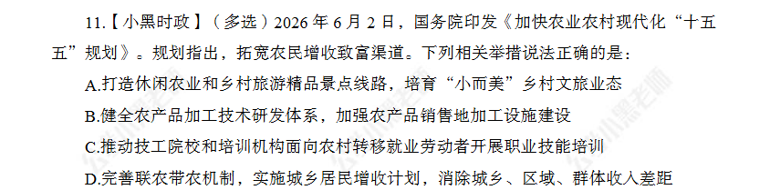

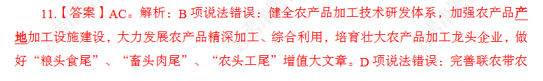

## 12

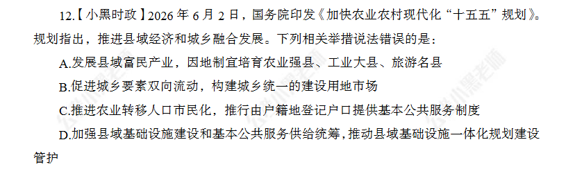

## 13

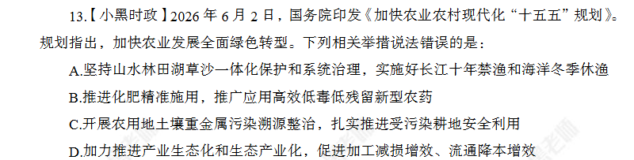

## 14

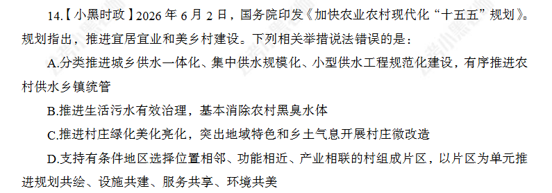

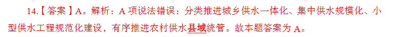

## 15

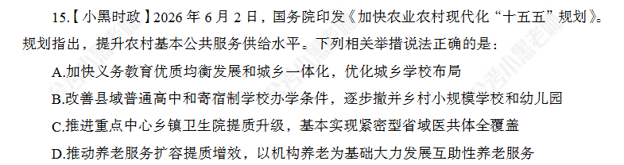

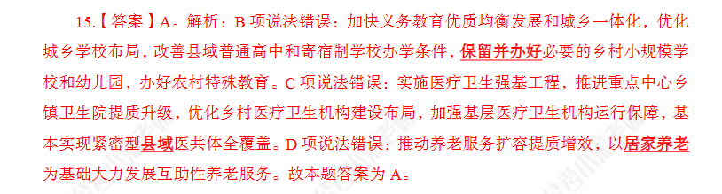

## 16

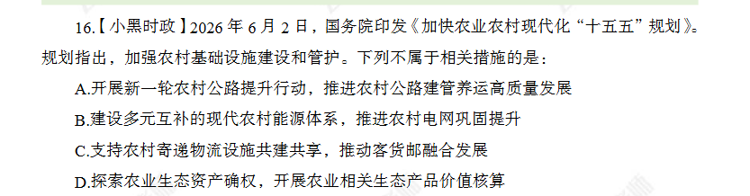

## 17

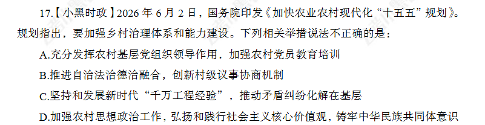

## 18

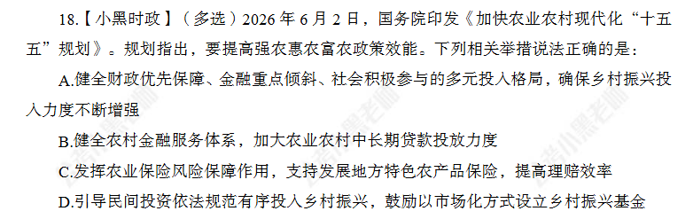

## 19

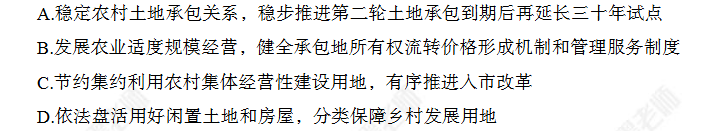

## 20

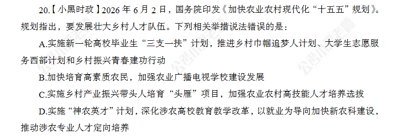

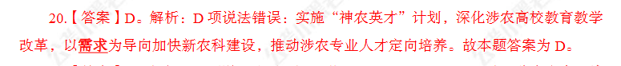

## 21

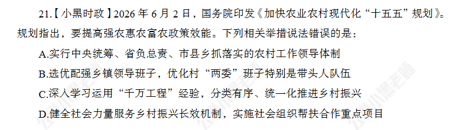

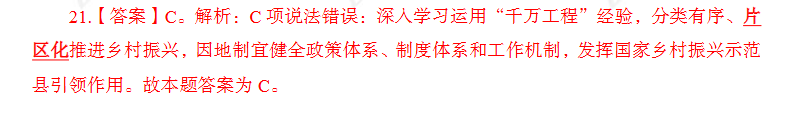

## 消化清单

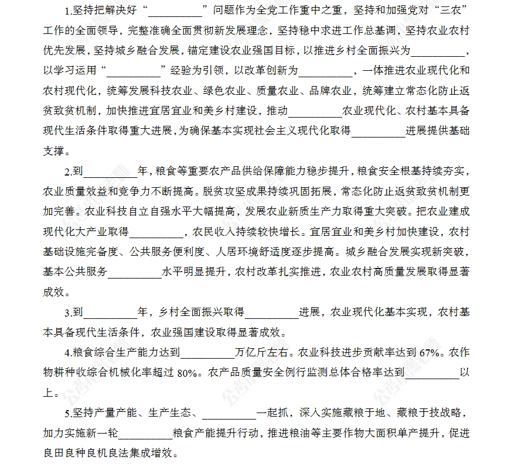

三农 总抓手 千万工程 根本动力 基本实现 决定性

2030 重大突破 均等

2035 决定性 1.45 98

增产增收 千亿斤

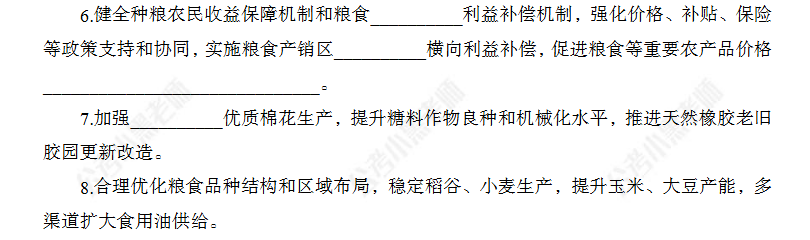

主产区 省际 保持在合理水平 新疆 

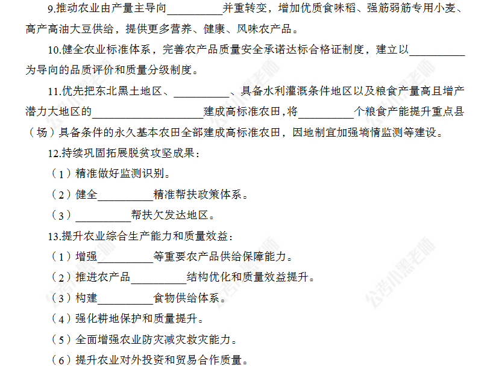

产量品质 市场需求 平原地区 永久基本农田 720

常态化 分层分类 粮食 供给 多元化 

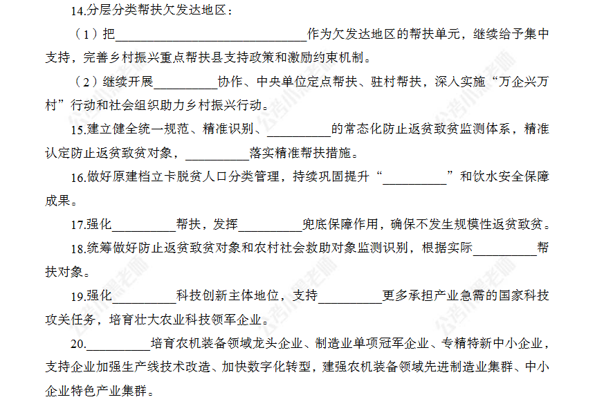

乡村振兴重点帮扶县 东西部 动态调整 分类 三保障 开发式 社会救助 动态调整 企业 企业 分类 

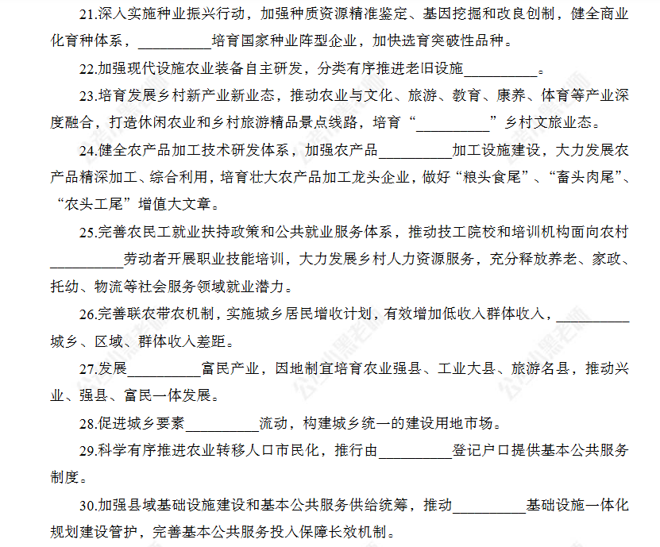

梯队 更新改造 小而美 产地 转移就业 缩小 县域 双向 常住地 县域 

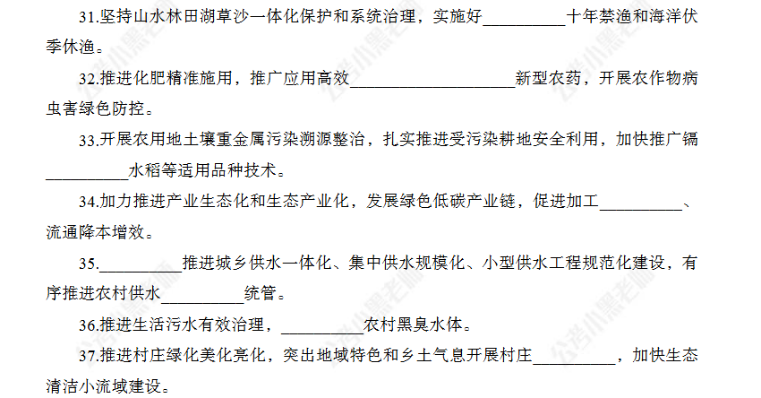

长江 低毒低残留 低积累 减损增效 分类 县域 基本消除 微改造 

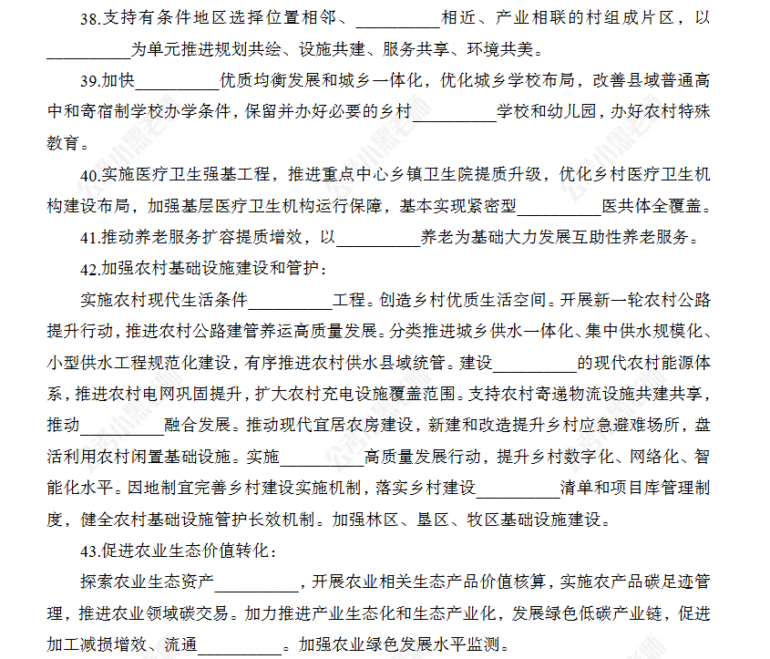

功能 片区 义务教育 小规模 县域 居家 补短板 多元互补 客货邮 数字乡村 任务 确权 降本增效

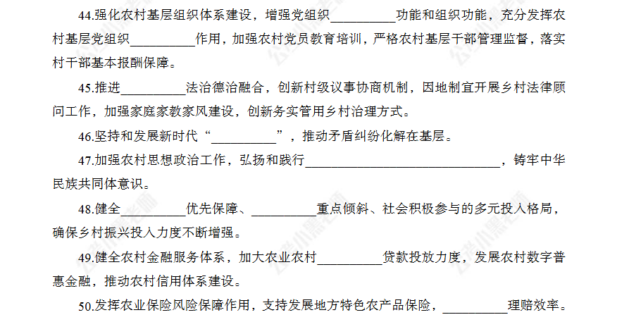

政治 领导 自治 枫桥经验 社会主义核心价值观 财政 金融 中长期 提高

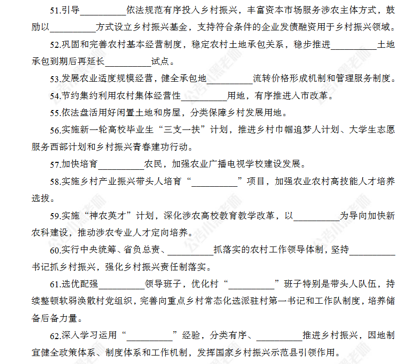

民间投资 市场化 第二轮 三十年 经营权 建设 高素质 头雁 需求 市县乡 五级 乡镇 两委 千万工程 片区化 

