## 1

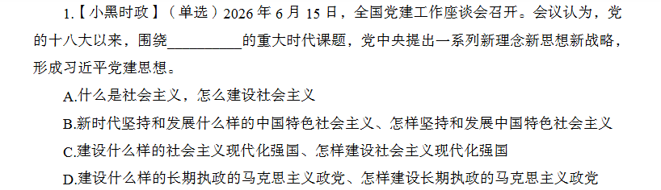

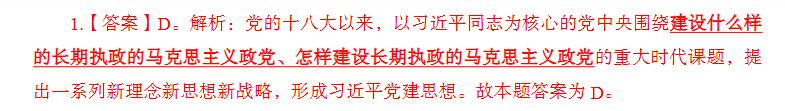

## 2

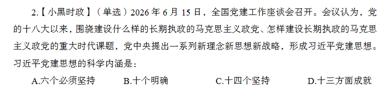

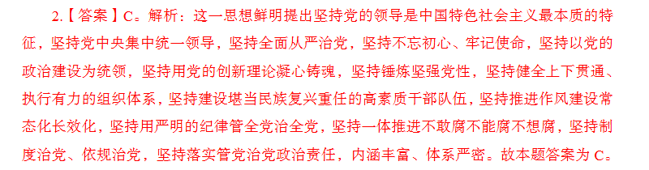

## 3

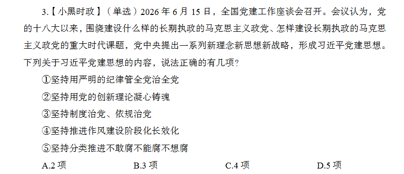

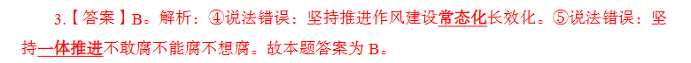

## 4

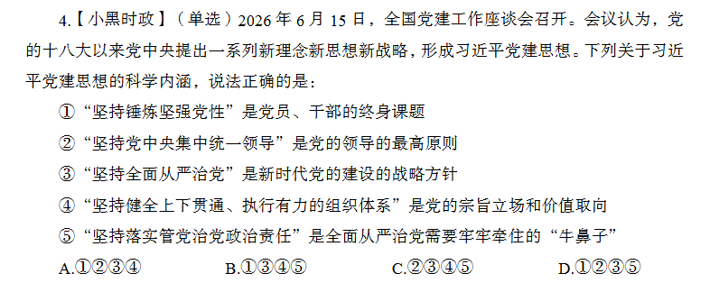

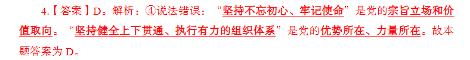

## 5

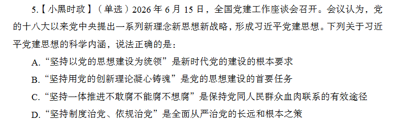

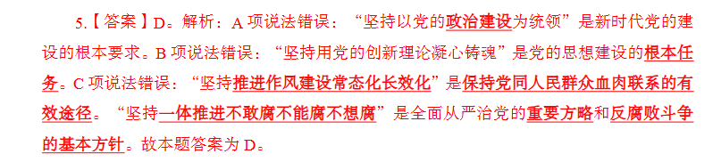

## 6

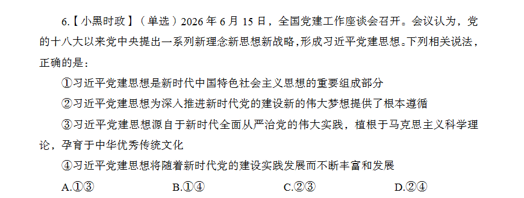

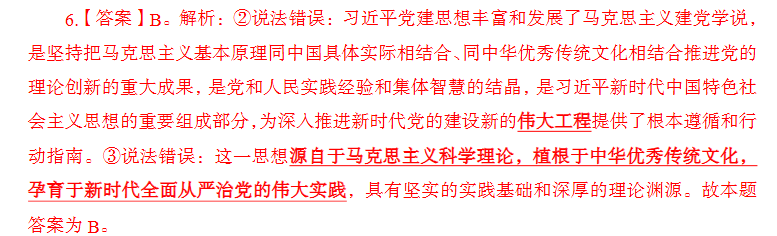

## 7

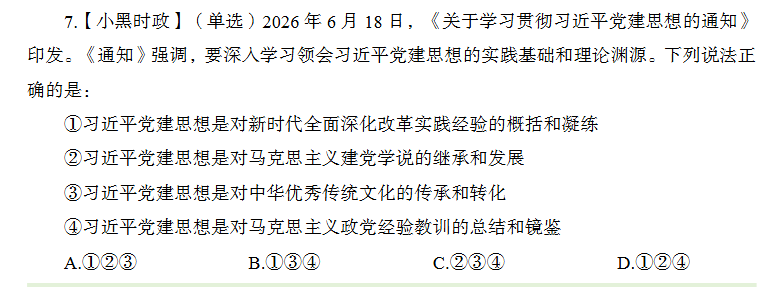

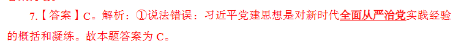

## 8

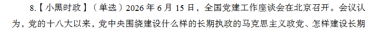

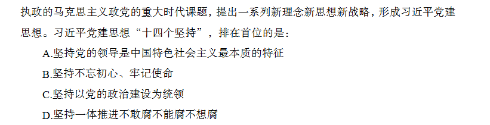

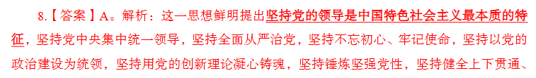

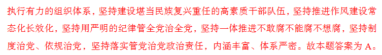

## 9

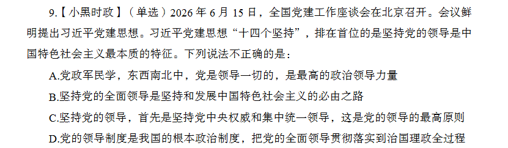

## 10

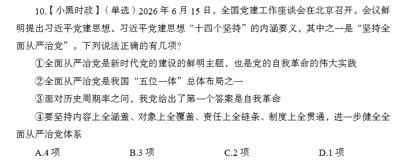

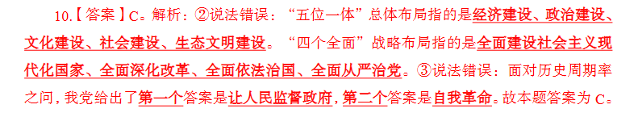

## 11

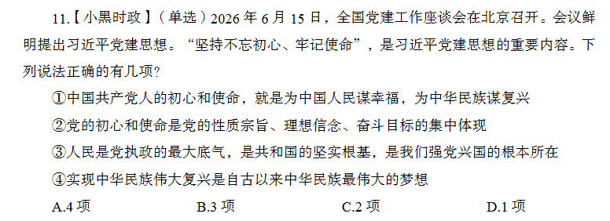

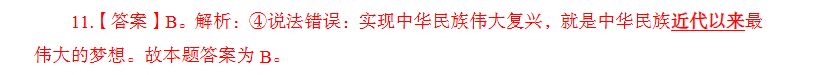

## 12

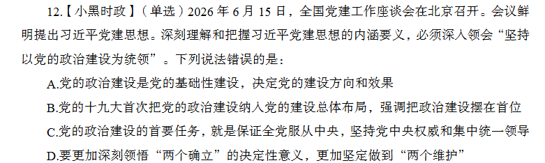

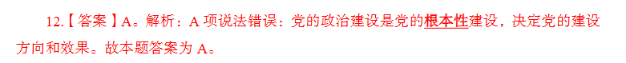

## 13

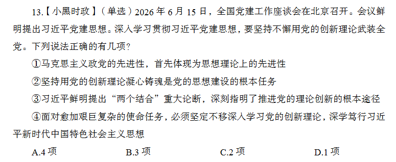

## 14

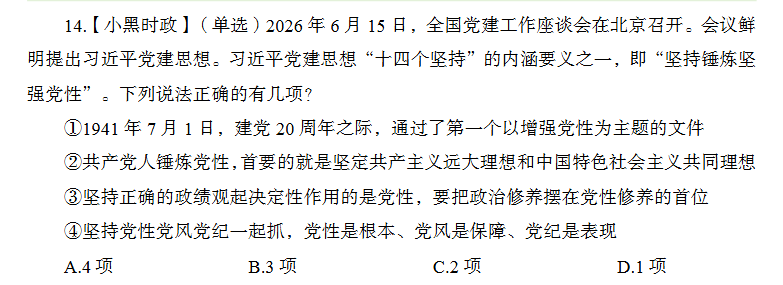

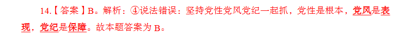

## 15

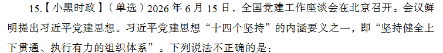

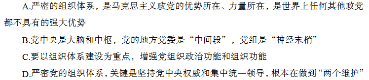

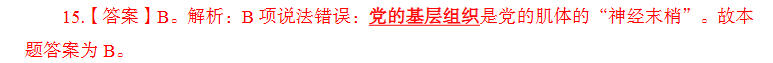

## 16

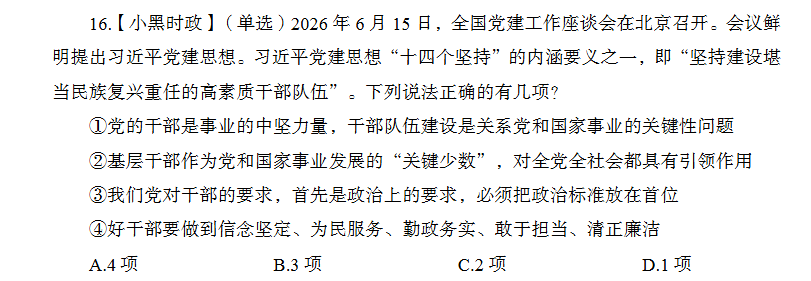

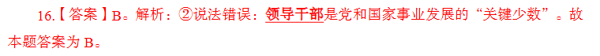

## 17

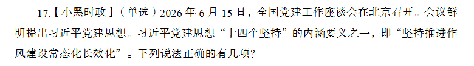

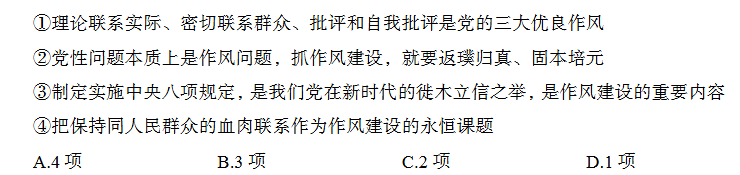

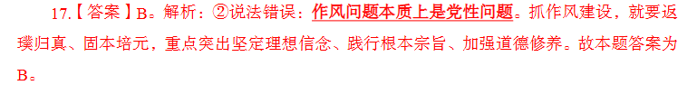

## 18

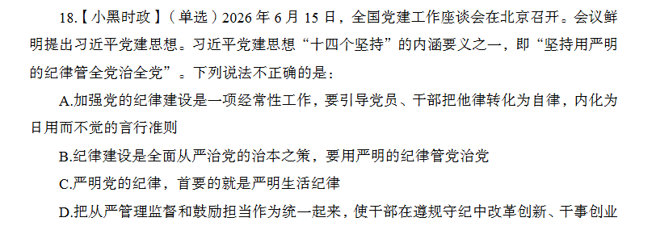

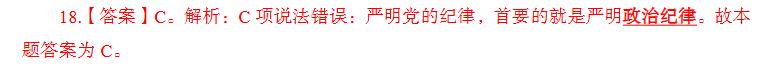

## 19

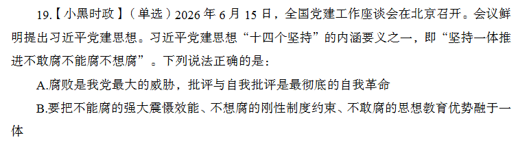

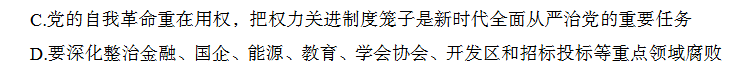

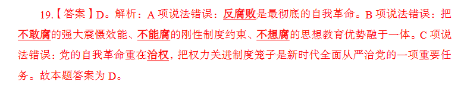

## 20

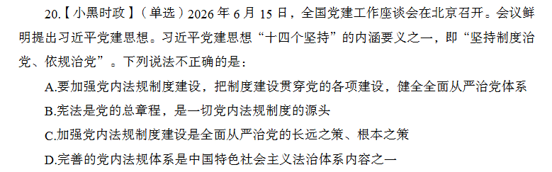

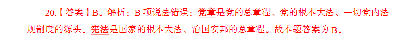

## 消化清单

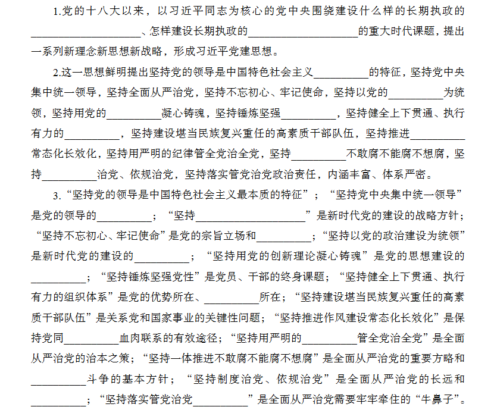

马克思主义政党 马克思主义政党 最本质 政治建设 创新理论 党性 组织体系 作风建设 一体推进 制度 

最高原则 全面从严治党 价值取向 根本要求 根本任务 力量 人民群众 纪律 反腐败 根本之策 政治责任

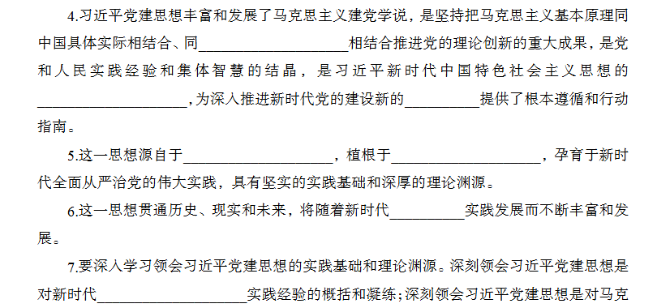

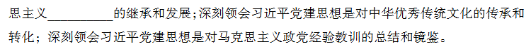

中华传统优秀文化 重要组成部分 伟大工程 马克思主义科学理论 中华优秀传统文化 党的建设 全面从严治党 建党学说 

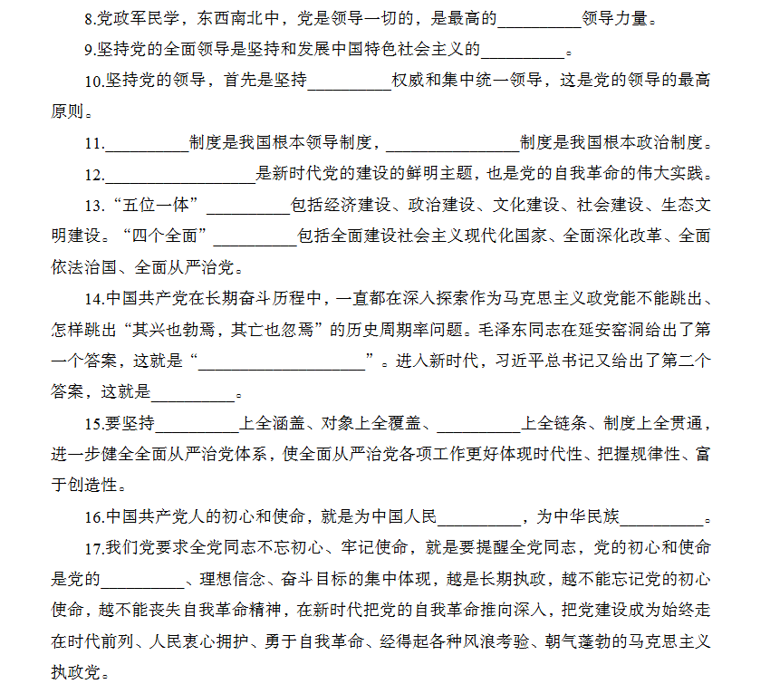

政治 必由之路 党中央 党的领导 人民代表大会 全面从严治党 总体布局 战略布局 让人民来监督政府 自我革命 内容 责任 谋幸福 谋复兴 性质宗旨

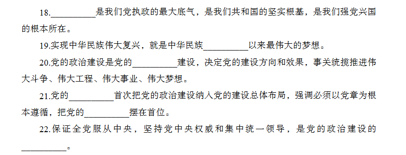

人民 近代 根本性 十九大 政治建设 首要任务

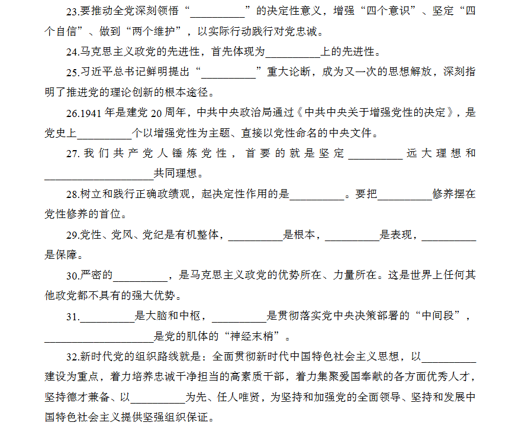

两个确立 思想理论 两个结合 第一个 共产主义 中国特色社会主义 党性 政治 党性 党风 党纪 组织体系 党中央 地方党委 党的基层组织 组织体系 德

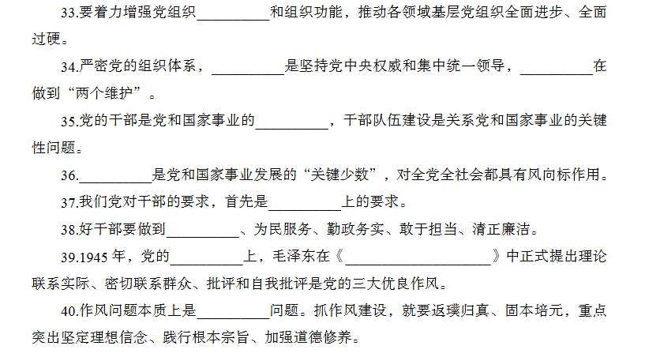

政治功能 关键 根本 中坚力量 领导干部 政治 信念坚定 七大 论联合政府 党性

中央八项规定 他律 自律 政治 威胁 自我革命 不敢腐 不能腐 不想腐 治权 制度建设

党章 宪法 法规制度 总目标 党内法规 依法行政 法治社会