## 1

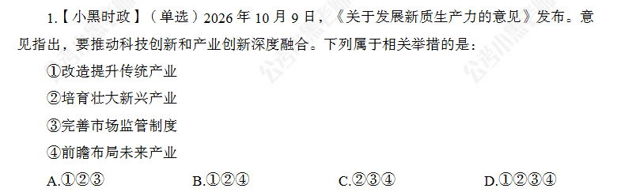

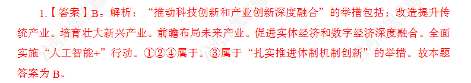

## 2

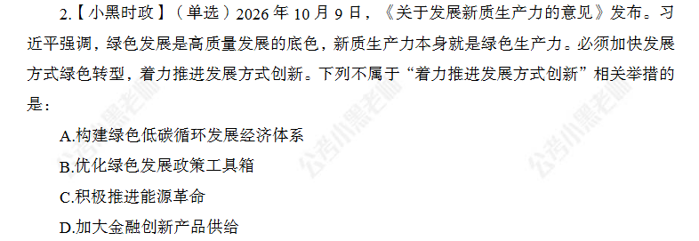

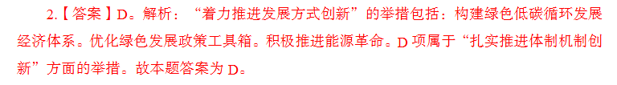

## 3

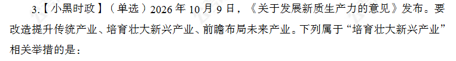

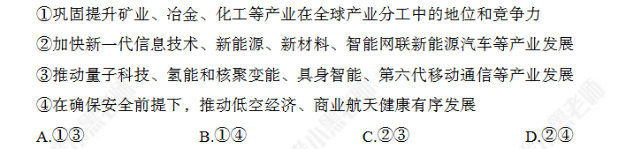

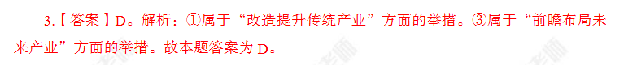

## 4

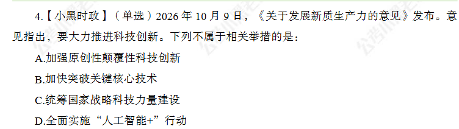

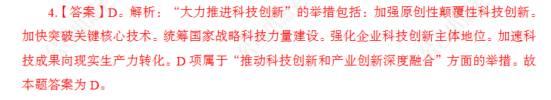

## 5

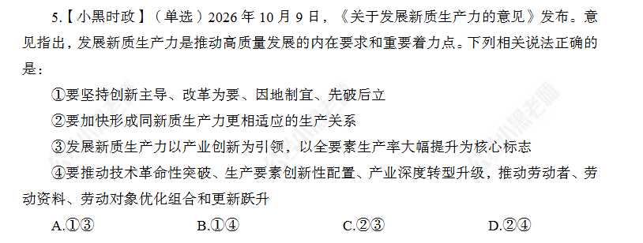

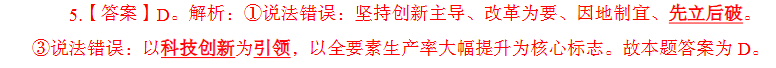

## 6

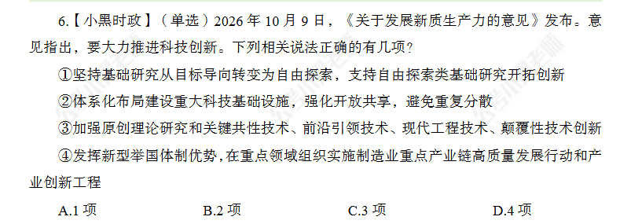

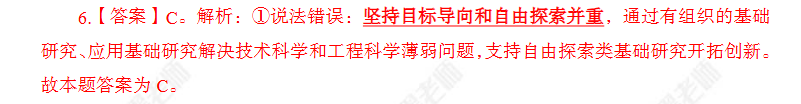

## 7

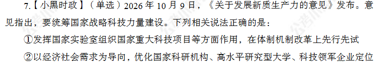

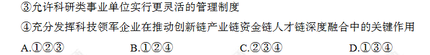

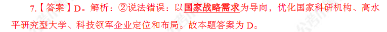

## 8

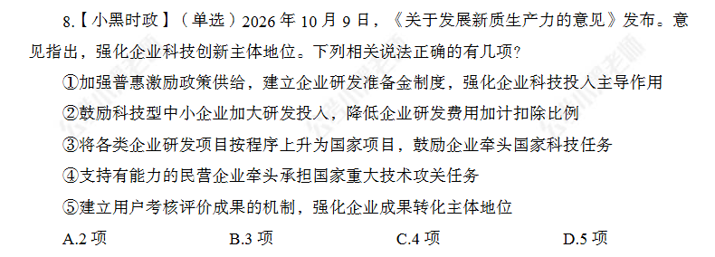

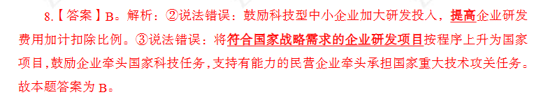

## 9

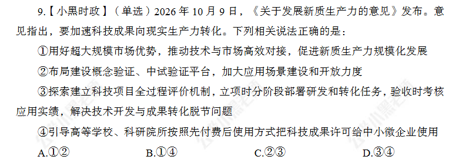

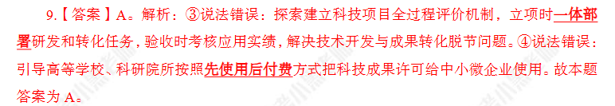

## 10

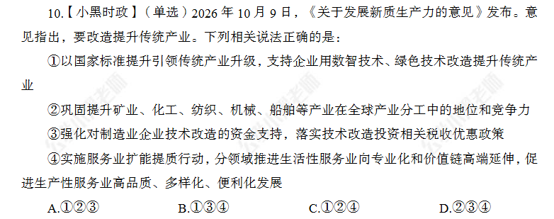

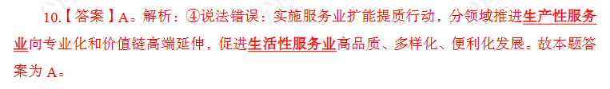

## 11

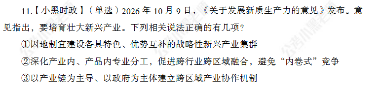

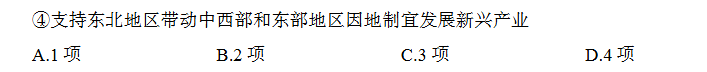

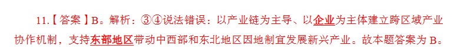

## 12

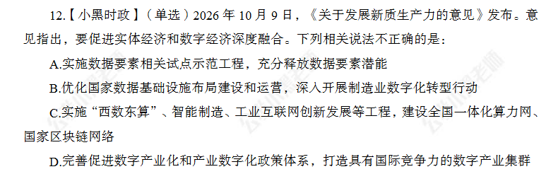

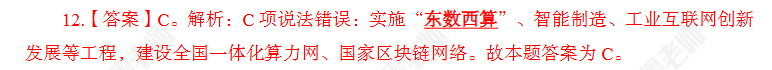

## 13

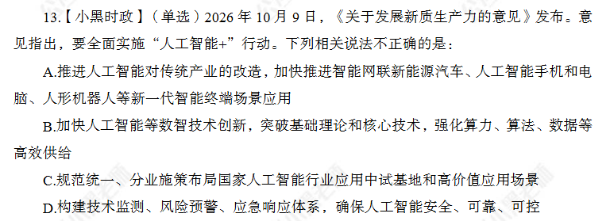

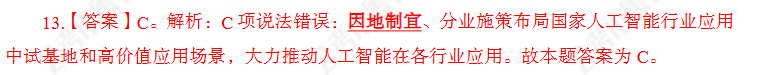

## 14

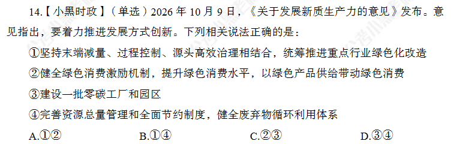

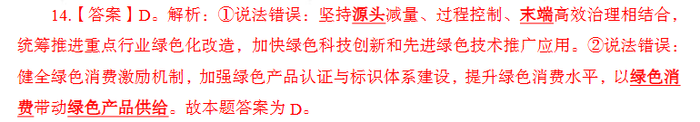

## 15

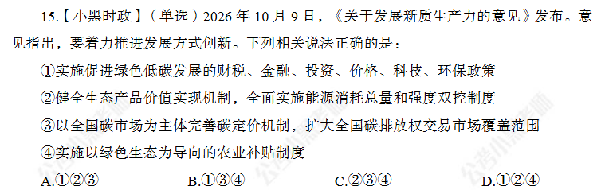

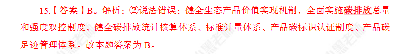

## 16

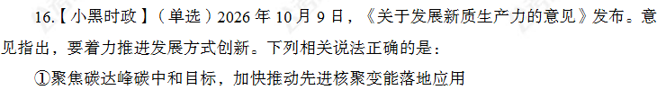

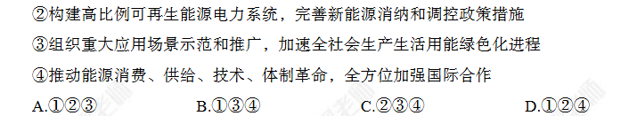

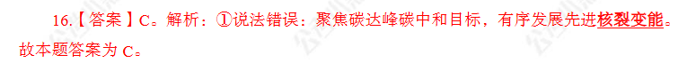

## 17

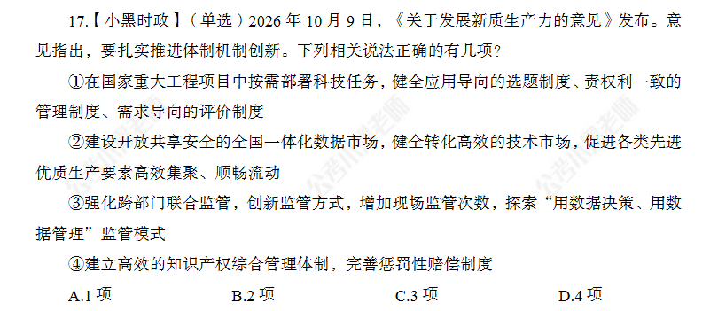

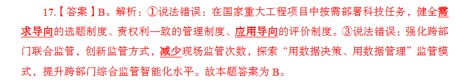

## 18

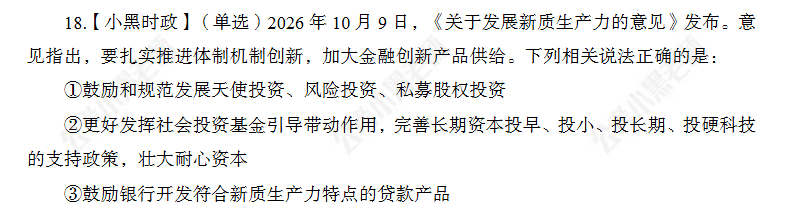

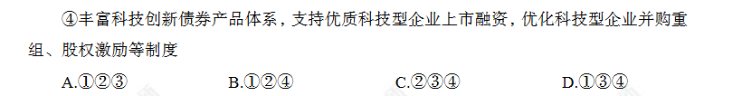

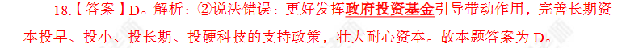

## 19

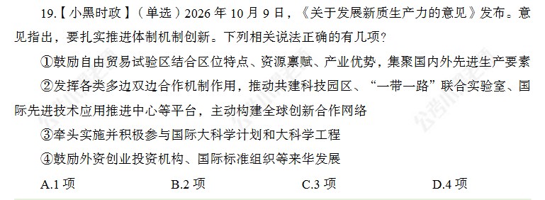

## 20

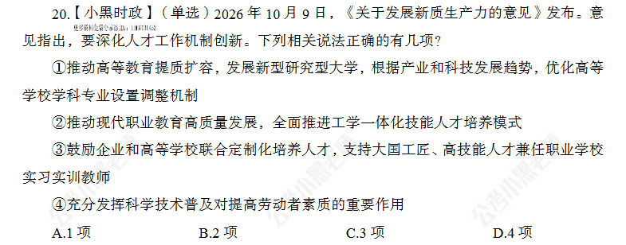

## 21

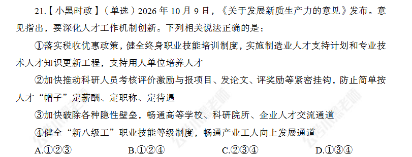

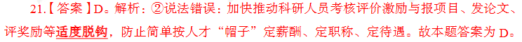

## 22

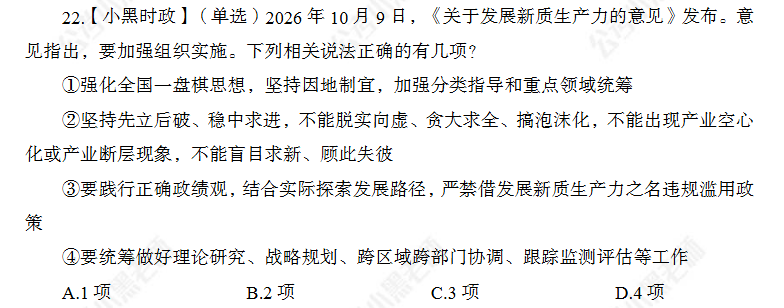

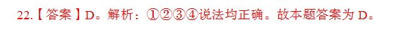

## 消化清单

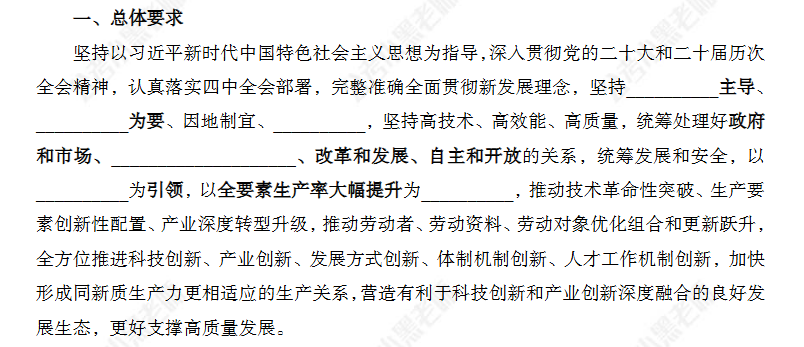

创新 改革 先立后破 质态和业态 科技创新 核心标志

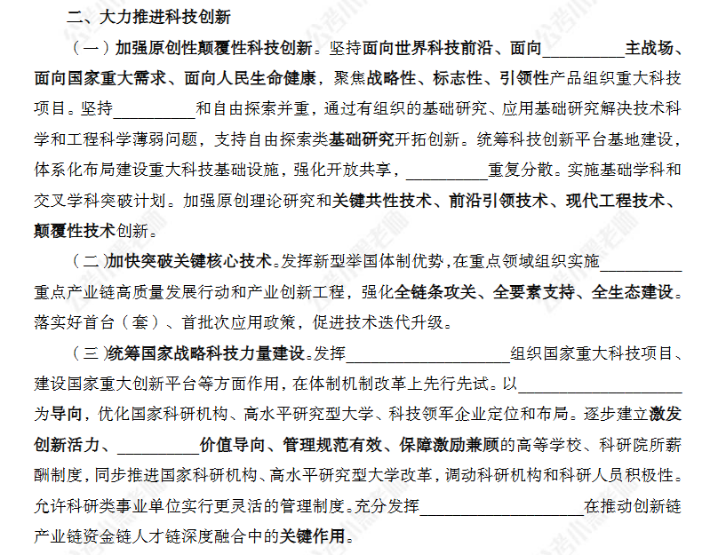

经济 目标导向 避免 制造业 国家实验室 国家战略需求  知识 科技领军企业

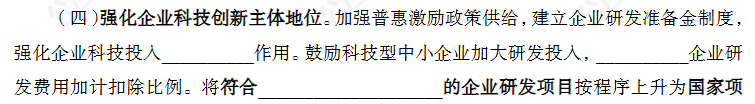

主导 提高 国家战略需求 民营 企业 规模化 全过程 一体 应用 先使用后付费

实体经济 绿色 数智化 生产性 生活性 航空航天 产品内 产业链 主体 东部 中西部 低空经济

核聚变 第六代 东数西算 一体化 分业施策

源头 末端 消费 供给 强度 碳市场 绿色生态 碳达峰碳中和 核裂变 高比例 

需求 管理 应用 减少 惩罚性 政府 耐心 牵头

提质扩容 研究型 工学 定制化 适度脱钩 分类 脱实向虚 空心化