## 1

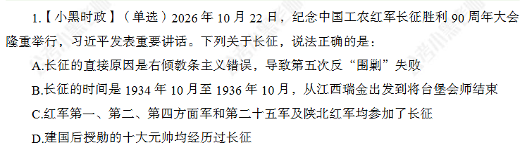

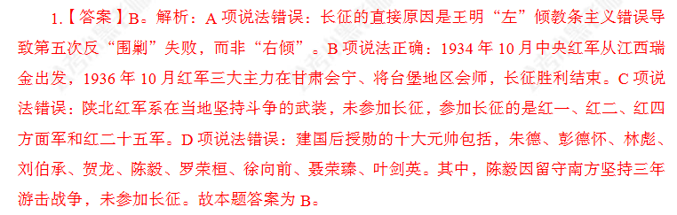

## 2

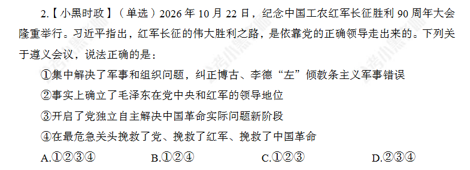

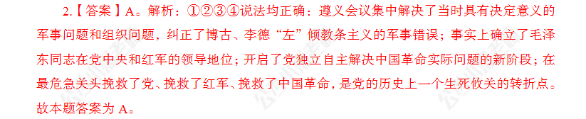

## 3

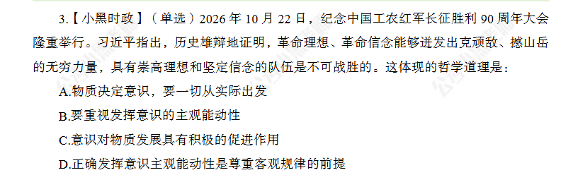

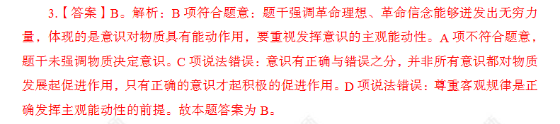

## 4

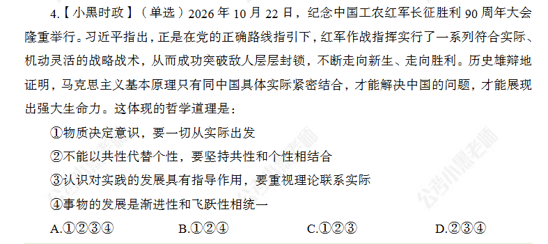

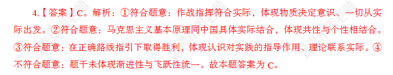

## 5

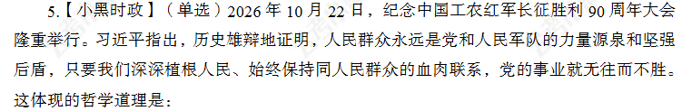

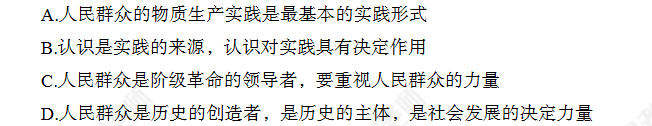

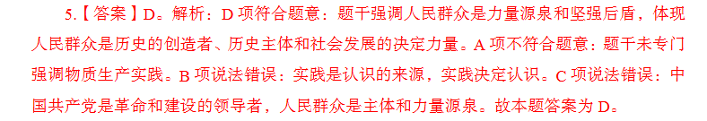

## 6

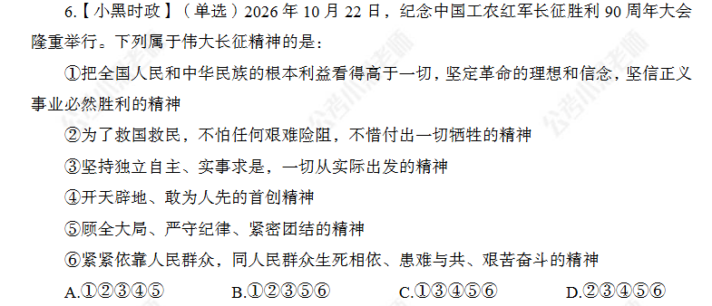

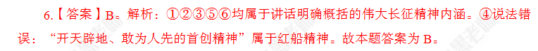

## 7

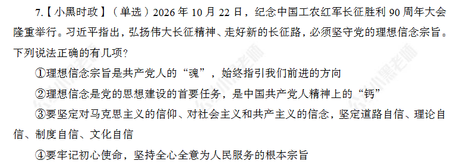

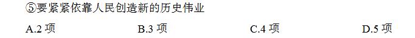

## 8

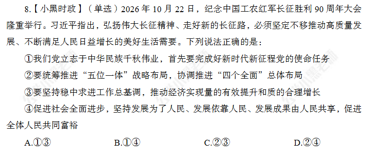

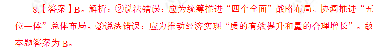

## 9

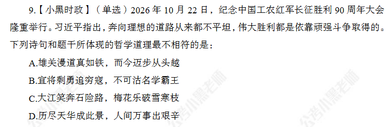

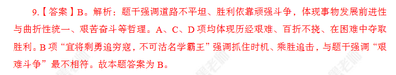

## 10

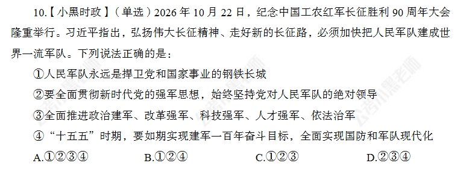

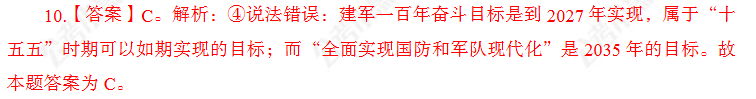

## 11

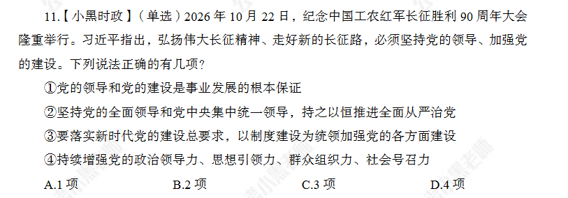

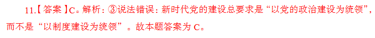

## 12

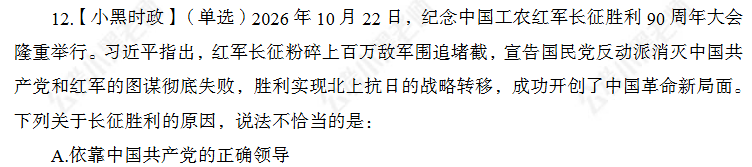

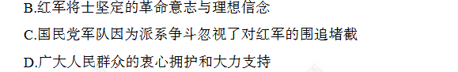

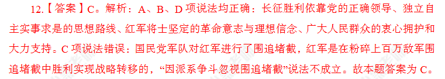

## 13

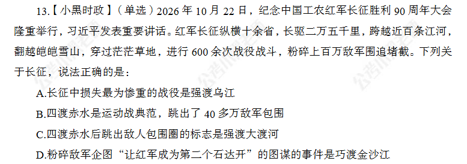

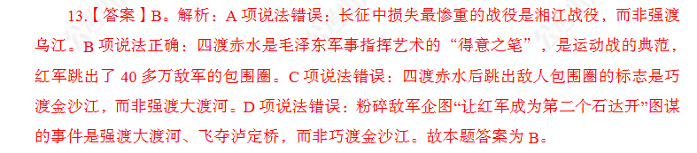

## 14

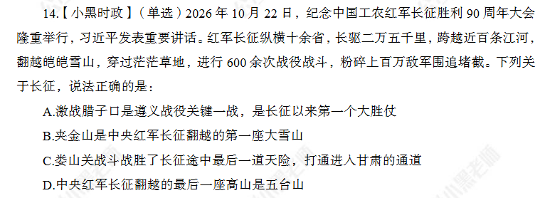

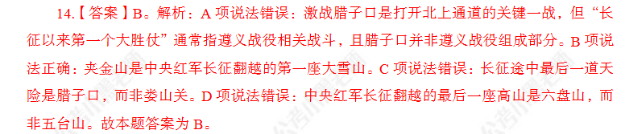

## 15

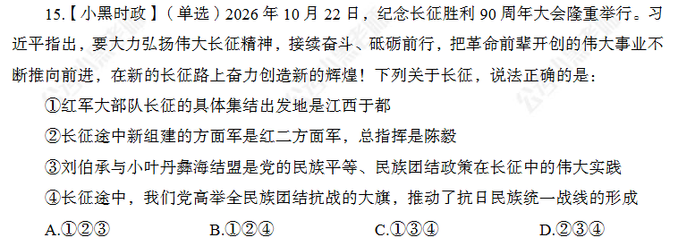

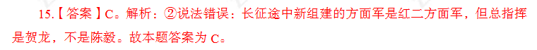

## 16

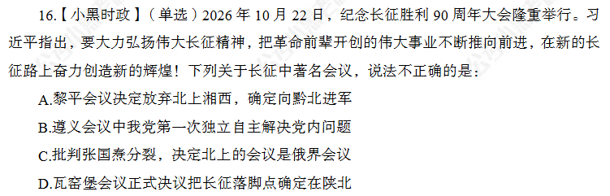

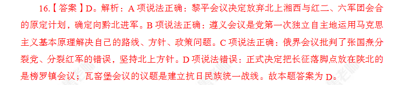

## 17

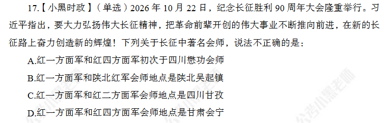

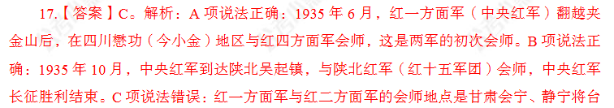

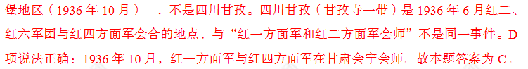

## 18

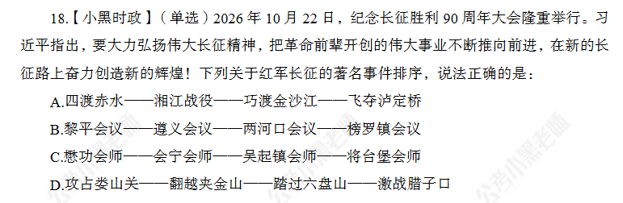

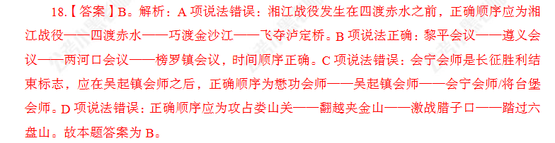

## 19

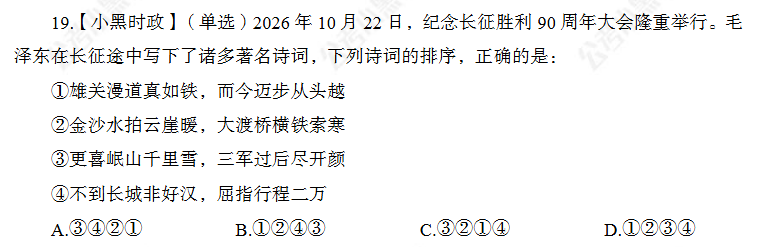

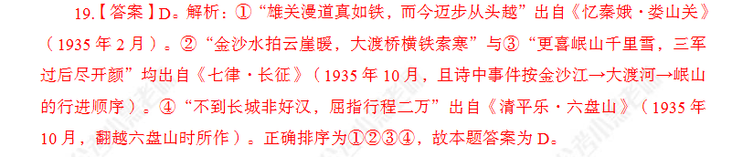

## 20

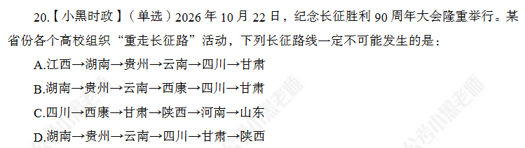

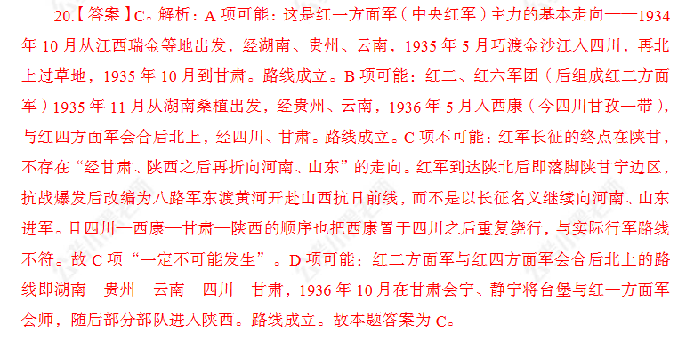

## 消化清单

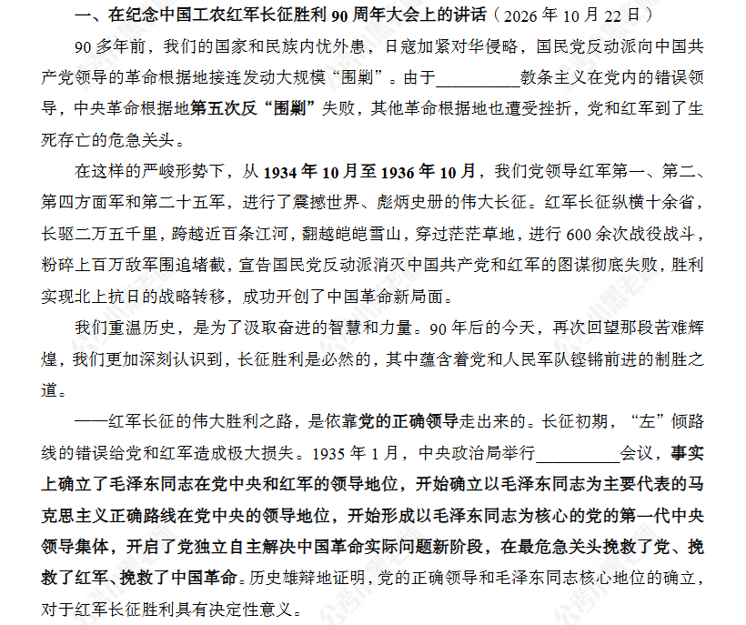

左倾 遵义 

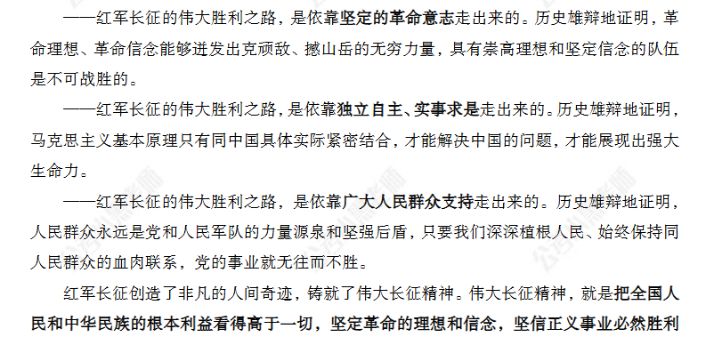

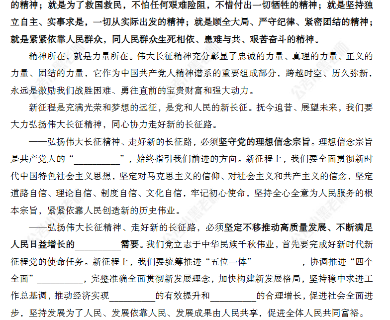

魂 美好生活 总体布局 战略布局 质 量

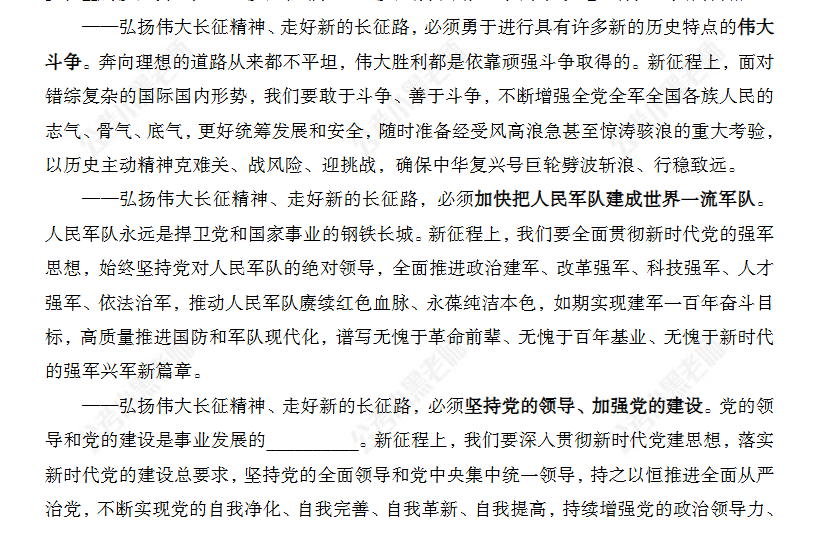

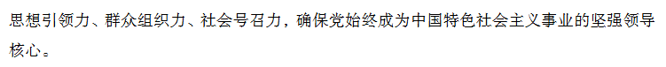

根本保证

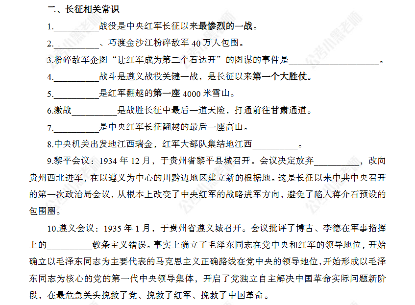

湘江 四渡赤水 飞夺泸定桥 娄山关 夹金山 腊子口 六盘山 于都 北上湘西 左倾

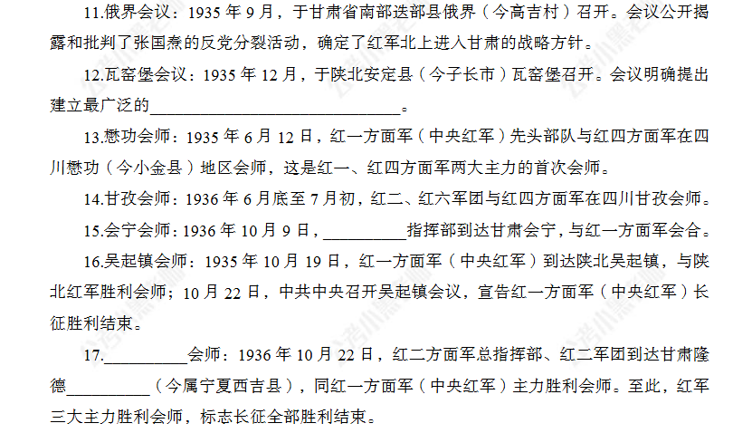

抗日民族统一战线 红四方面军 将台堡 将台堡 血战湘江 巧渡金沙江 

