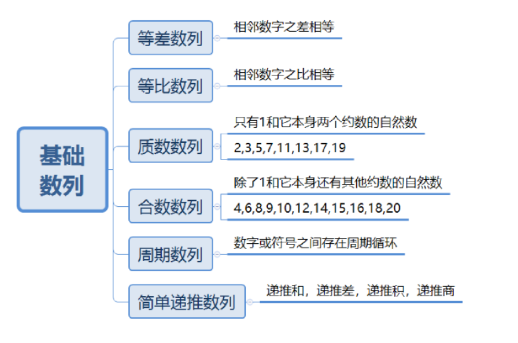
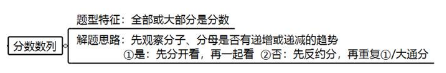
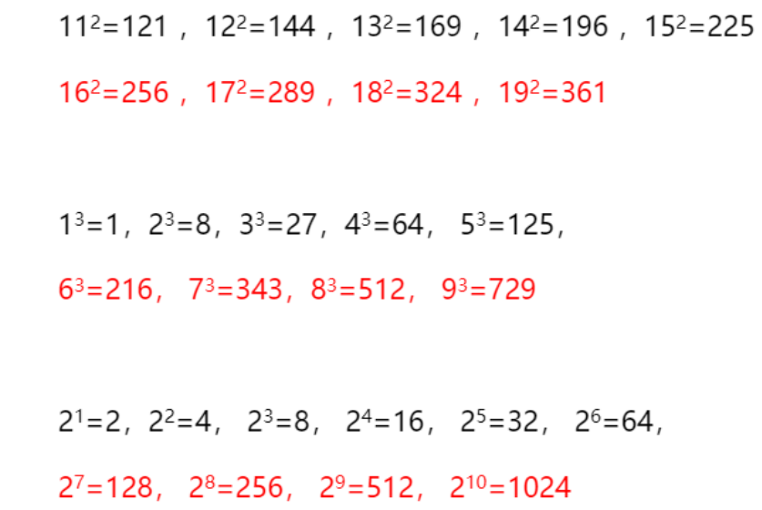

# 第一节 基础数列

1.等差数列：相邻数字之间差相等 

【例】2，5，8，11，14，17，„„„„ 

2.等比数列：相邻数字之间商相等 

【例】3，-6，12，-24，48，„„ 

3.质数数列：只有 1 和它本身两个约数的自然数叫作质数 

【例】2，3，5，7，11，13，17，19，„„ 

4.合数数列：除 1 和它本身外还有其他约数的自然数叫作合数 

【例】4，6，8，9，10，12，14，15，16，18，20，„„ 

5.周期数列：数字或符号之间存在周期性循环 

【例 1】5，2，0，5，2，0，5，2，0，„„ 

【例 2】1，-3，5，-7，9，-11，„„ 

6.简单递推数列 

递推和数列：【例】1，2，3，5，8，13，„„ 

递推差数列：【例】15，8，7，1，6，-5，„„ 

递推积数列：【例】2，2，4，8，32，256，„„ 

递推商数列：【例】108，18，6，3，2，„„

# 第二节 特征数列

## 一、多重数列

题型特征：项数比较多（含所求项≥7 项） 

解题思路： 

先交叉（分为奇数项、偶数项） 

再分组（两两分组；三三分组）

8 项、10 项优先考虑两两分组，9 项、 12 项优先考虑三三分组。分组之后观察组内的两个数，如果倍数关系明显，考 虑作商；如果倍数关系不明显，考虑作差、作和。

## 二、机械划分数列

题型特征 

①有小数点 

②大数字多（三位数、四位数） 

解题思路 

①整数部分与小数部分分开或结合找规律 

②拆：a.将各位数字拆开，求和找规律 

b.拆成几部分，找内部运算规律或每个部分找外部规律

## 三、分数数列

题型特征：全部或者大部分项是分数 

解题思路：观察分子、分母是否递增或递减 

①是——先分开、再一起 

②否——反约分转化为分子、分母递增或递减的数列

优先对中间项进行反约分。

【注意】大通分： 

1.特征：分子或分母有明显的公倍数，分母特别容易统一。 

2.思路：把分子（分母）转化为同一个数，找分母（分子）的规律。

## 四、幂次数列

幂次数列 

题型特征：本身是幂次数：8、27、64、125 

或附近有幂次数：35、48、63、80 

解题思路：普通幂次——直接转化为 a n 

修正幂次——a n±修正项

# 第三节 非特征数列

【注意】非特征数列：多级数列、递推数列。重点学习“识别”和“思路”； 

非特征（数列）只是特征不明显，还是有特征的。

## 一、多级数列

题型特征 

①相邻两项有明显的倍数关系 

②无明显特征，变化趋势平缓 

解题思路 

①相邻两项作商 

②作差（一次、两次），作和

## 二、递推数列

递推数列 

题型特征：无特征、多级无规律考虑递推 

解题思路：圈仨数（不大不小）、找规律（和、倍、积、方）、做验证

【例 8】（2023 福建）2，4，11，47，520，（ ） 

A.1863 

B.79243 

C.24443 

D.125933

【解析】8.先识别，无明显特征，前一项是 47、后一项是 520，倍数关系达 到 10+倍，变化急速，不考虑多级（多级的特征是平缓）；解题思路：圈三个数， 建议不大不小（最好靠中间）→4、11、47，变化急速→优先猜“积”、“方”，4*11+3=47， 

验证：2*4+3=11，11*47+3=517+3=520，规律为“①*②+3=③”，则所求项 =47*520+3=24443，对应 C 项。【选 C】