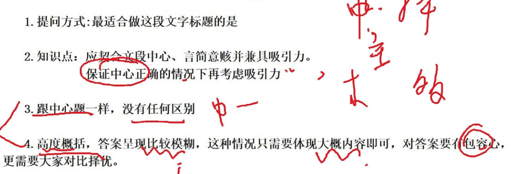
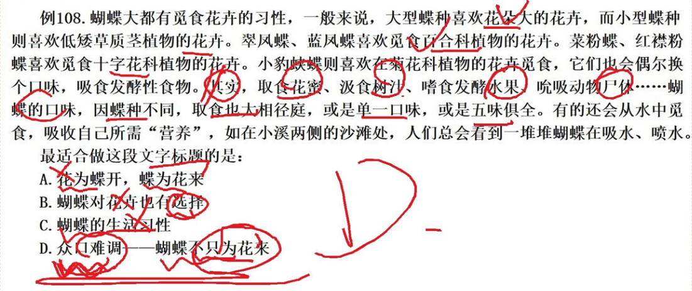
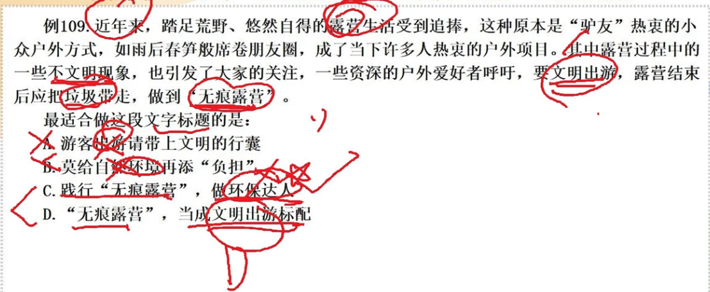
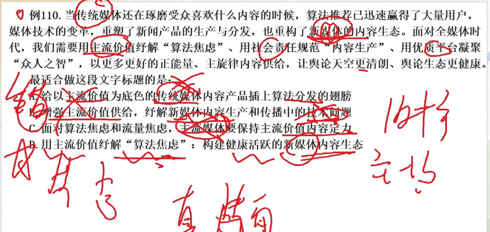
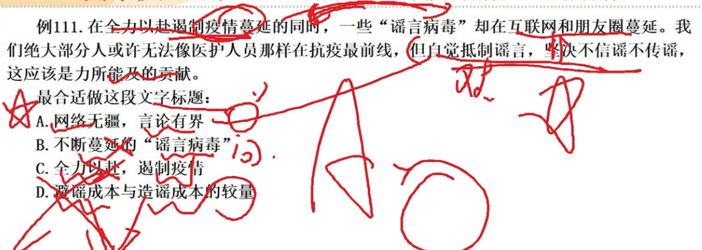
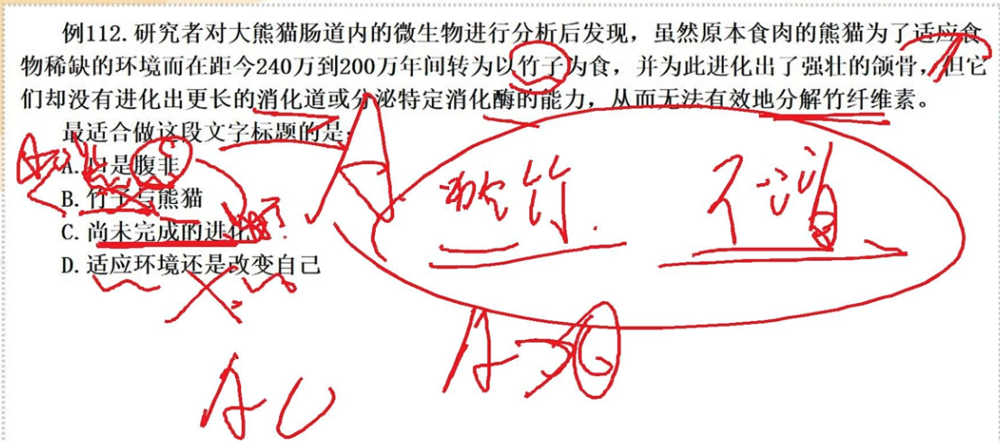
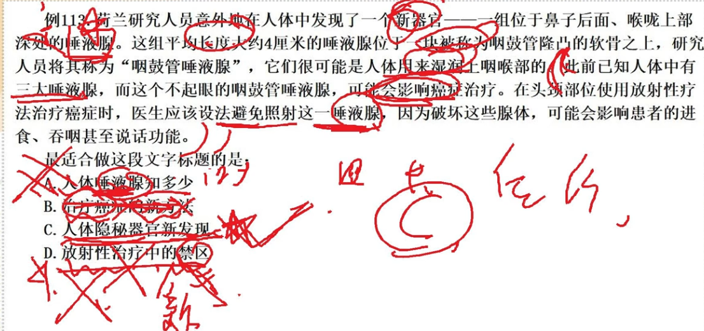
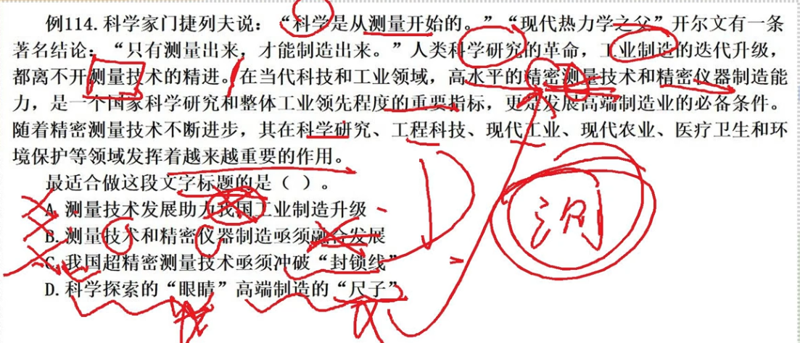

提问方式：最适合做这段文字标题的是

知识点：应契合文段中心、言简意赅并兼具吸引力

------

------

C和D对比，C是为了做环保达人，这不是目的，题干是说要文明出游。

------

A选项传统媒体错了，是新媒体；B选项技术问题错了，C选项主流媒体错了，没有这个概念；D虽然片面，但是ABC都错了，只能选D。

------

标题填入题的答案一般都比较模糊，B是问题，对应转折之前；CD是无关选项，选A。

------

熊猫吃竹子不消化。

------

A选项，题干人体有三大唾液腺，但是中的是这个新唾液腺，C虽然模糊，但是其他选项都不对。

------

A选项错在我国，B选项错在融合发展，C选项更是无中生有，选D。