提问方式：

- 对文段理解正确/不正确的是：
- 符合/不符合这段话意思的是：
- 从文段中可以得知的是：
- 这段文字没有解释下列哪一问题：

1.看清提问：选是/选非

2.选项短，先选项再文段

  选项长，先文段再选项

3.选非：绝对化表述作为答案概率更高

  选是：温和表述作为答案概率更高

4.常见错误：无中生有、偷换时态、偷换概念、偷换逻辑、绝对化、强加对比、文意不符

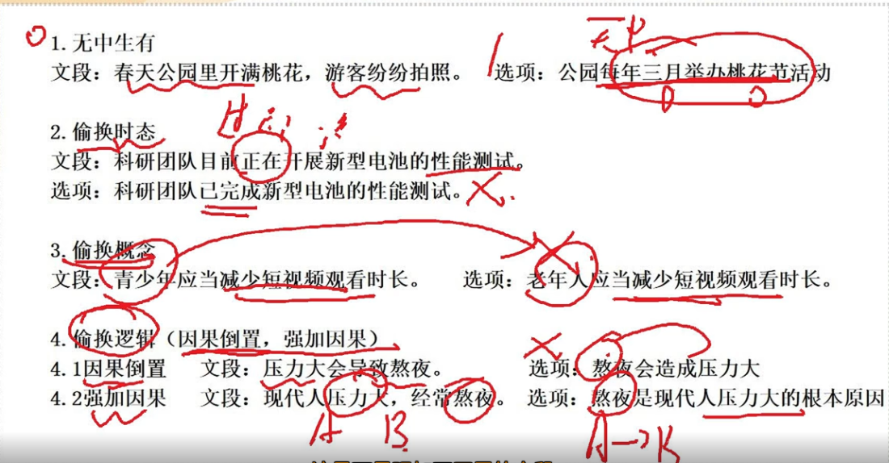

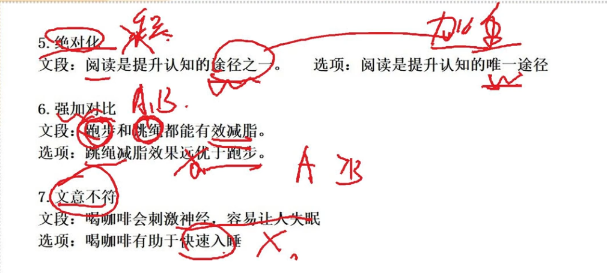

------

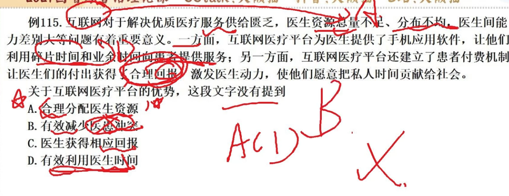

------

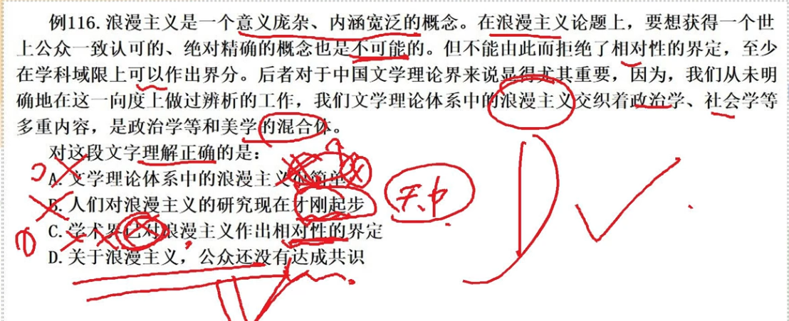

AB无中生有，C选项时态不对。

------

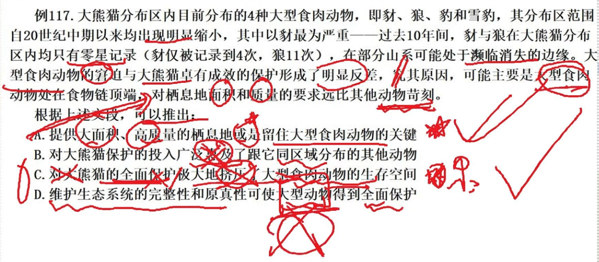

B错在惠及，C错在挤压，有点强加因果，D话题不对，是大型食肉动物，而不是大型动物。

------

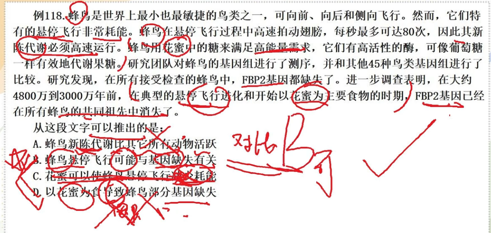

A选项是对比，文段没提到，C选项，文段说的是花蜜可以提供高能量，排除；D选项，并没有明确说花蜜和基因缺失的关系。

------

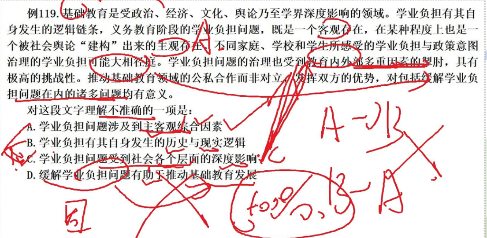

D选项因果导致，选D，虽然B和C选项不太确定。

------

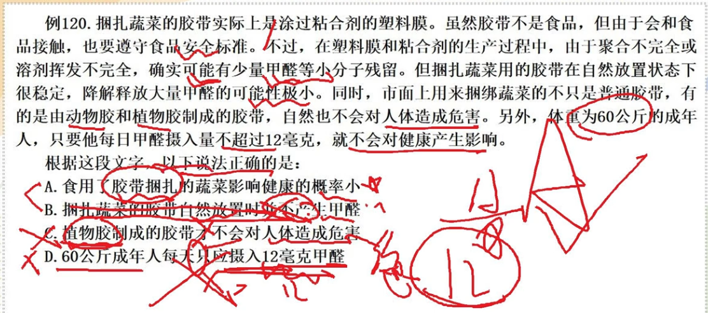

------

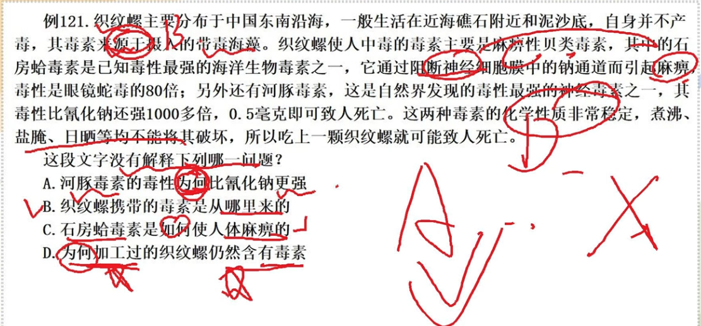

------

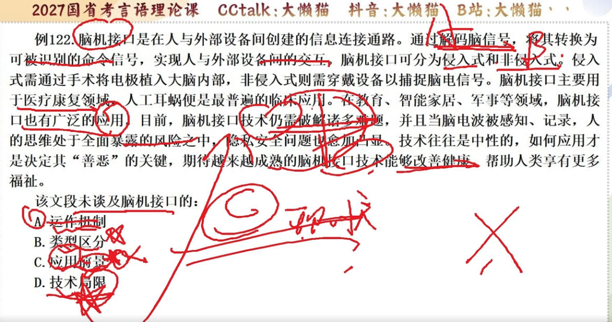

C选项提到了应用，但是没有提到前景，前景是未来的。

------

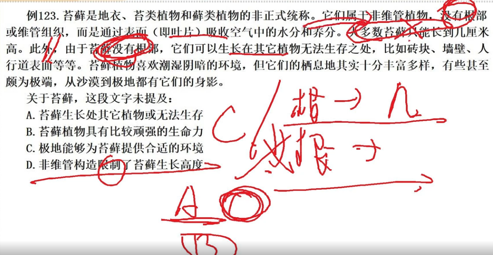

A和B比较好排除，C选项错在合适，文段说的是它可以生长在其它植物无法生存之处，不代表无法生存之处就是合适的。D选项，文段的并列结构都提到了没有根部xxx，D也可以排除。