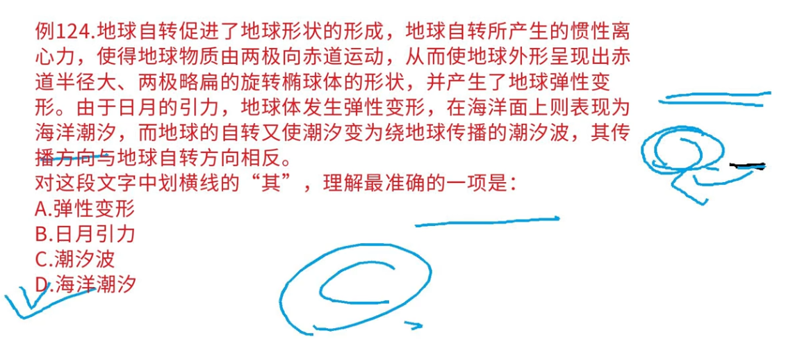
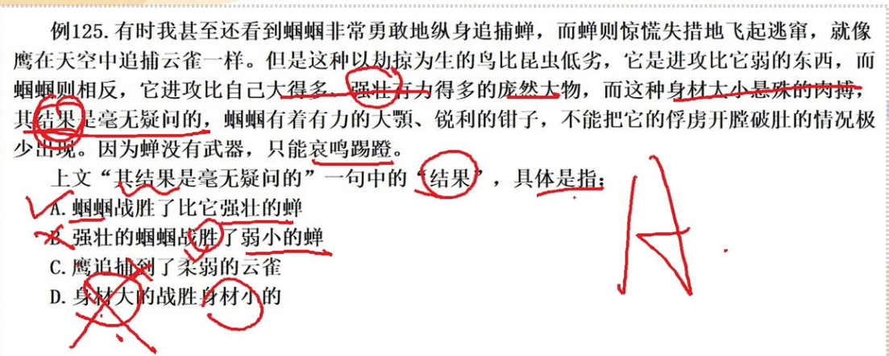
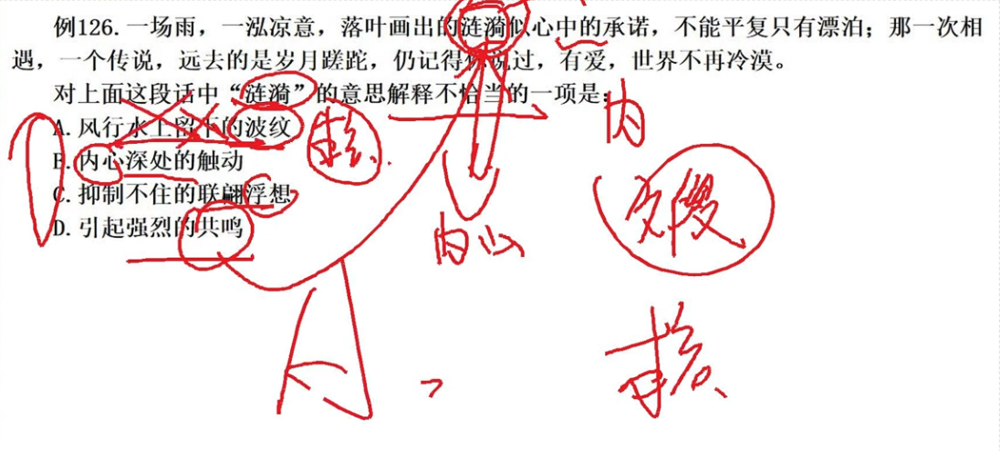
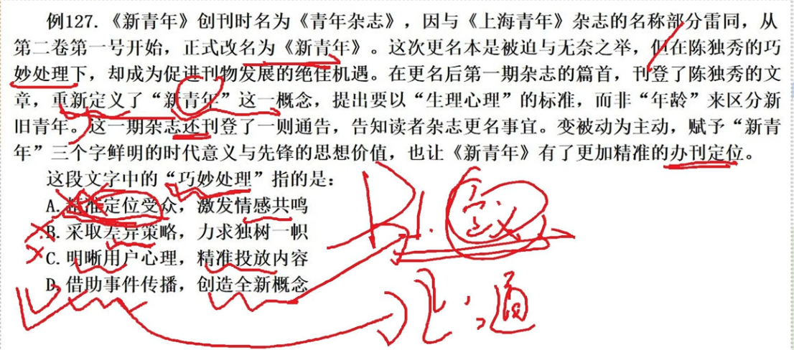
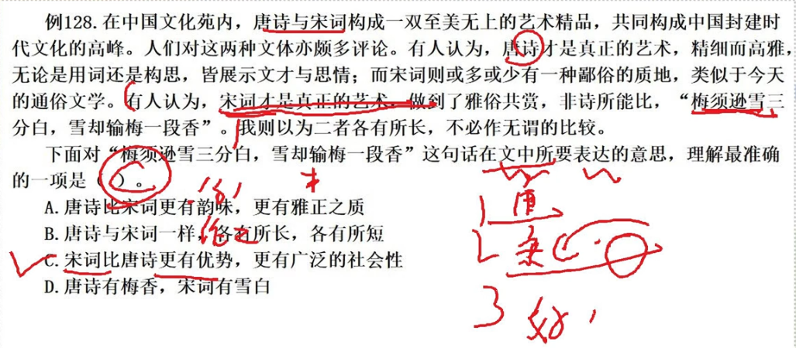
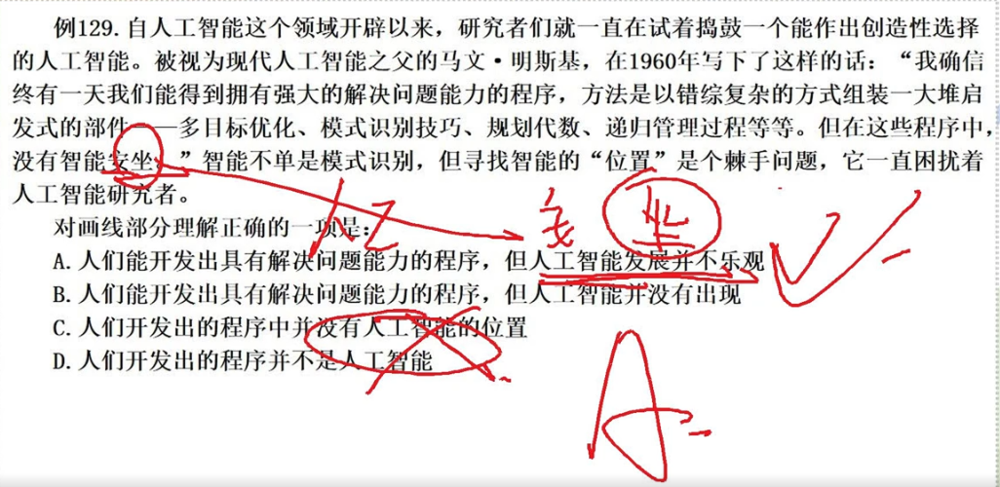
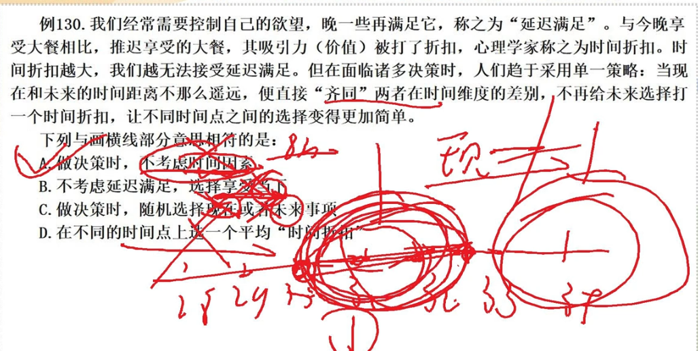

提问方式：材料中XX指代的是

对画线部分理解正确的一项是：

三类：代词、实词、句子

做题思路：代词一般就近靠前，如前面出现例子，认真确定是指代前面的例子还是再往的观点

总+例子，这xxx，这指代的是总的观点，而不是例子。

实词和句子，确定词句所在位置，再理解在文中起到的作用（有时候会有本意不一致）

------

------

A是本意，BCD都是内心相关，是引申义。

------

ABC只有一件事情，只有D选项有两件事，对应定义新青年这一概念以及刊登了一则通告。

------

文段有三种观点，1.唐诗比宋词好；2.宋词比唐诗好；3.一样好；这句话对应C。

------

位置坐的不那么安心、安稳，对应A。

------

把两个时间点当成一个，就不需要考虑时间，选A。