提问方式：填入画横线部分最恰当的一项是：

## 一、段首

总结全文、总结前半部分、引出下文

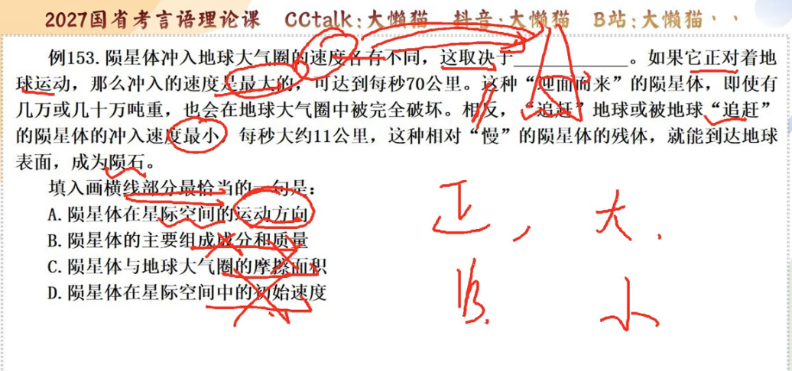

------

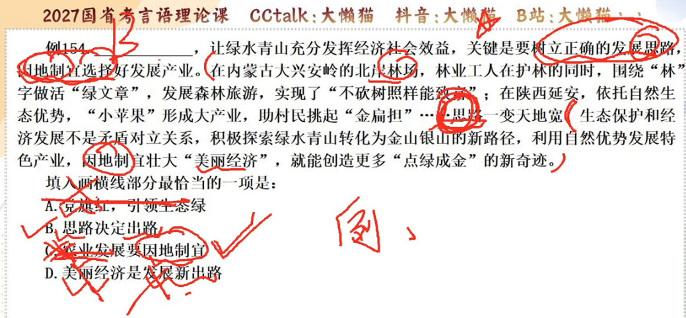

C选项农业错误，也有林业；D选项没有体现美丽经济怎么做，B选项是做法。

------

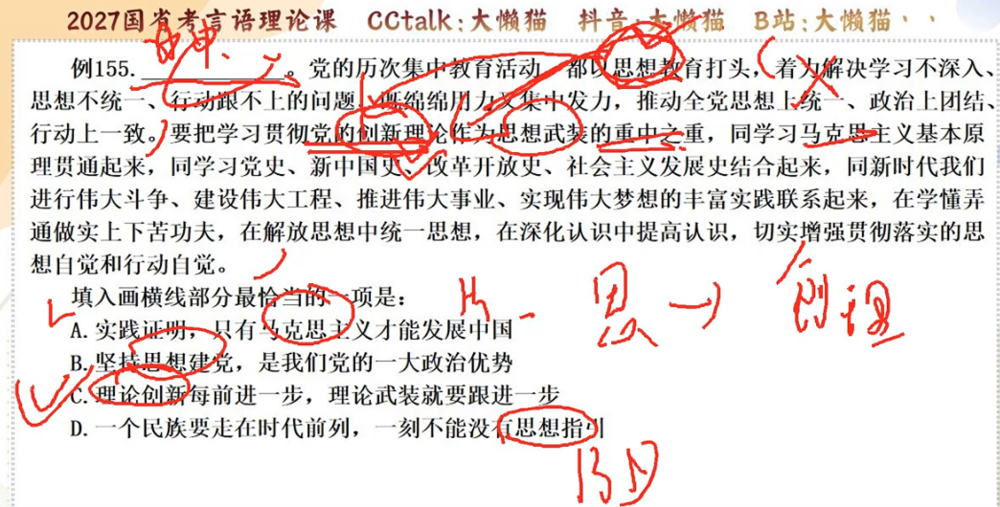

创新理论是重点。

------

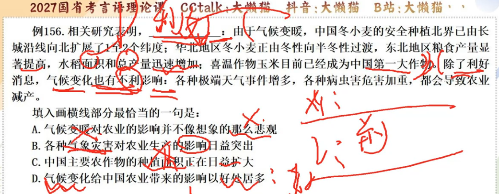

选利好的，C片面，A和B不是好的，选D。

------

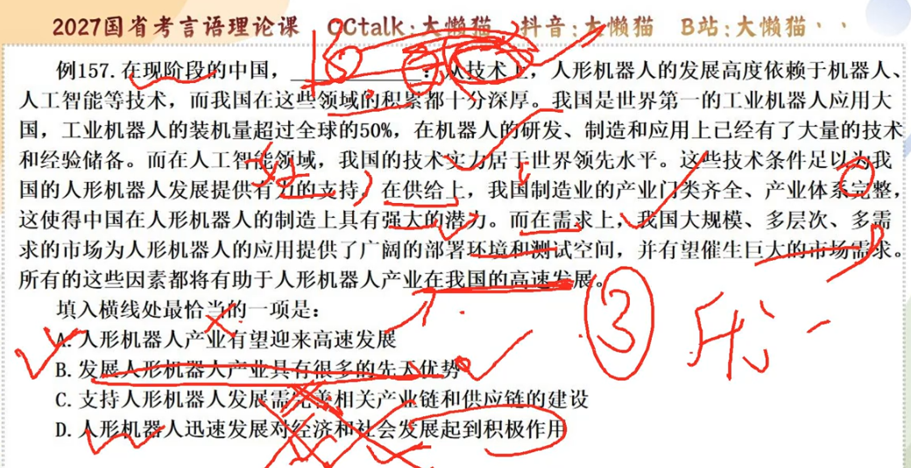

------

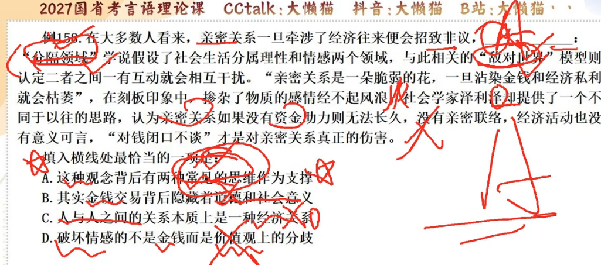

如果是冒号，那么就是总结下一句，和上一题一样，两种思维对应分隔领域和敌对世界。

## 二、段中

承上启下

如果选项只有承上或只有启下也可以选

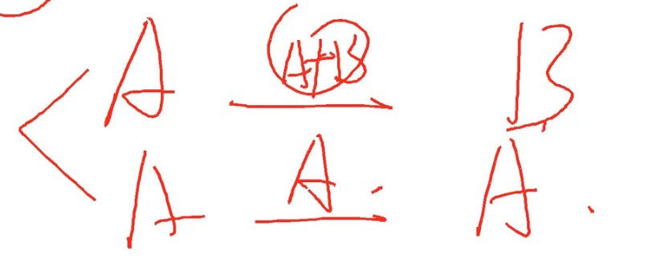

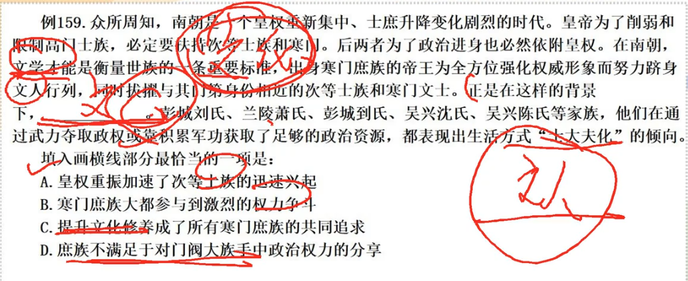

上半部分说的文化，后半部分士大夫化也是文化，选带有文化的，选C。 

------

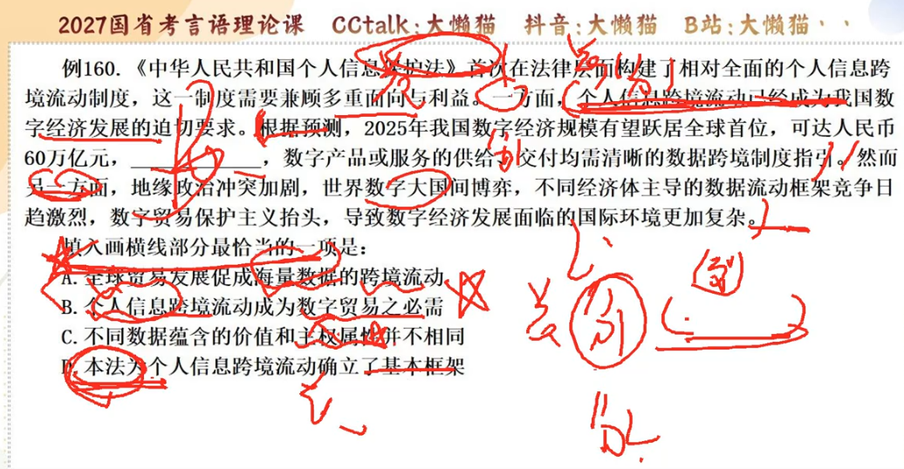

对应分1的部分，选B。A话题没有B明确，B是个人信息跨境流动。

------

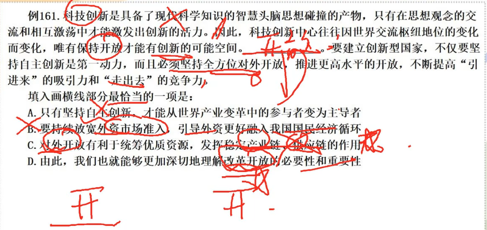

选项要包含开放，A排除，B选项只有引进来，没有走出去，C选项产业链、供应链是无中生有，排除，选D。

------

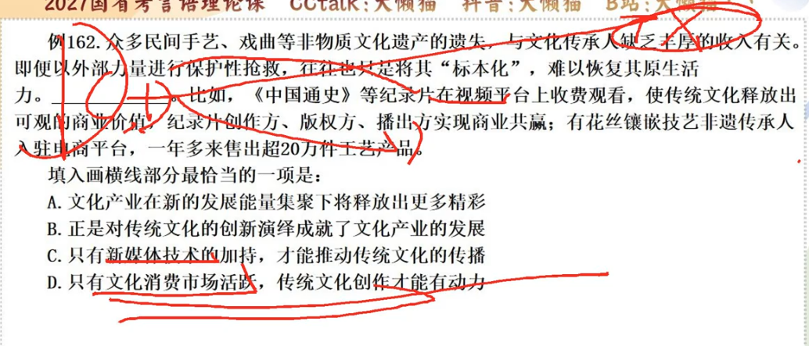

C只对应后半部分，D选项消费承上启下。

## 三、段尾

总结全文、提对策、总结后半部分

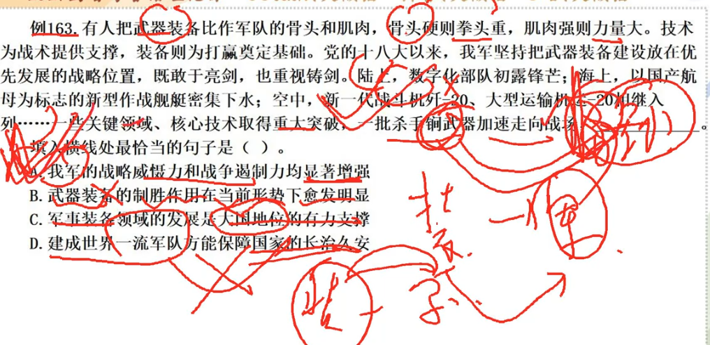

聊装备和军队的关系，接下来要谈军队，选A。

------

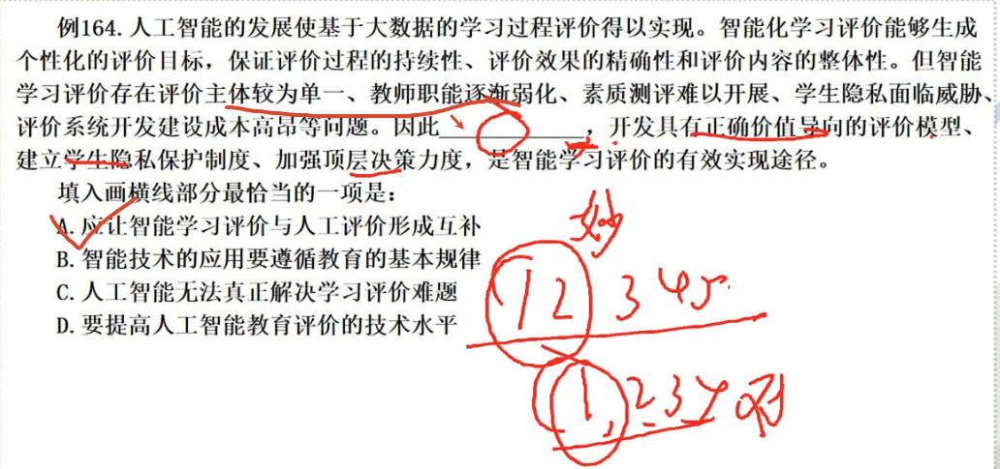

选项要解决2个问题，选A，这也是横线后面为什么是逗号而不是顿号的原因。

------

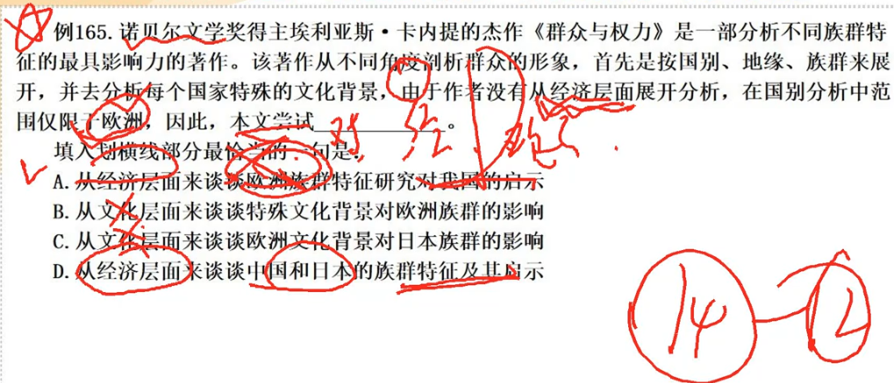

要从经济层面，并且欧洲以外的选项，选D。

------

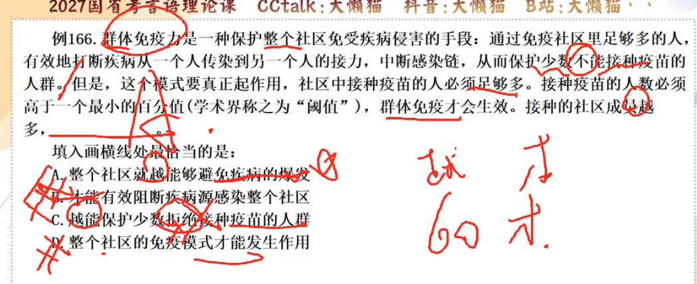

越......越......，排除B和D，选项C错在少数拒绝，文段说的是不能接种。

------

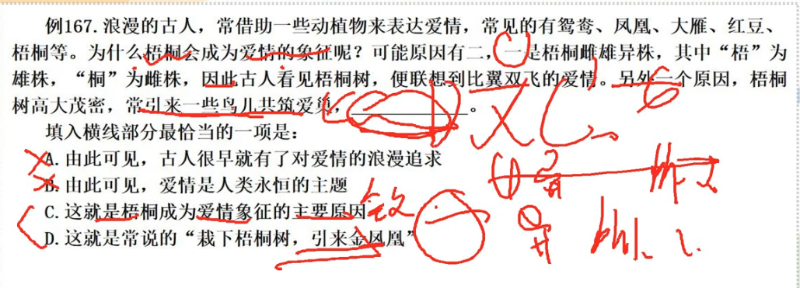

第一个原因给出了因果，第二个原因少了果，C选项是总结全文，而D选项是后一个原因的果，选D。