提问方式：将以上句子重新排列，语序正确的一项是

做题思路：从选项入手，一般不建议自己排序

## 一、首句对比

首句特征：下定义、背景引入

非首句特征：指代不明、关联词后半部分，举例子等

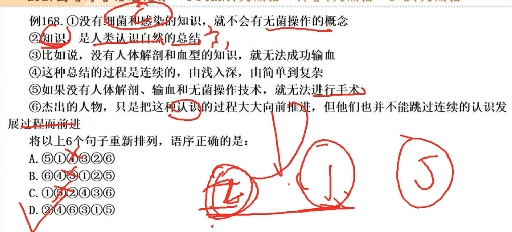

2要在1前面

------

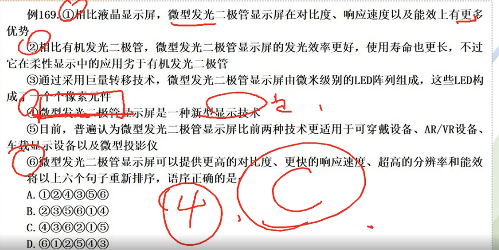

------

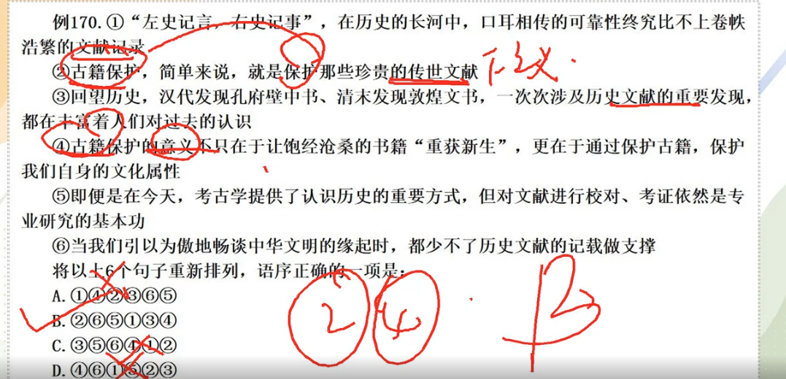

2下定义，4是作用，2在4的前面。

------

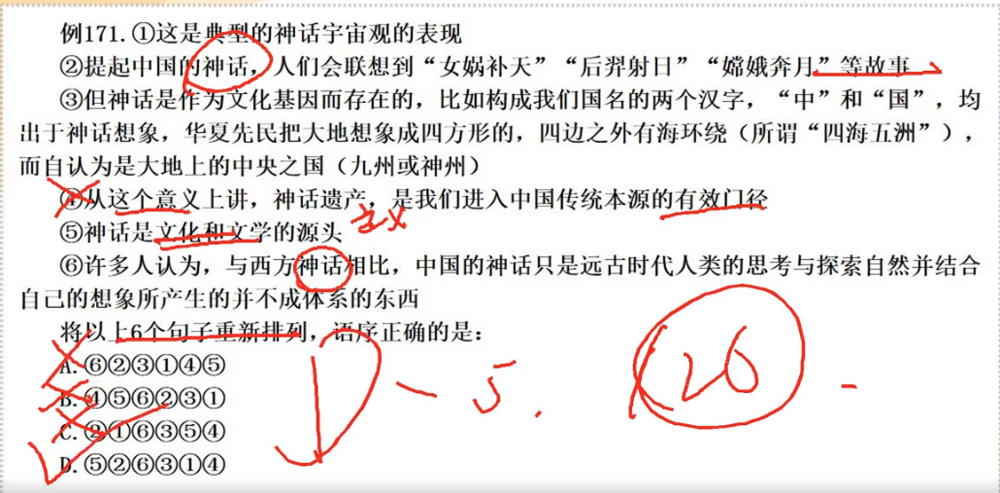

4指代不明，不能作为首句，排除B，256都在聊神话，5是下定义，5要在26前面，选D。

------

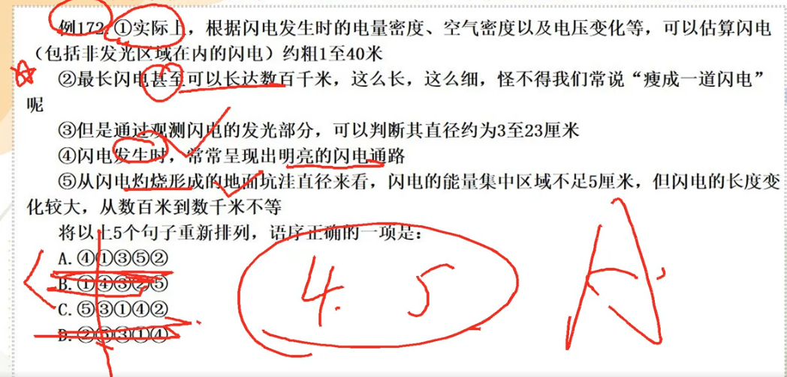

1的实际上以及2的甚至都表明它们不能作为首句，对比A和C，先闪电然后再灼烧，4在5前面，选A。

## 二、确定捆绑

指代词、关联词、例子、话题一致

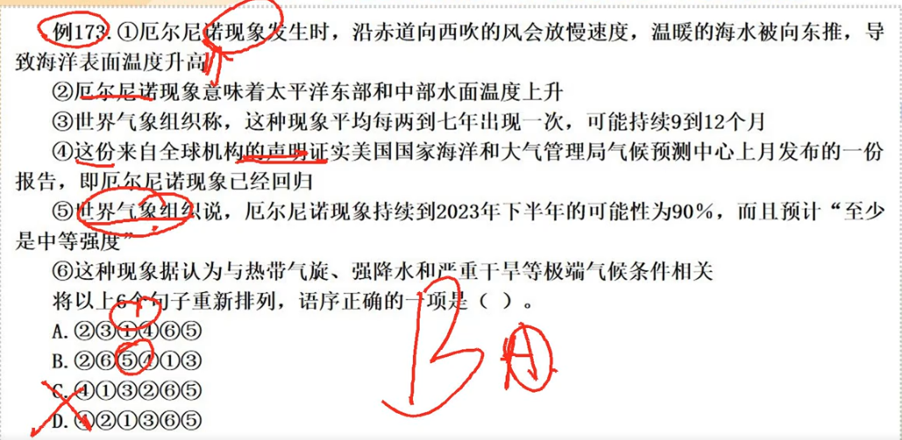

首先4的这份指代词不能作为首句，排除C和D，然后判断4的前面是1还是5，发现是5，选B。

------

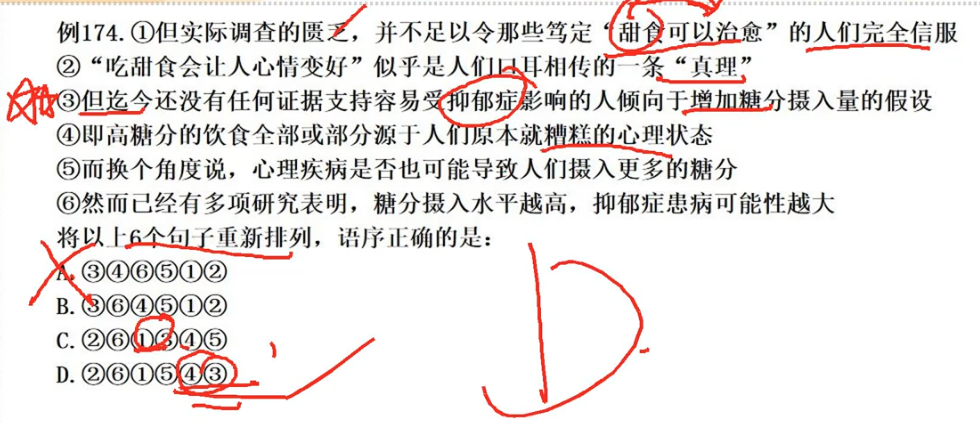

------

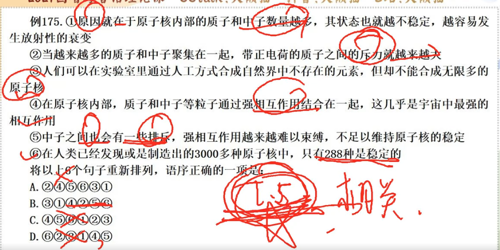

25话题相关且唯一，需要进行捆绑，选B。

## 三、确定顺序

1.问题+分析+对策

2.观点+解释

3.A+B

先A再B

4.全称+简称

5.时间顺序

6.日常逻辑

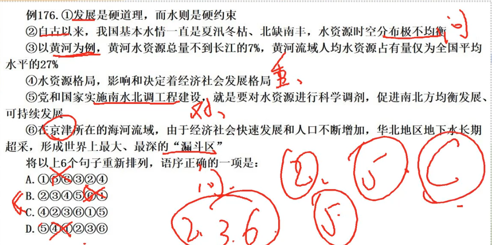

2是问题，5是对策，所以2在5的前面，排除A和D，对比B和C，3和6也是问题，也要在5的前面，选C。

------

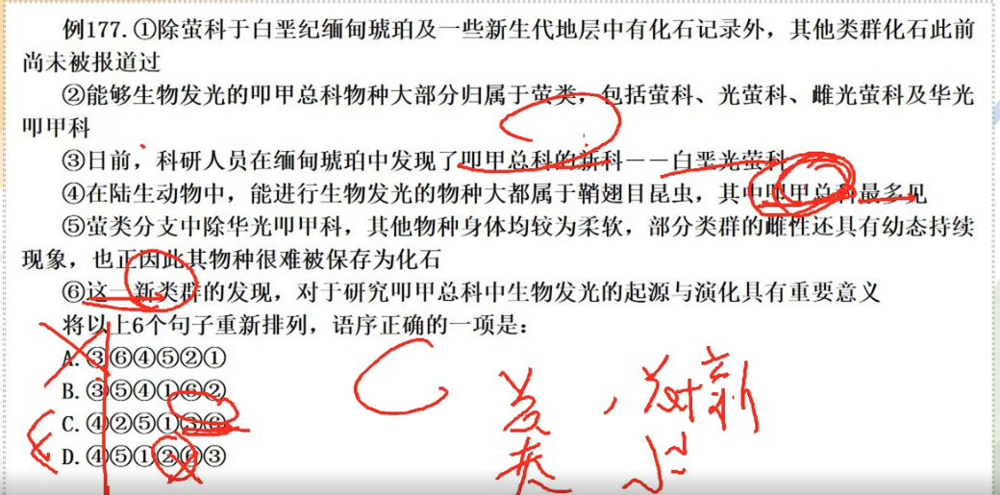

首句，3和4，先大再小，排除A和B，然后看到6有指代词，提到新，36和26，3有提到新，选C。

------

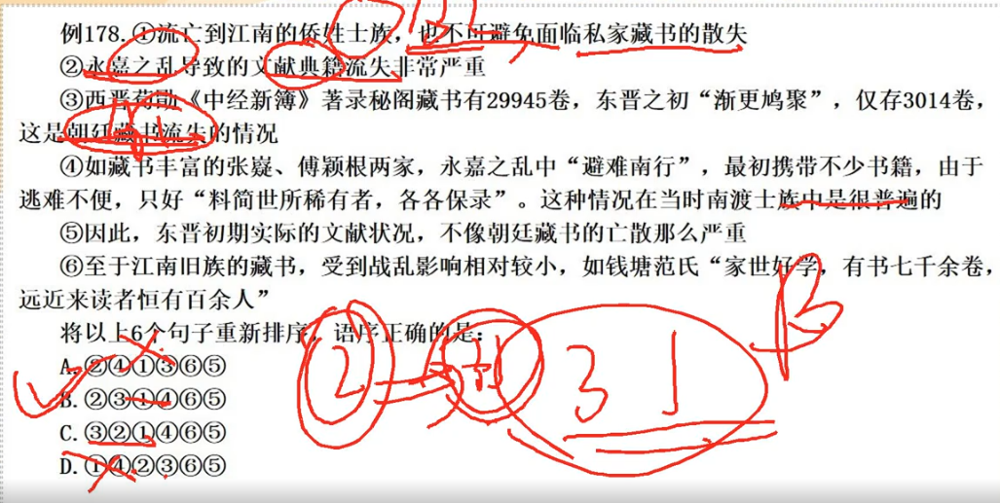

首先第1句，也不可避免，表并列，不适合作为首句，排除D，另外1和3都提到流失表并列，并且1在后面，排除A。剩下B和C，123中，朝廷和士族都是对永嘉之乱这个观点的解释说明，选B。

------

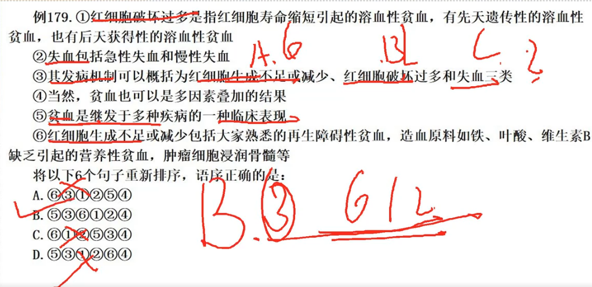

3的话题并列，后面讨论的顺序要按照3的顺序，对应612，并且3要在它们的前面，选B。

------

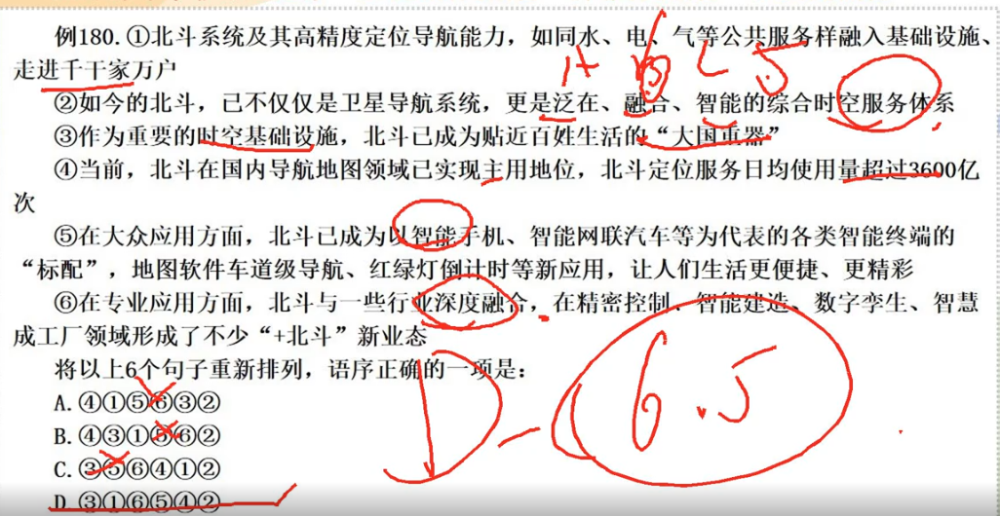

------

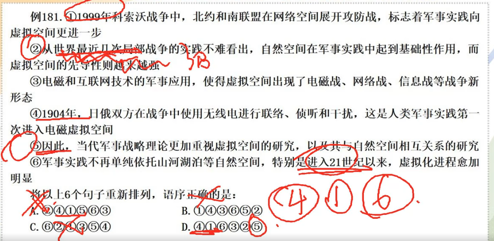

416存在时间先后顺序，排除B和C，因此表总结，对应尾句，选D。

------

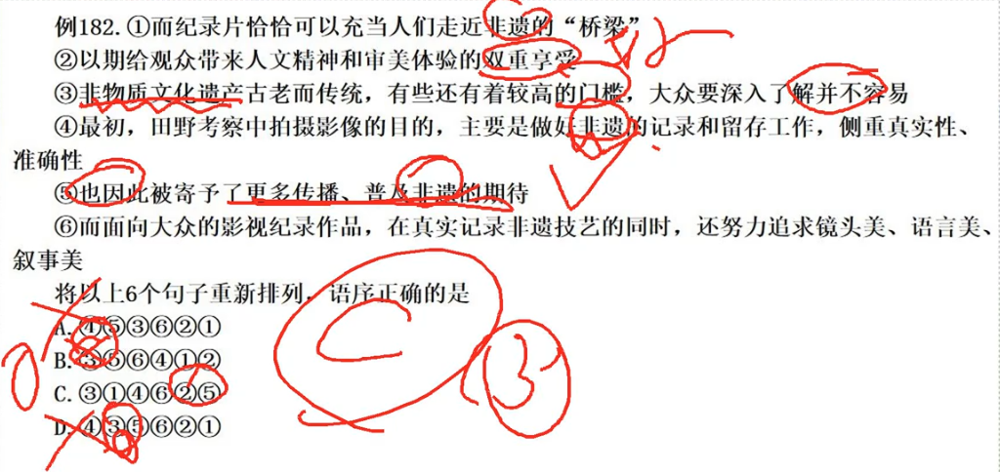

3讲非物质文化遗产，145谈到非遗是它的简称，所以3在前面，排除A和D，然后5有因此，看它的前一句应该是好的，选B。

------

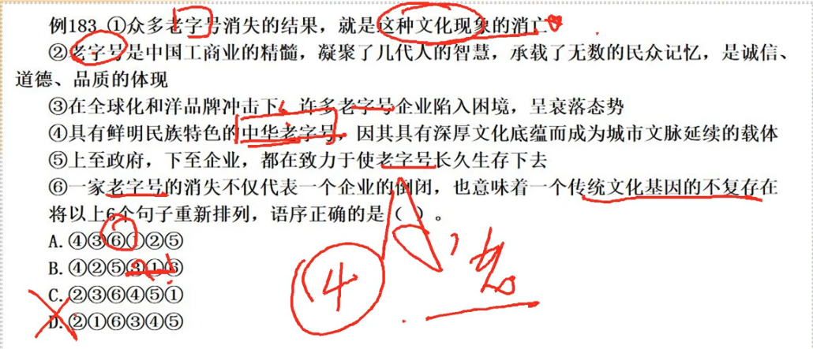

4中华老字号是全称，其他老字号是简称，排除C和D，61都是谈文化消亡，31,3说的是企业，排除。

------

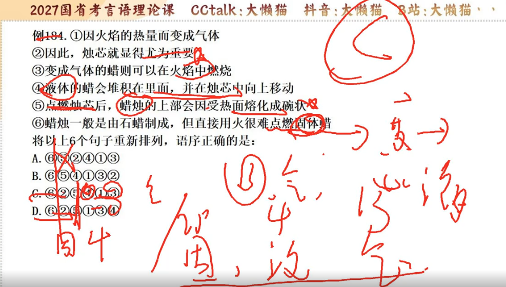

首句6说固体蜡很难点燃，后面是25还是52呢，应该是先引出烛芯，然后再说烛芯怎么用，排除A和B，接着13是气体，4是液体，25是固体，顺序是固体，液体，气体，选C。

------

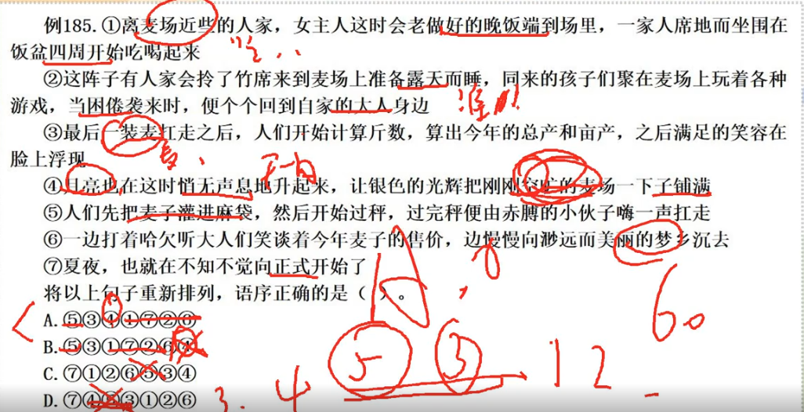

先53再12，先装麦子，活干完了，才能吃饭睡觉，排除C，然后装完最后一袋麦子，麦场才能空，3在4前面，排除D，对比A和B，就是4的顺序不一样，月亮一开始就出来了，并不是睡觉之后才出来，选A。

## 四、尾句对比

总结、对策

这个用的比较少，没有思路才用，放在最后面用

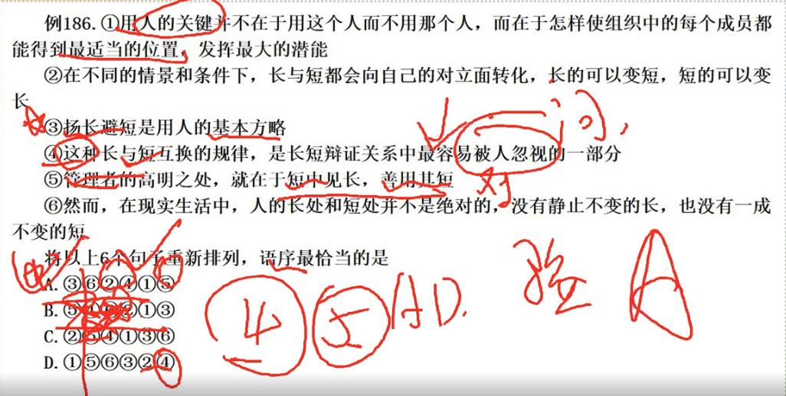

首句不好确定，找指代词，24还是54,显然24会好点，排除B和C，A和D的尾句不同，4是问题，5是对策，5更适合作为尾句，选A。

------

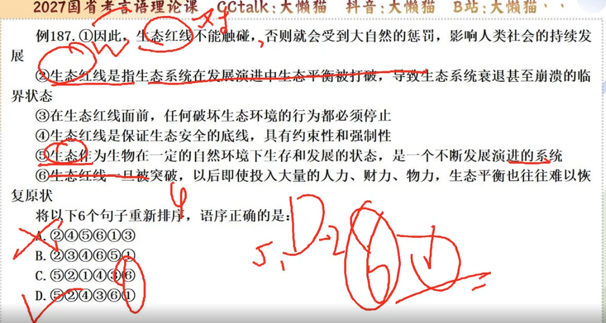

先大后小，先生态，然后再生态红线，所以5在2前面，剩下C和D，看尾句，1适合做尾句，选D。