## 速算技巧

### 加法

尾数法

高位叠加法

### 减法

分段法

### 乘法

小分互换

乘法拆分

乘法放缩

### 除法

除法拆分

除法放缩

### 基础概念

基期A、现期B、增长率R、增长量X

### 速算技巧

415份数法

假设分配法

#### 选项极近时的假设思维

选项极其相近时，反而可利用选项进行计算。

（保留三位，若选项差距在 1 左右则选项极近）

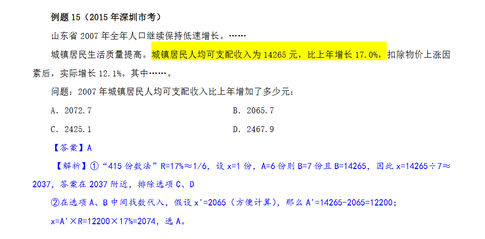

总结：这类题一般都是针对增量X，先用假设分配或者415大概估算X，然后排除2个选项，从剩下2个数的范围取一个好算的数，算出基期，然后根据公式X=A*R算出增长量即可。

## 高频考点之ABRX类

### ABRX类之A

#### 基期

代入、直除、假设分配

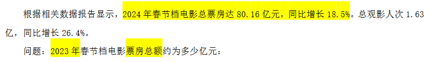

#### 间隔基期

求出间隔增长率，即变成第一类考法

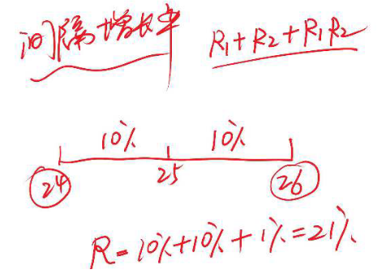

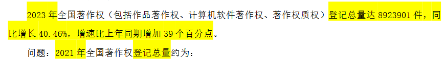

#### 基期和差

假设分配法求得两个基期求和或求差

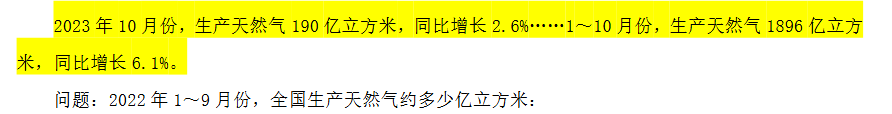

#### 已知变化情况求基期

A=X/R

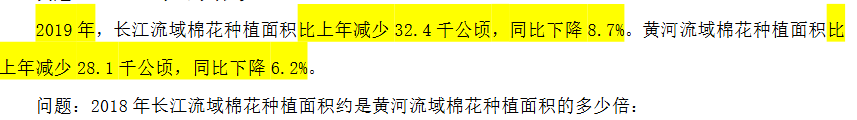

### ABRX类之B

#### 假设增量求后期

求出X，根据B=A+nX列不等式即可

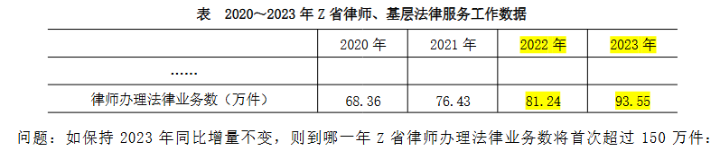

#### 假设增速求后期

利用公式B=A+AR依次求出后一年，一般两到三次即可求出答案

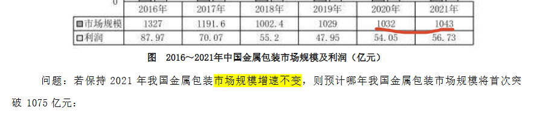

#### 按照实际增长率求后期

根据名义增长率求得基期后，再用实际增长率求后期

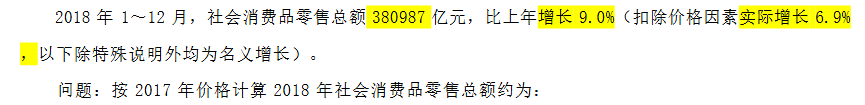

### ABRX类之R

#### 一般增长率

直接套用公式“R＝X/A ”即可

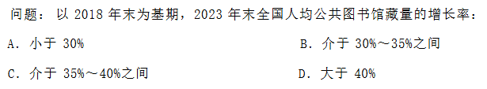

#### 间隔增长率

已知今年较去年增长R1，去年较前年增长R2，则今年较前年增长“R1＋R2＋R1× R2”

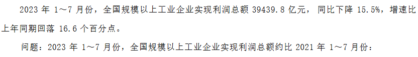

##### 逆运用

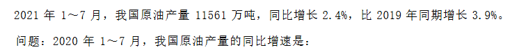

解析：值比3.9-2.4=1.5小，值不管正负都比R间-R1/R2的绝对值小

间隔倍数=间隔增长率+1

#### 比值增长率

比值倍数=比值增长率+1

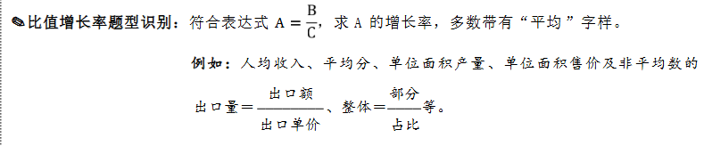

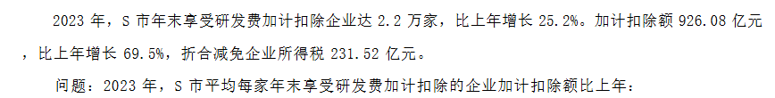

##### 特殊比值增长率

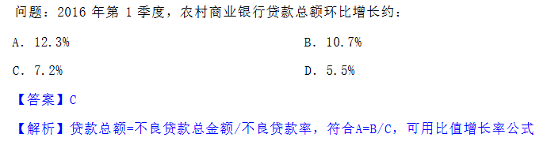

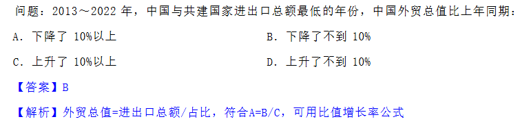

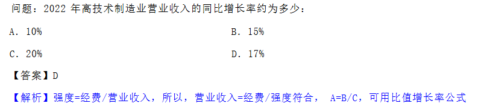

#### 乘积增长率

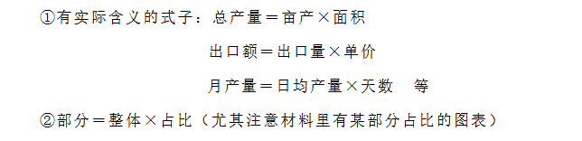

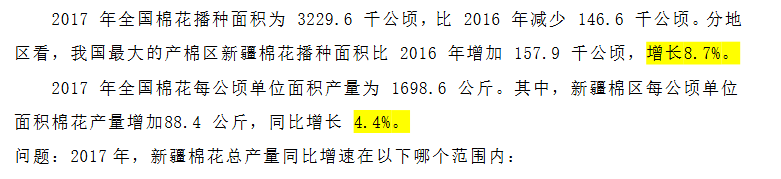

新疆棉花总产量=新疆棉花总面积×每公顷单位面积棉花产量

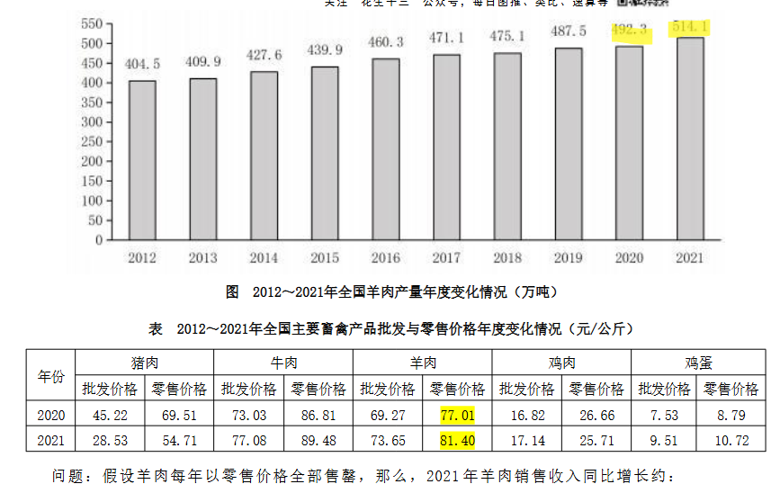

销售收入=产量×价格

##### 部分乘积增长率

有占比，想乘积。

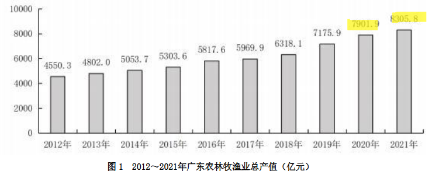

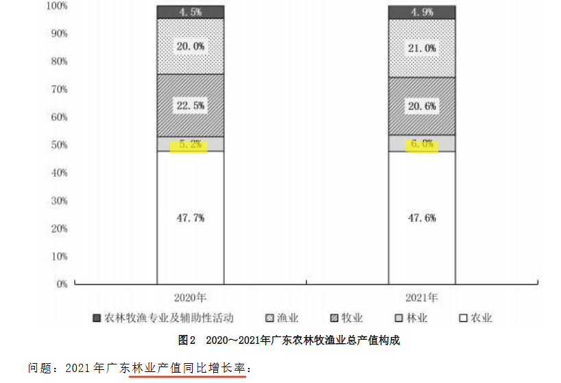

林业=总产值×占比

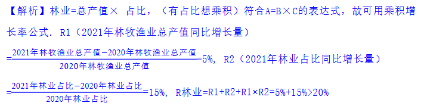

R1=830-790/790

R2=6-5.2/5.2

### ABRX类之X

#### 一般增长量

使用假设分配直接得出增量

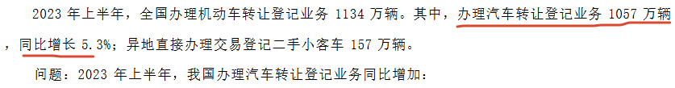

#### 两期增长量倍数或比值

依次求得 X1、X2，再求比值即可

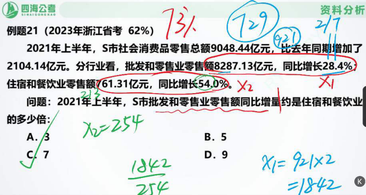

#### 各部分增量相加等于总的增量

X=X1+X2+X3+......

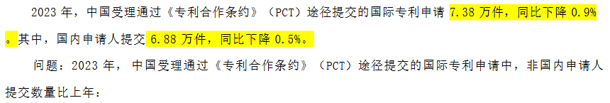

国际申请专列数=国内申请数量+非国内申请数量

## 高频考点之比重类

### 单期比重之现期比重

#### 比重=部分/整体

部分=整体*比重，整体=部分/比重

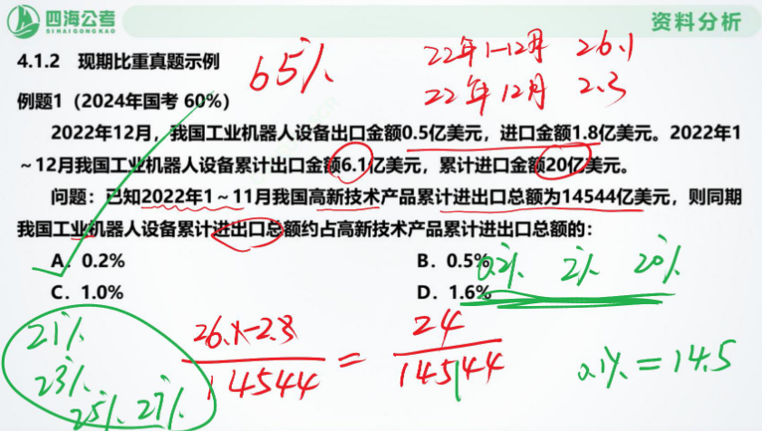

#### 部分比重和或比重差

套用公式即可，比重和（比重差）＝部分和（部分差）/整体

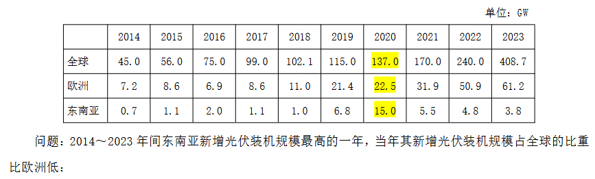

部分比重差

#### 饼状图

从12点钟顺时针排列，多利用1/2、1/3、1/4、1/8等或两部分之间的倍数关系

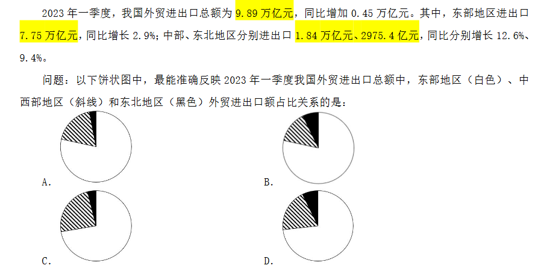

### 单期比重之基期比重

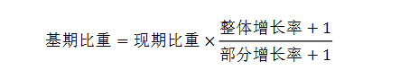

选项有的会有一个现期比重，要注意，别选了现期比重

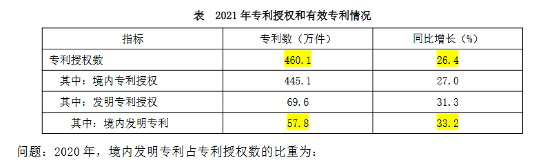

### 单期比重之隔级比重

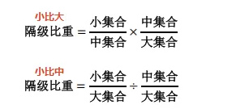

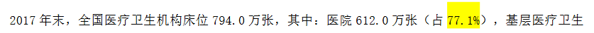

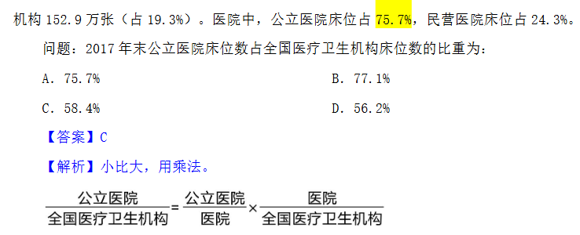

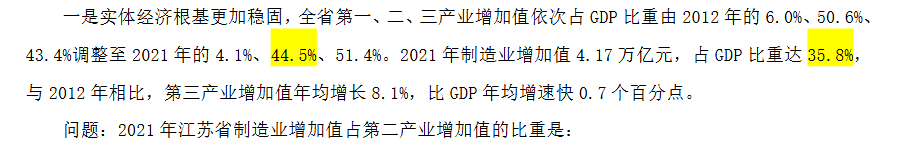

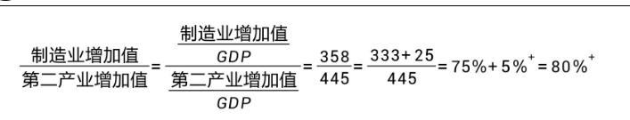

### 两期比重变化之比重趋势

分子增速大于分母增速，比重上升

分子增速小于分母增速，比重下降

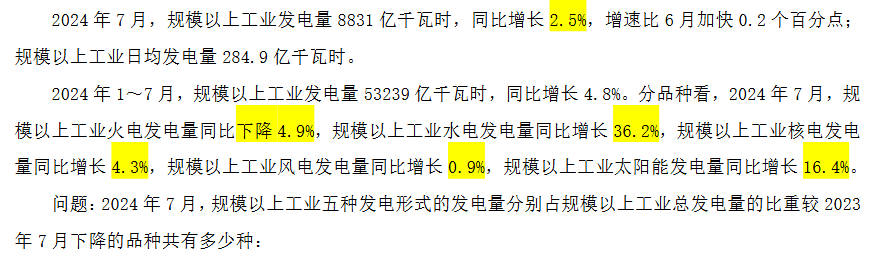

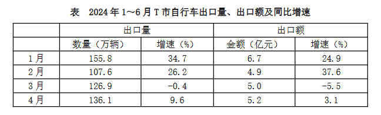

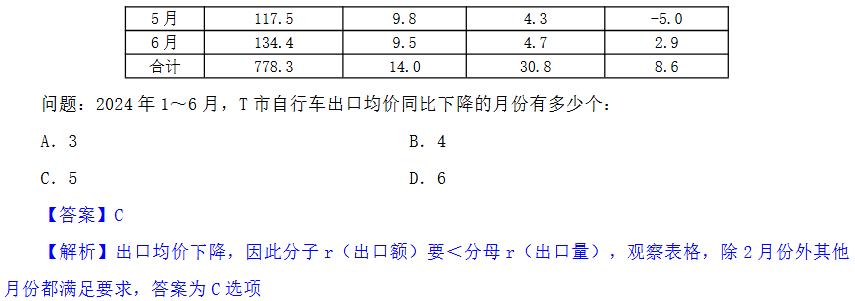

均价，后除前，后就是分子，也是价格

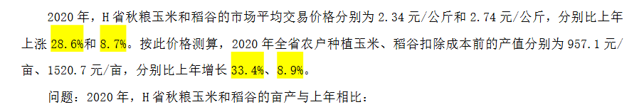

亩产的单位公斤/亩，价格单位是元/公斤，产值单位是元/亩，那么就可以产值/价格

##### 比重趋势多一步

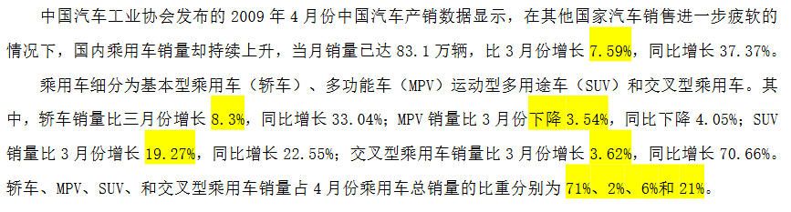

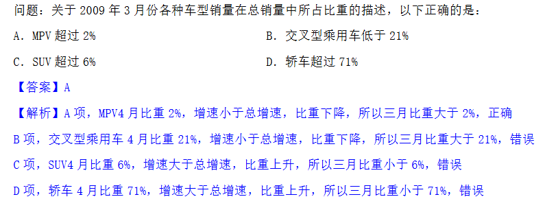

##### 比重趋势逆运用

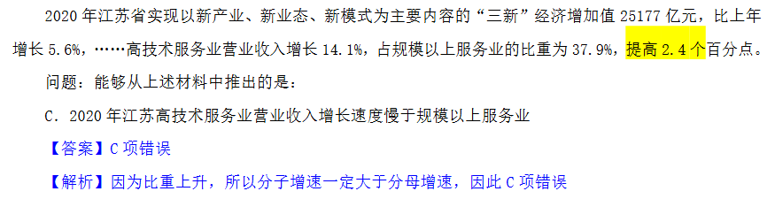

### 两期比重比较之比重差

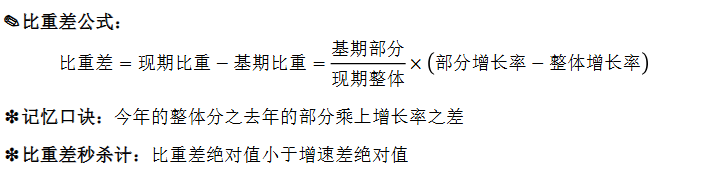

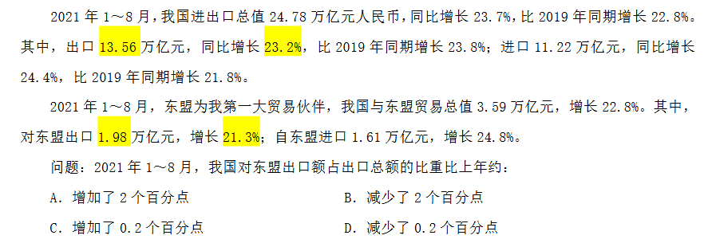

### 比值差

注意，问法的区别

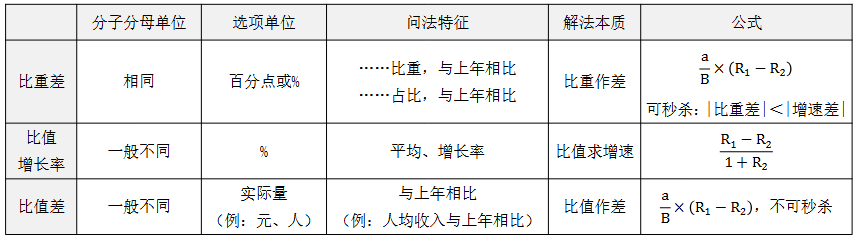

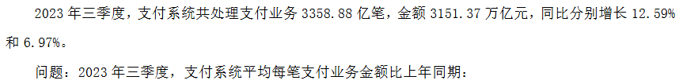

## 高频考点之盐水类

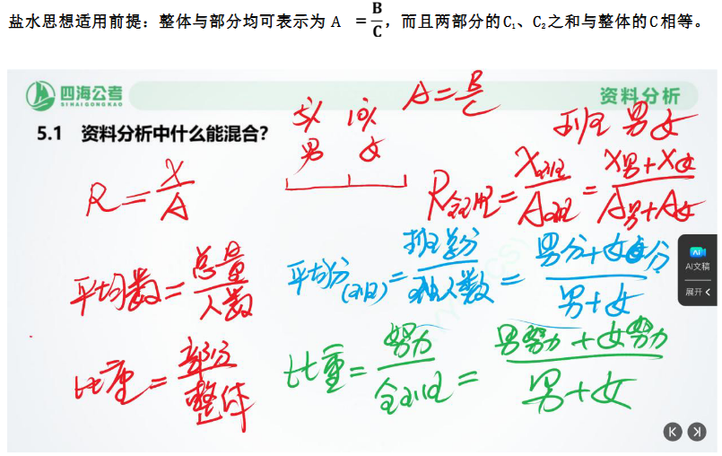

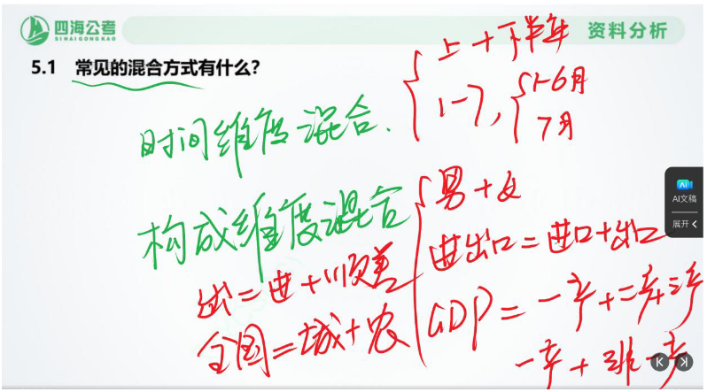

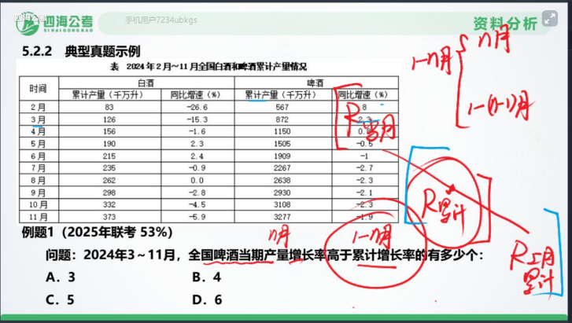

当月累计=当月+上月累计，当月>当月累计>上月累计，如图画出来

需要用到混合的这个中间量，当月累计

需要用到混合的这个中间量，全年

需要用到混合的中间量，1-7月

### 十字交叉法、线段法

已知3R求量之比，用十字交叉法；已知2R和量之比求第三R，用线段法

线段法：混合之前写两边，混合之后写中间，距离和量成反比，并且混合之后靠近量（分母）大的

比如：R=X/A，距离指的就是R之间的距离，量指的就是基期A。

再比如：人均收入=总收入/人数，距离指的就是人均收入之间的距离，量指的就是人数。

### 三浓度排序

牢记“部分1浓度＞整体浓度＞部分2浓度”，“部分1浓度＞整体浓度”等价于“整体浓度＞部分2浓度”，反之亦然。

### 已知3R求量之比

十字交叉法

求得的“量之比”多为基期量或人数（求人数想盐水）之比

人均收入=总收入/人数

### 已知两R和量之比求第三R

线段法

## 高频考点之比较类

### 趋势法

分子增速（倍数）大于分母，则分数变大

分子增速（倍数）小于分母，则分数变小

**补充知识点：比较增速大小不能看斜率，斜率指的是增量。**

### 替代比较

#### 末期/基期替代年均增长率比较

#### 现期/基期替代增长率比较

（B和A相差悬殊时比较增速大小时使用）

#### A/非A替代A/整体比较（近一数据比较）

#### X/B替代X/A比较

一般会给出增量

#### 图形高度比值替代数据比值

0刻度在同一水平线时，图形的高度之比可替代数据之比比较大小。

### 增量大小比较

①：B越大R越大则X越大（大大则大）：

②：一大一小看倍数。

注意，增量要带正负号比较

## 高频考点之平均倍数类

### 平均数

#### 基期平均数

#### 平均数变化情况

R分子>R分母，同比重趋势

#### 比值差

同两期比重差

#### 平均数增长率

同比值增长率

#### 区分

### 倍数

#### 现期倍数

#### 基期倍数

#### 比值倍数

#### 间隔倍数

#### 利用基期倍数解决“基期环比增长率问题”

### 年均增长量

### 年均增长率

当选项比较接近时，用格尺法

### 年均增长率与间隔增长率结合考察

用年均增速求间隔增长率

### 假设年均增速相同求后期

## 特殊考点：拉动增长、贡献率和容斥问题

增量贡献率比较大小：当比较不同部分对同一整体的增量贡献率时，因整体增量相同，只比较部分增量大小即可。

