## 对比实验归因

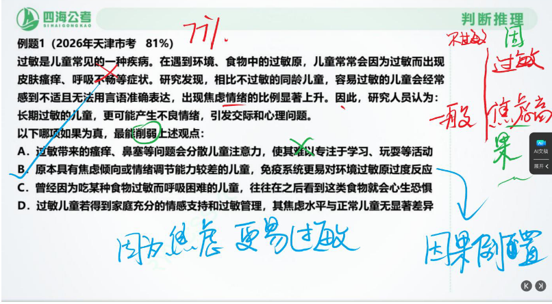

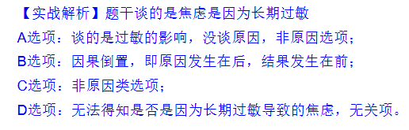

## 时间对比归因

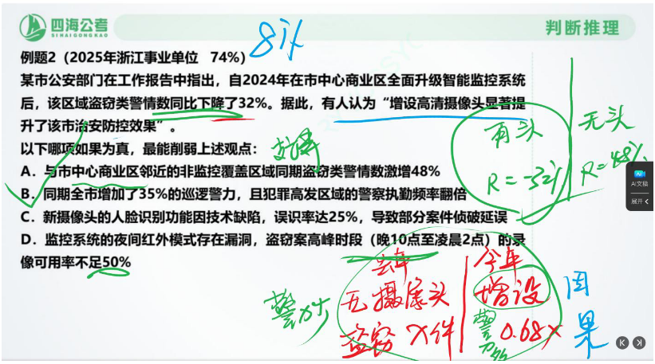

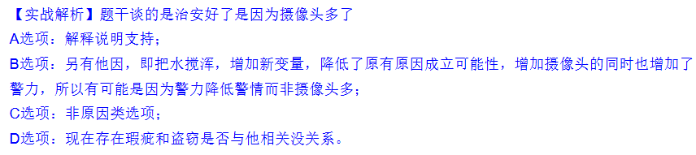

## 一般归因

没有明显的对比试验和时间对比，只针对某个既成事实进行原因分析（也可以看作是某种情况和其他情况的对比）

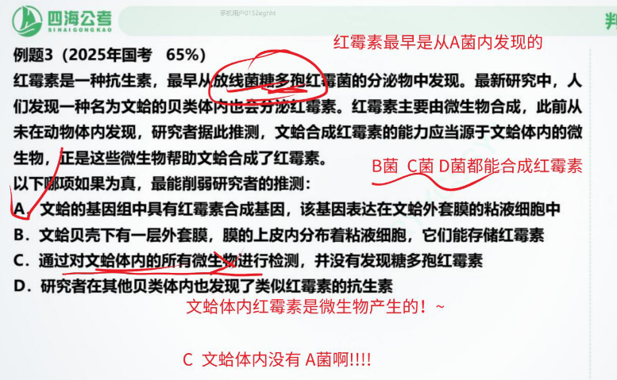

## 另有他因质疑

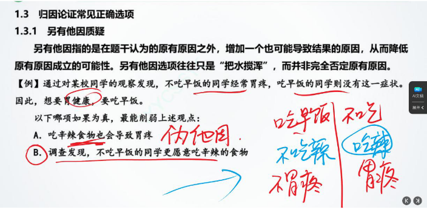

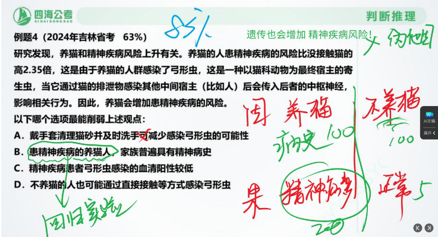

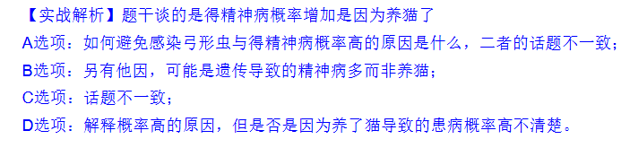

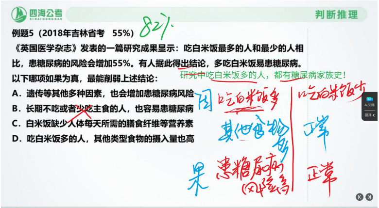

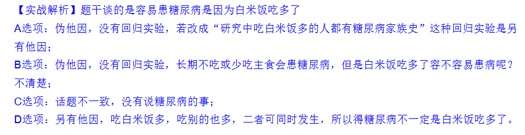

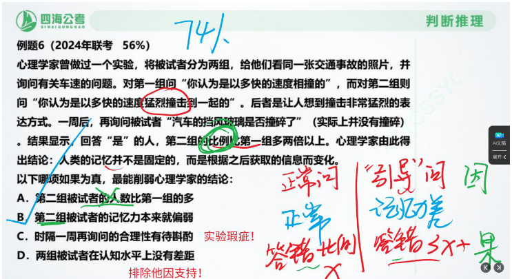

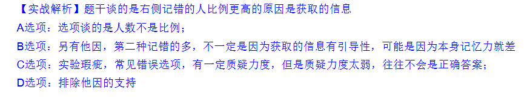

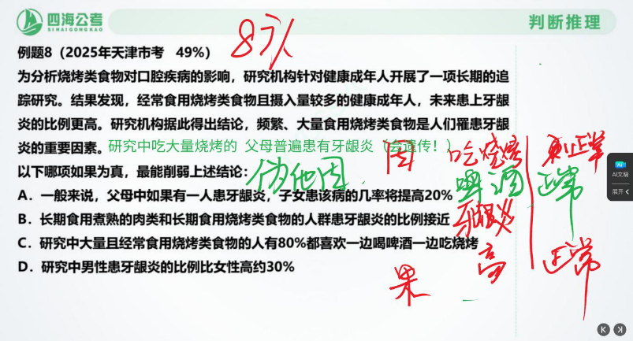

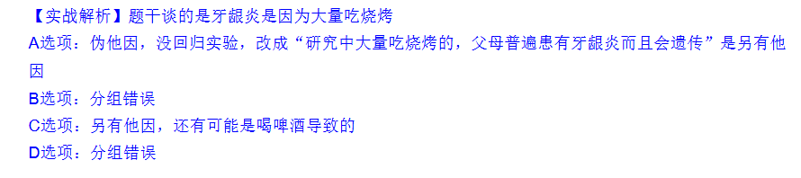

## 因果倒置质疑

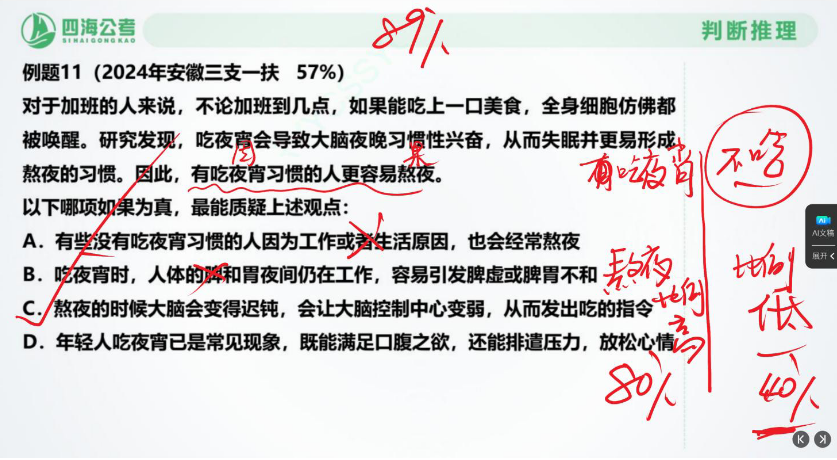

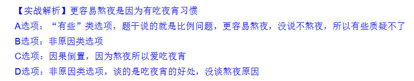

## 否定此因质疑

否定此因>另有他因

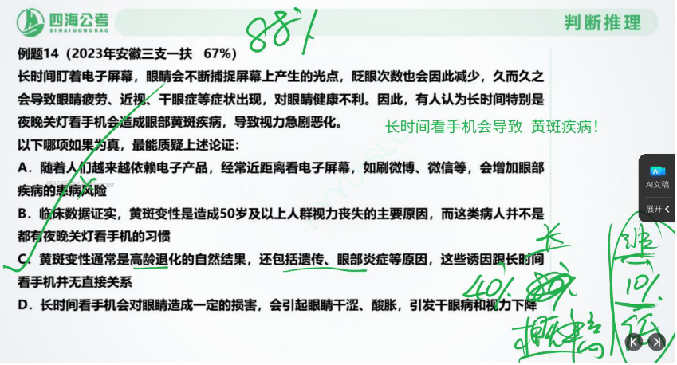

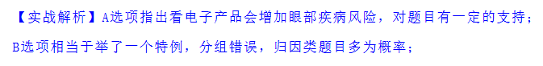

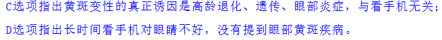

## 排除他因支持

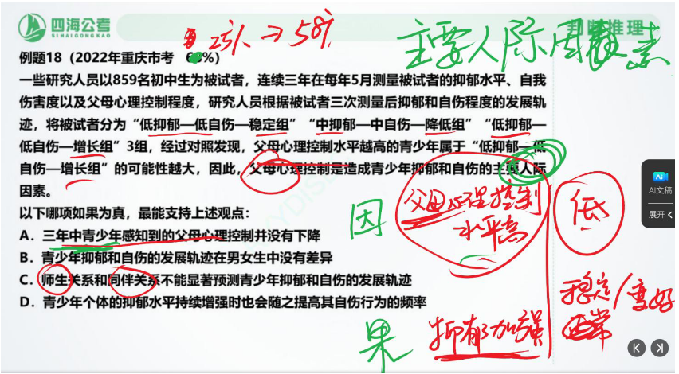

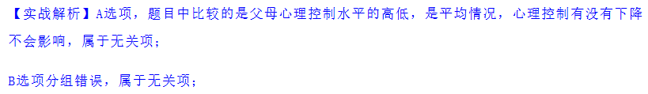

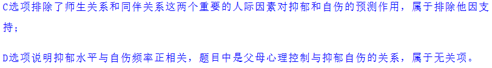

## 解释说明支持

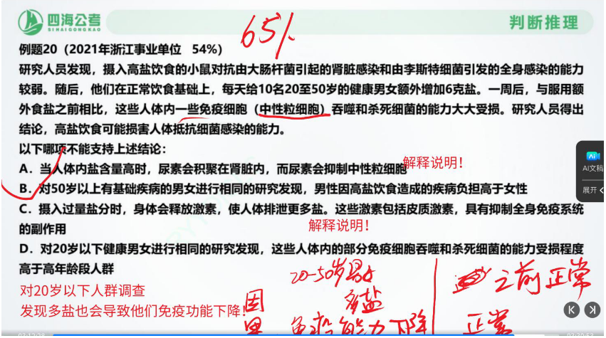

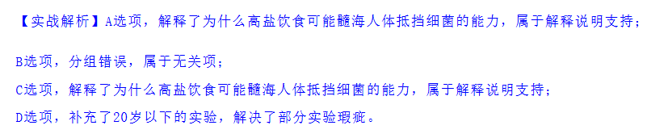

## 补全对比实验

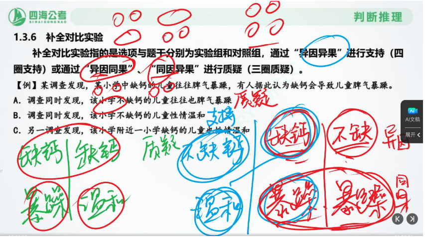

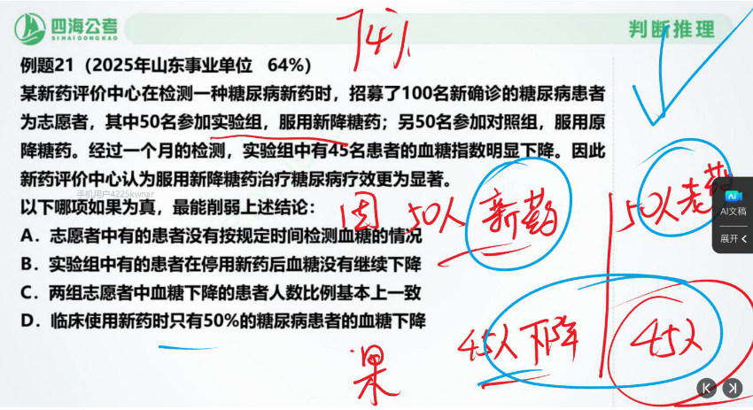

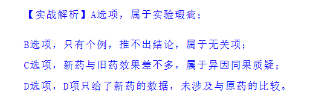

## 特殊归因之直接根本原因

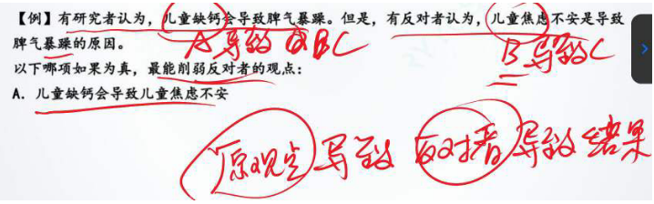

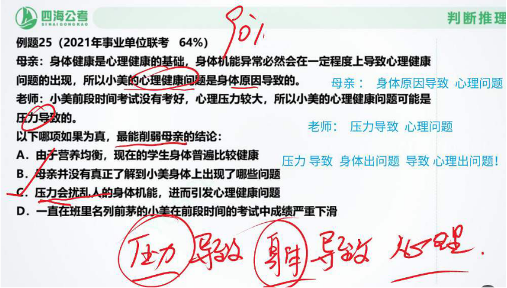