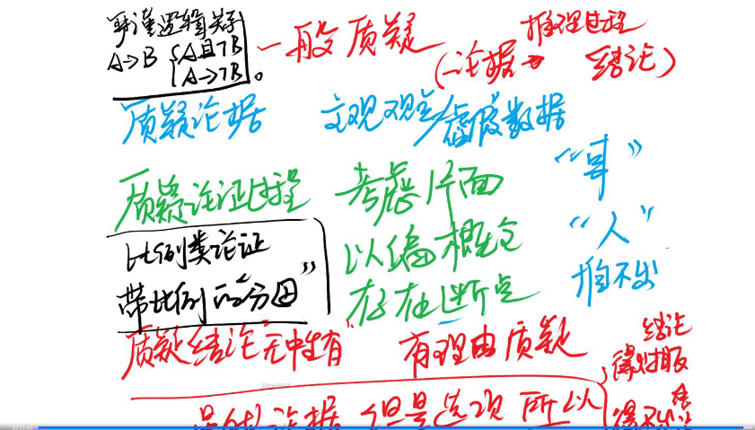

## 质疑错误论据

论据是**个人观点、个人判断**时，常存在论据有误的错误。

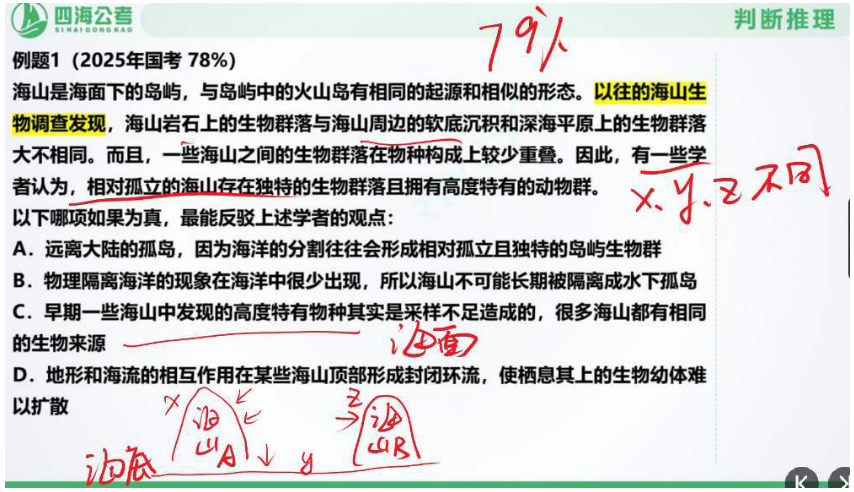

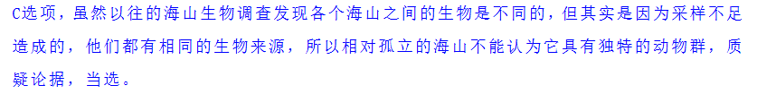

## 质疑论证漏洞

通常情况下可以采用“虽然但是所以不”造句验证，即“**虽然（论据）但是（选项）所以不（结论）**”。

### 考虑片面

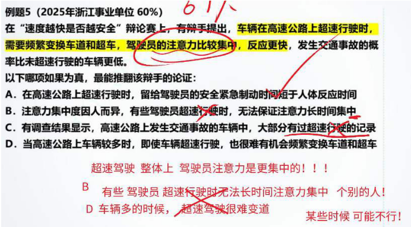

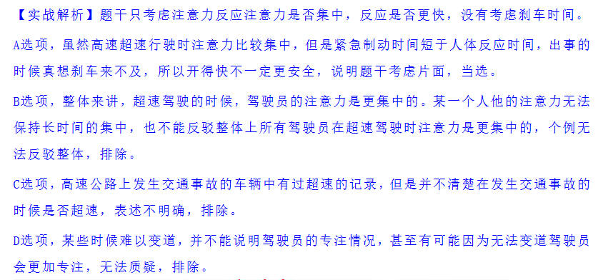

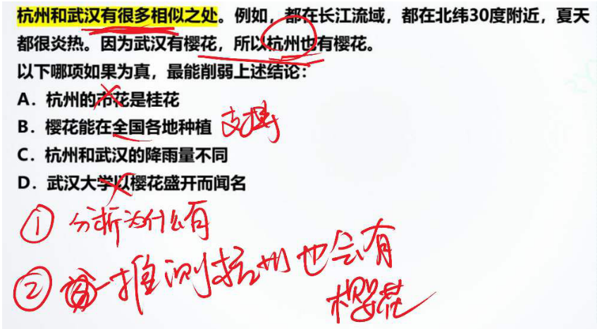

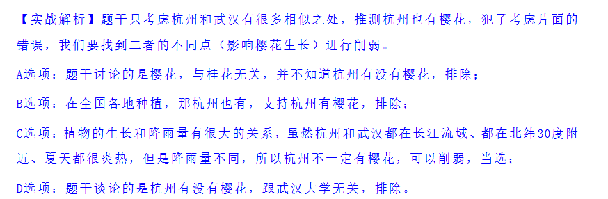

### 以偏概全

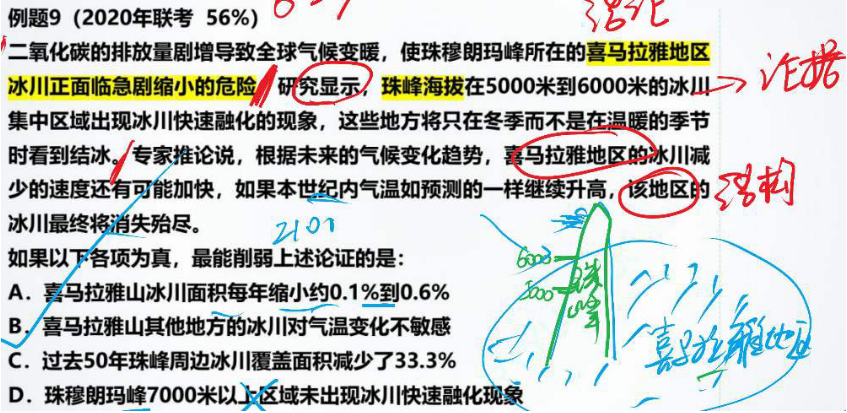

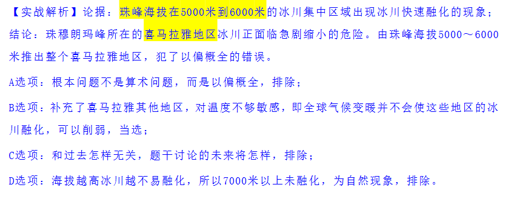

### 存在断点

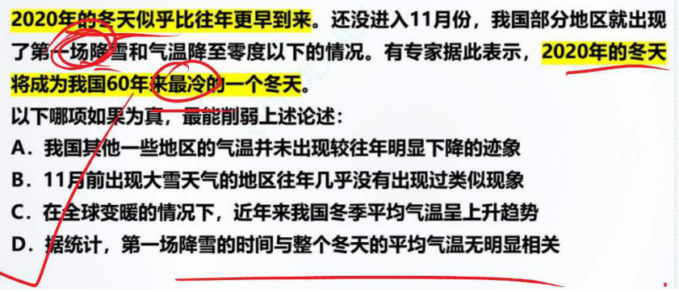

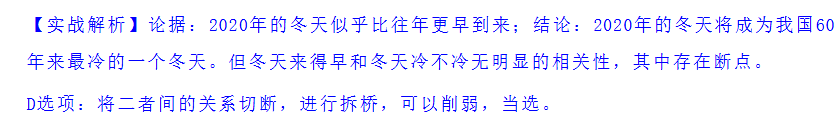

### 质疑结论的“无中生有”

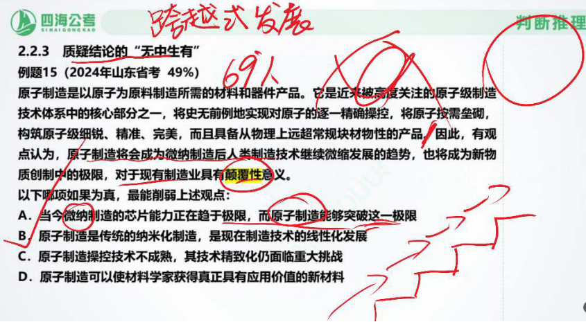

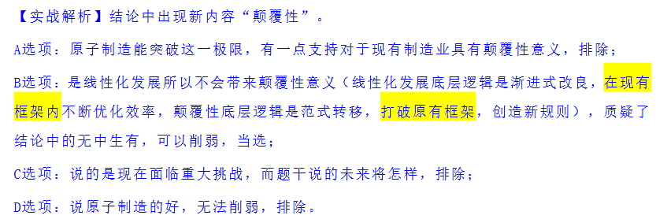

## 特殊质疑之严谨逻辑关系

若题干的结论存在逻辑关联词（例如如果就、只有才、所有都等），可翻译为 A→B，再在选项中寻找

A 且非 B，少数题目可用 A→非 B 代替 A 且非 B 进行质疑。

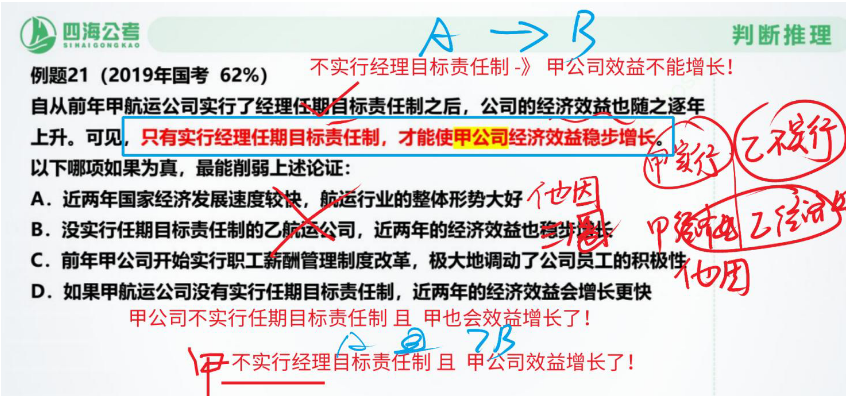

## 特殊质疑之比例类论证

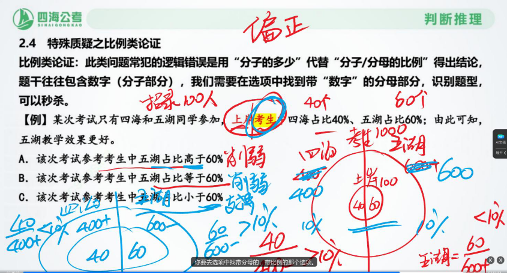

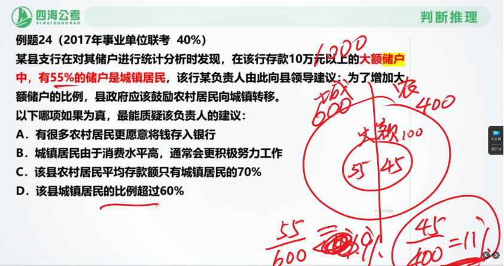

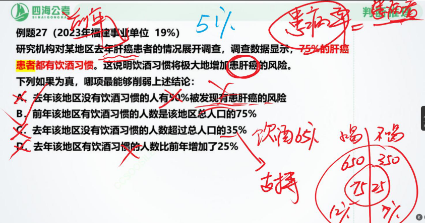