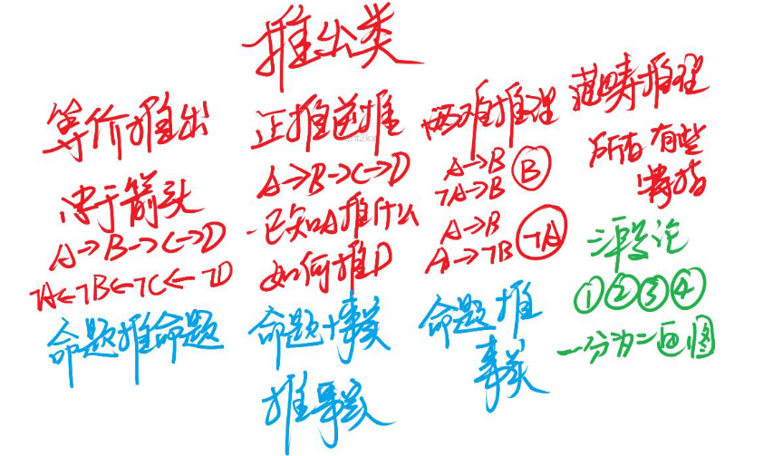

## 等价推出

等价推出指的是将题干逻辑关系和选项逻辑关系分别翻译后，二者完全一致。考察的是对翻译规则的掌握，常用知识点有命题的传递和原命题与逆否命题（a→b和非b→非a）等价。

### 与题干等价

原命题与逆否命题等价

### 与题干不等价

解题技巧：若题干只有一个逻辑关系，可直接翻译选项，选项三个相同一个不同，直接选不同的选项即可。

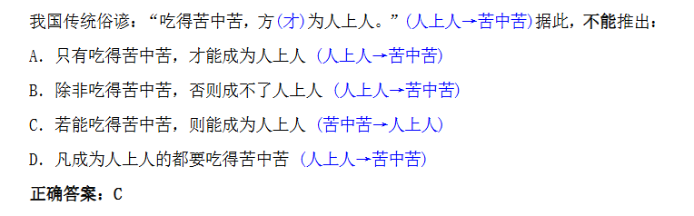

## 正推逆推

### 正推

解题技巧：无需将题干中的多个命题联立，根据已知事实，按照逻辑传递规则推出即可。

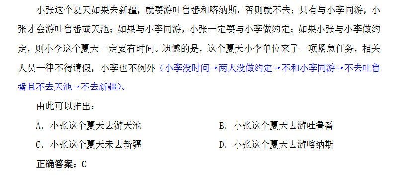

### 逆推

解题思路：首先将要得出的结论翻译到箭头后。要想得到C，根据B→C，需要B成立，要想得到B，根据A→B，需要A成立，一步一步逆推即可。此类题目最常考察考点是“a或b”的“否一推一”，即要想a成立，需要b不成立。

或者吃西瓜或者吃葡萄，怎么能保证一定吃到葡萄呢？否一推一，不吃西瓜

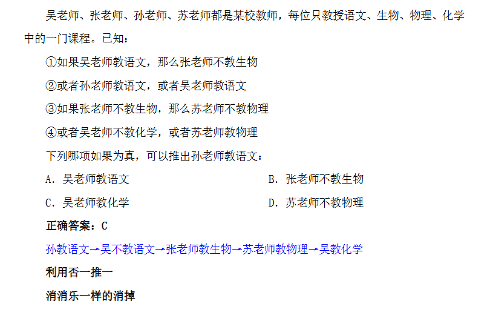

## 两难推理

解题方法：A→B、非A→B，可推出B成立（可翻译成无论是否A，都会B）；A→B、A→非B，可推出非A成立。

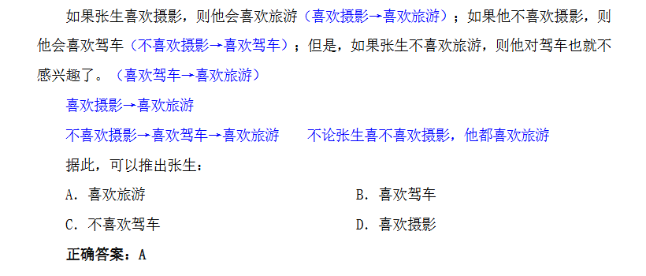

## 范畴推理

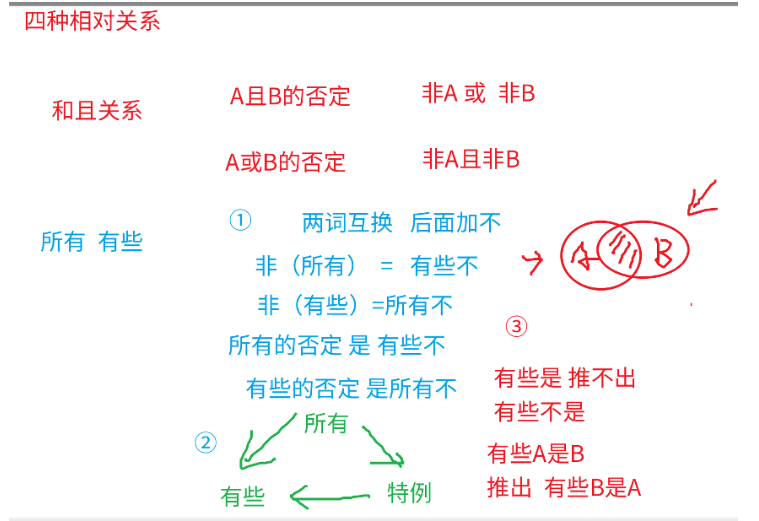

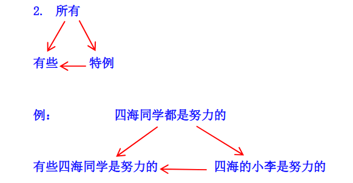

### 直言命题考察

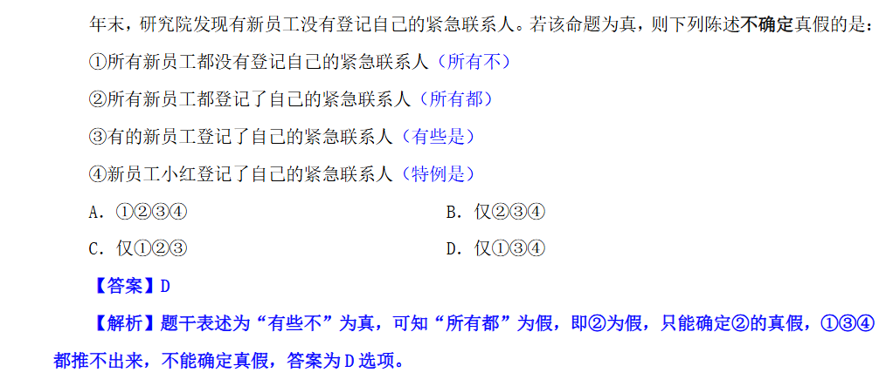

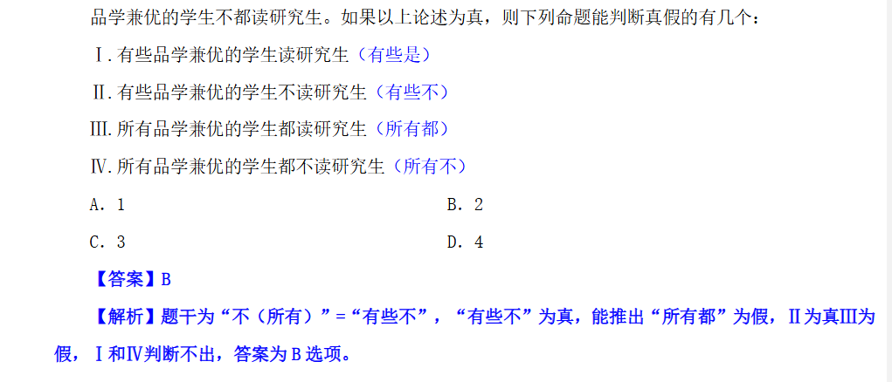

### 三段论考察

#### 三段论之推前提

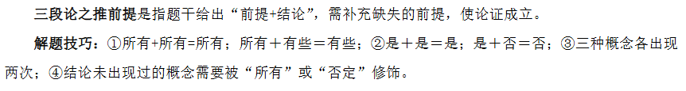

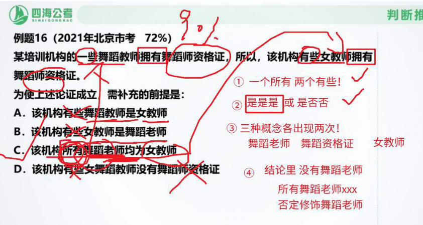

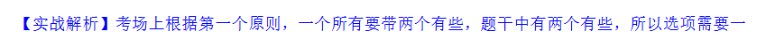

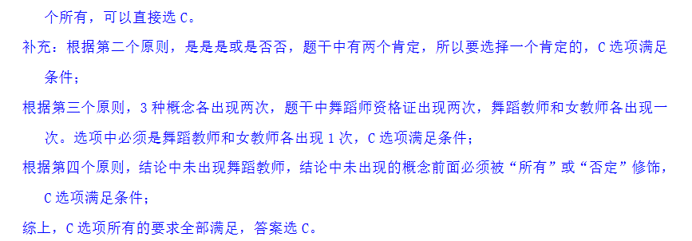

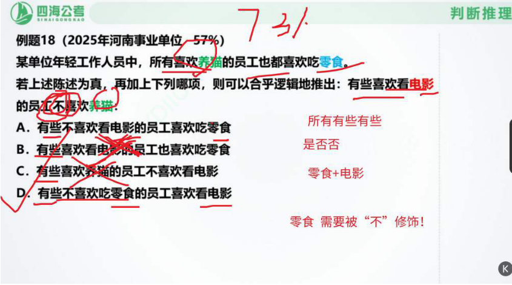

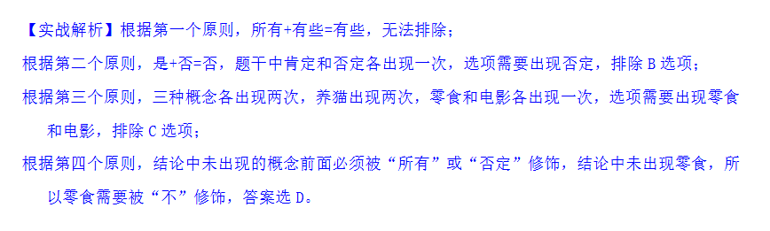

#### 三段论之推结论

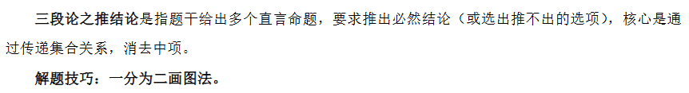

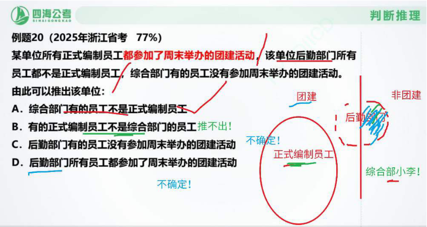

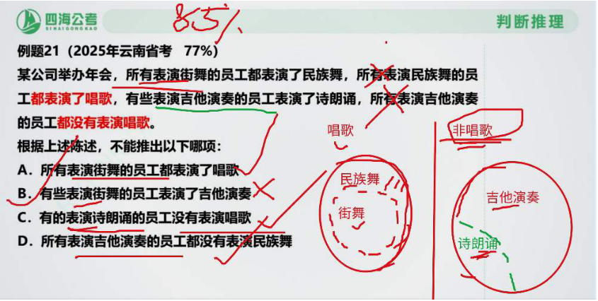

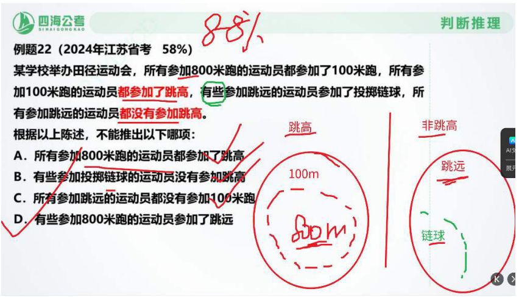

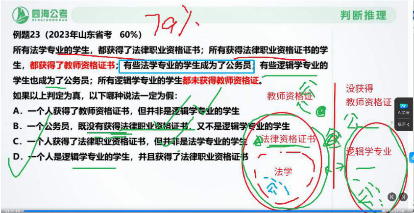